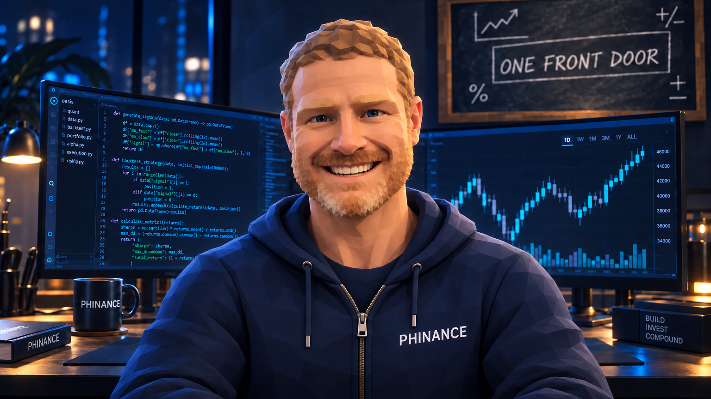
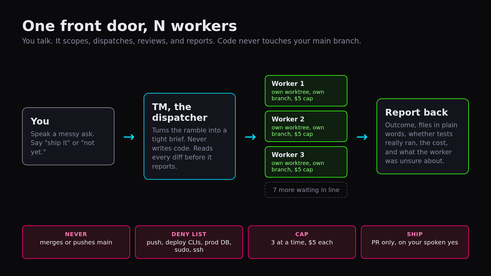
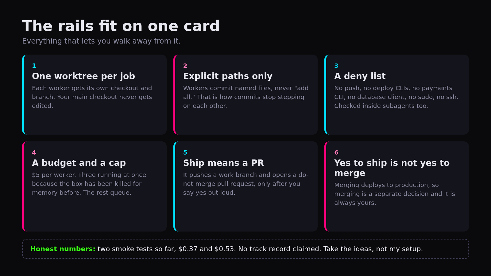
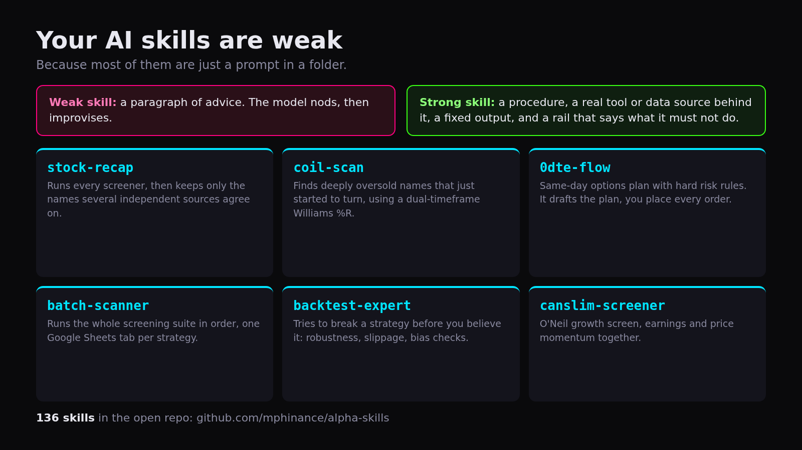

# Your AI Skills Are Weak. I Talk to One Dispatcher Instead.

*AI 70% | Business 30%*

<!--seo-title: Your AI Skills Are Weak. I Talk to One Dispatcher Instead.-->
<!--seo-desc: I stopped juggling five coding windows by hand. One orchestrator writes the briefs, hands them to headless Claude Code workers in their own git worktrees, and reports back. Two smoke tests so far, $0.37 and $0.53.-->

For these past few months in the beginning of building TraderMatrix.pro I was a glorified router for a bunch of expensive interns and I called it “productivity”.

I had five coding windows open. I typed prompts into the wrong one, forgot which project a session was even on, and watched commits step on each other.

<!--subscribe-->

## One front door

**The fix was fewer places to talk.**

I talk to one thing, out loud. It turns my rambling into a tight brief, hands the brief to a headless Claude Code worker, reads the diff when the worker finishes, and tells me what happened. It never writes the code.

The orchestrator runs on a cheap model, because talking and reading diffs does not need the expensive brain. The workers are Sonnet, each in its own git worktree on its own branch, each with a hard $5 budget.

I did not invent any of this. Take what is useful and ignore the rest.

## The prompt

The whole thing is about 30 lines. A few of them carry the weight:

*You are the mouth, the scoper and the reviewer. You do not write the code.*

*When a worker finishes, you review the diff and the test output yourself before you report. Say what the worker could not do or was unsure about.*

*Never invent a result. If you have not read the diff, you do not know what changed.*

**An orchestrator that reports without reading is a hype machine with a voice.**

I put the scrubbed prompt in a gist so you can steal it: https://gist.github.com/mphinance/5e52ee671b2267e50f081969a3200f1d

## The rails

A prompt is the mouth. The hands are a dispatch script, and the rules in it are what let me walk away.

Two of them fixed my actual pain:

One worktree per job, and workers commit named files, never "add all." That is how commits stopped stepping on each other.

One front door. I cannot type into the wrong window because there is only one window.

The rest is damage control. A deny list so a worker cannot push, deploy, touch the payments CLI, run a database client, or sudo anything. A dollar cap per worker. Three running at once, because the box has been killed for memory before, and the rest wait in line.

And the one I care about most: **a yes to ship is not a yes to merge.** Ship pushes a work branch and opens a do-not-merge pull request, and only after I say yes out loud. Merging deploys to production, so that call stays with me.

## The honest numbers

I have not run a ten issue batch yet. I have run two smoke tests, and they cost $0.37 and $0.53.

**Two runs is not a track record.** When I run a real batch, you get the arithmetic, misses included.

## Why your skills are weak

Skill libraries are all over my feed. Most of them are a paragraph of advice in a folder. The model nods, then improvises.

**A strong skill has four things: a procedure, a real tool or data source behind it, a fixed output, and a rail that says what it must not do.**

My due diligence template is a good example of the rail part. Two of its ground rules: every number carries a source, or it gets cut or marked unverified. Dates are verified or absent. If an earnings date came from an aggregator and not the company or a filing, the draft says "date not confirmed" and leaves it out.

My 0DTE skill drafts the plan with hard risk rules. I place every order. The skill does not get a vote on that.

There are 136 of these in the open at github.com/mphinance/alpha-skills. Some are rough. All of them have a procedure and a rail.

## The part that is not about AI

**Five windows felt like speed. It was noise with a progress bar.**

I try to run the rest of my life the same way: one thing in front of me, and a rule I follow even when I do not feel like it. Here the honest voice waiting when the work is done tells me what I actually did, and it shows me a diff.

If you build something like this, tell me what breaks. I would rather hear it than find out in production.

If you want the data side of what I build on, here is [tradermatrix.pro](https://www.tradermatrix.pro/?ref=MPHINANCE) (that is my referral link) and [youtube.com/@TraderMatrixHQ](https://www.youtube.com/@TraderMatrixHQ).

<!--share-->

~ Michael
