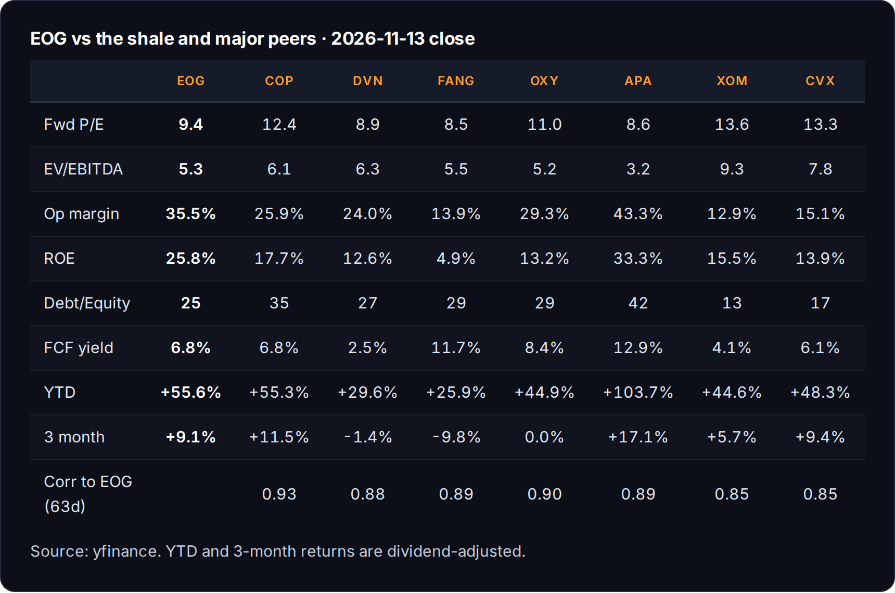
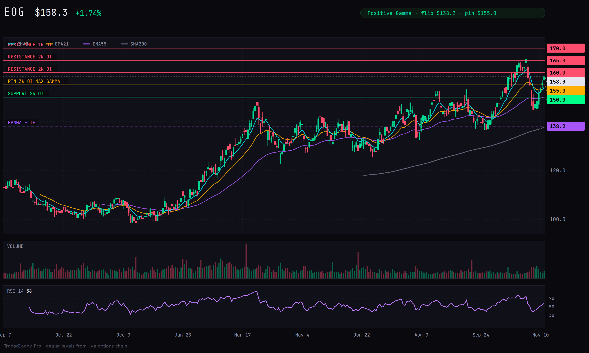

# Crude Fell 15%. EOG Didn't Care.

*Research 60% | Trading 40%*

<!--seo-title: Crude Fell 15%. EOG Didn't Care.-->
<!--seo-desc: EOG due diligence against seven oil peers: the Q3 beat, the buyback, gamma walls, and a price target with the trigger and stop.-->

**EOG Resources (EOG)** · **$158.32** at the 2026-11-13 close

!> **Score: 7/10 · Size: 1R · Action: BUY ON TRIGGER**
!> EOG Resources (EOG) is the cheapest high-quality producer in the oil patch: **9.4x** forward earnings, **$2.2B** of net debt on an **$82B** company, and **$1.06B** of stock bought back last quarter alone. Crude dropped **15%** in two weeks. EOG fell with it, held a higher low at **$144.14**, and is back within **5%** of its all-time high while WTI sits in the **$86 to $89** range. My target is **$175** by March expiration, with **$188** as the stretch if $165.93 breaks. I am not buying it at **$158**, straight into the $160 and $165 call walls. I want **$154.50** or a daily close over **$165.93**.

## 1. Business and management

An oil-weighted shale producer that has quietly turned into a big gas company too.

- Q3 production **1,433.1 Mboe/d**, a record and **+10.1%** year over year. Oil was **550.4 Mbbl/d**, **+3.0%**, so most of the growth is gas and NGLs from Dorado and the Encino assets. *([Q3 release, 8-K Ex.99.1](https://www.sec.gov/Archives/edgar/data/821189/000082118926000226/exh99-1110526.htm))*
- Core areas: Delaware Basin, Eagle Ford, Utica (from Encino, closed 8/1/25 for **$4.47B**) and Dorado dry gas. It sold its Woodford Oil Window interest for **$180M**, closed 10/19/26. *([Q3 10-Q](https://www.sec.gov/Archives/edgar/data/821189/000082118926000227/eog-20260930.htm))*
- Chairman and CEO **Ezra Yacob**. CFO **Ann Janssen** retires at year end and **Jeff Hibbard**, formerly a managing director in Morgan Stanley's Global Energy Group, takes over 1/1/27. *([8-K 9/24/26](https://www.sec.gov/Archives/edgar/data/821189/000119312526400333/d40889dex991.htm))*
- **3,400** employees, **$82.1B** market cap, **$84.6B** enterprise value. *(yfinance)*

## 2. The numbers

Q3 was earned at a realized oil price of $86.72. WTI closed Friday at $88.56. The quarter that just printed is a fair read of what this company earns at today's crude.

- Q3 vs Q3 2025: revenue **$8.55B** vs $5.85B (**+46%**), net income **$2.78B** vs $1.47B (**+89%**), adjusted EPS **$4.87** vs **$4.45** expected. *([Q3 release](https://www.sec.gov/Archives/edgar/data/821189/000082118926000226/exh99-1110526.htm), oilprice.com)*
- Operating cash flow **$3.81B**, capex **$1.60B**, free cash flow **$2.18B** (**+57%** year over year). Realized oil **$86.72/bbl** vs $65.95. *([Q3 release](https://www.sec.gov/Archives/edgar/data/821189/000082118926000226/exh99-1110526.htm))*
- EPS surprise, newest first: **+9.3%, +2.1%, +6.2%, +3.4%, +10.8%, +5.2%, +3.5%, +6.8%**. Eight straight beats. *(yfinance)*
- 2026 capex **$6.3B to $6.7B**, unchanged. 2026 production **1,393 to 1,425 Mboe/d**. For 2027 the CEO points to low single digit oil growth at roughly current activity, and the COO flagged modest drilling cost inflation. *([Q3 call](https://www.marketbeat.com/instant-alerts/transcript-eog-resources-q3-earnings-call-highlights-2026-11-07/), [RBN](https://rbnenergy.com/daily-posts/analyst-insight/q3-2026-earnings-calls-eog-lifts-2026-oil-guidance-doubles-janus-plant))*
- Balance sheet at 9/30: cash **$5.75B**, debt **$7.92B**, net debt **$2.18B**, net debt to total capitalization **6.2%**. Current ratio **1.9**. *([Q3 release](https://www.sec.gov/Archives/edgar/data/821189/000082118926000226/exh99-1110526.htm), yfinance)*
- Cash returned in Q3: **$544M** in dividends plus **$1.06B** in buybacks. Year to date: **$4.41B**. **$10.64B** of authorization left after the board doubled it to **$20B** on 5/20. *([Q3 release](https://www.sec.gov/Archives/edgar/data/821189/000082118926000226/exh99-1110526.htm), [Q3 10-Q](https://www.sec.gov/Archives/edgar/data/821189/000082118926000227/eog-20260930.htm))*
- Dividend raised **8%** to **$1.10** a quarter (**$4.40** a year, **2.8%** yield), record date 1/15/27, paid 1/29/27. Payout ratio **26%**. *([Q3 10-Q](https://www.sec.gov/Archives/edgar/data/821189/000082118926000227/eog-20260930.htm), yfinance)*
- TraderMatrix quality score **99/100**. *(TDPro)*

## 3. Filing read (10-Q / 10-K / 8-K / S-series / 424B)

No debt raises, no new deals, and a tax warning that doubled as an early read on the quarter.

- **8-K 10/8 (Item 2.02):** raised Q3 current tax guidance to **$835M to $935M** from $545M to $645M, citing higher crude 'as a result of the ongoing conflict in the Middle East.' A tax bill that big is what a strong quarter looks like. *(8-K 10/8/26)*
- **8-K 5/21 (Items 5.07, 8.01):** buyback authorization raised from **$10B to $20B**. *(8-K 5/21/26)*
- **8-K 9/24 (Item 5.02):** CFO succession, Janssen to Hibbard on 1/1/27. *([8-K](https://www.sec.gov/Archives/edgar/data/821189/000119312526400333/d40889dex991.htm))*
- No 424B or notes offering in six months. No new acquisition since Encino. *(EDGAR filing index)*
- 10-Q risk language ties 2026 price upside and cost inflation to the Middle East conflict and disrupted shipping routes. The tailwind and the risk come from the same war. *([Q3 10-Q](https://www.sec.gov/Archives/edgar/data/821189/000082118926000227/eog-20260930.htm))*
- Approved about **$300M** to expand the Janus gas plant in the Delaware Basin, doubling processing capacity by 2H28, and signed a long-term LNG gas sale indexed to JKM. *([Q3 call](https://www.marketbeat.com/instant-alerts/transcript-eog-resources-q3-earnings-call-highlights-2026-11-07/))*

## 4. News, last 6 months

The stock topped the day crude topped, and it bottomed before the earnings print.

- **5/7:** Devon closes its all-stock purchase of Coterra. Coterra is no longer a comp. *(Devon release via panabee.com)*
- **5/20:** buyback authorization doubles to $20B. *(8-K)*
- **9/24:** CFO succession announced. EOG closed **$140.35** that week and made its **$137.35** low on 9/30. *(8-K, yfinance)*
- **10/8:** tax guidance raised on higher crude. The stock went from **$141.38** on the week of 10/4 to **$165.54** on 10/30. *(8-K, yfinance)*
- **10/30:** all-time closing high **$165.54**, the same day Brent closed **$117.64**. *(yfinance)*
- **11/1:** OPEC+ held December output targets flat, citing disrupted Iran war flows. *(Reuters via staradvertiser.com)*
- **11/2 to 11/4:** Brent falls to **$94.62**. EOG falls to **$147.06** before reporting. *(yfinance)*
- **11/5:** Q3 beat and dividend raise. The stock closed **$144.89** that day, then **+1.5%** the next session and **+9.3%** over the following six. *([oilprice.com](https://oilprice.com/Company-News/EOG-Resources-Lifts-Dividend-8-as-Q3-Profit-Surges-89.html), yfinance)*

## 5. Growth drivers

This doesn't need oil to go up. It needs oil to not collapse, and buybacks do the rest.

- **Buyback:** Q3's **$1.06B** pace annualizes to about **5%** of the market cap, on top of a **2.8%** dividend. *(Q3 release, derived)*
- **Gas:** total production grew **10%** against oil's **3%**, Henry Hub is up from **$2.90 to $3.23** since 10/30, and Janus plus the JKM-linked LNG deal add more gas exposure. *(Q3 release, Q3 call, yfinance)*
- **Cost position:** **35.5%** operating margin, highest of the large caps in the peer set. *(yfinance)*
- **Free cash flow at today's oil:** Q3's **$2.18B** was earned at **$86.72** realized. Annualized, that is about **$8.7B**, or **10.6%** of the market cap (derived). *(Q3 release, derived)*

## 6. Risks

Almost all of the risk is the oil price, and the oil price is a war headline.

- **Ceasefire risk:** the 2026 crude move came from the US and Israel striking Iran in late February and the disruption at Hormuz. A durable de-escalation could take crude back toward the **$58** it started the year at. *(The National, Gulf News, Q3 10-Q)*
- **Crude is already rolling:** WTI **-15%** and Brent **-18.5%** since 10/30. EOG has not followed yet. If crude keeps falling, the equity catches down. *(yfinance)*
- **OPEC+:** the 2027 production framework is the next decision. Meeting date not confirmed by OPEC. *(see Unverified)*
- **Costs:** management flagged modest drilling and completion inflation for 2027. *([Q3 call](https://www.marketbeat.com/instant-alerts/transcript-eog-resources-q3-earnings-call-highlights-2026-11-07/))*
- **CFO transition** on 1/1/27, ahead of the Q4 print. Low risk, but it is new. *([8-K](https://www.sec.gov/Archives/edgar/data/821189/000119312526400333/d40889dex991.htm))*

## 7. Competition and correlation

EOG trades as one block with the group, so the edge has to come from quality and price, not from a different driver. On those two it ranks at or near the top.

- Forward P/E **9.4** against **12.4** for COP, **13.6** for XOM and **13.3** for CVX. Only the smaller, more levered names (DVN 8.9, FANG 8.5, APA 8.6) are cheaper. *(yfinance)*
- Operating margin **35.5%** and ROE **25.8%**. Only APA beats it on either line, and APA carries the highest debt-to-equity in the group at **42**. *(yfinance)*
- 63-day return correlation to EOG: COP **0.93**, OXY **0.90**, FANG and APA **0.89**, DVN and XLE **0.88**, XOM and CVX **0.85**. This sector trades on crude first. COP's next print is effectively an EOG event. *(yfinance)*
- Beta over 252 sessions: **1.13** to XLE and **-0.66** to SPY. For a year it has moved against the index, which makes it a hedge as much as a long. *(yfinance)*
- Over 3 months EOG is **+9.1%** while FANG is **-9.8%**, DVN **-1.4%** and OXY **flat**. The Permian pure plays are lagging and the low-cost, balance-sheet names are leading. *(yfinance)*

## 8. Sentiment and positioning (people)

The Street is constructive but not crowded, and insiders have been quiet.

- **29** analysts, consensus **buy**, mean target **$168**, median **$166**, range **$141 to $213**. *(yfinance)*
- Since the Q3 print: Susquehanna **$187 to $196** (Positive), UBS **$186 to $190** (Buy), Truist **$160 to $166** (Hold), Barclays **$147 to $155** (Equal-Weight). Every change was a raise, including from the holds. *(yfinance)*
- Insider trades over the last 21 days: **none** filed, buy or sell. Politician trades over 180 days: **none**. *(TDPro)*
- Short interest **16.7M** shares, **6.5** days to cover, down **2.7%** at the 10/30 settlement. Short volume ratio **52%** on 11/12, which is normal market-maker hedging, not a bet against it. *(TDPro (FINRA))*

## 9. Options and flow (dealers and size)

Dealers are long gamma here, so price tends to pin rather than run. The ceiling is built from call open interest at $160 and $165.

- Gamma regime **positive**, flip **$138.15** on the by-strike model and **$143.76** on the Apex model. Spot is **12.7%** above the lower one. Either way, a move below the flip would mean dealers start amplifying selling instead of absorbing it. *(TDPro get_gex_ticker, get_apex_levels)*
- Dominant strike **$155**: **3,029** call OI, Apex score 100. Above spot: **$160** (1,389 call OI), **$165** (1,993), **$170** (1,050). Below: **$150** (1,291 call, 428 put). Five expiries through 12/18. *(TDPro)*
- EOG sits in a **positive gamma pocket**: long gamma while the broad market is short gamma. Moves get damped here even when the tape trends. *(TDPro)*
- Expected move: **2.2%** for one day ($154 to $162), **4.6%** for one week ($151 to $166), **8.4%** for one month ($145 to $173), **10%** for six weeks ($143 to $176). Hold rates run **68% to 76%**. *(TDPro get_expected_move)*
- IV rank **41/100**, mid-range. IV fell from **38%** to **32%** in the five sessions after earnings. *(TDPro (CBOE))*
- Unusual options activity on 11/13: **none** flagged. Dark pool blocks over 30 days: **none** in the feed, which on a $82B name is a coverage gap and should not be read as a signal. *(TDPro)*
- Jan 15 2027 **$165 calls** carry **3,024** OI, the largest single line in the chain at quote time. *(yfinance option chain)*

## 10. Chart and technicals

This is an uptrend that pulled back hard on crude, held its 50-day, and is now back under the all-time high. It is not extended, and it has not broken out yet.

- All-time high **$165.93** on 10/30. Low since then **$144.14** (11/6 and 11/9). 52-week low **$101.59** on 12/19/25. *(yfinance, unadjusted)*
- EMA stack **8 $154.07 > 21 $153.84 > 34 $152.66 > 55 $150.57 > 89 $147.54**, all rising. SMA 50 **$150.03**, 200 **$139.25**. Price is **13.7%** over the 200-day. *(yfinance)*
- RSI(14) **57.7**. ADX(14) **20.6** with +DI **26.0** over -DI **23.4**, so buyers lead but there is no strong trend reading yet. MACD **0.66** under signal **1.09**, still rolling over from the October peak. *(yfinance)*
- ATR(14) **$4.35**. Average volume over 20 days **3.2M**, and the bounce came on falling volume (5.8M on 11/9 to 3.2M on 11/13). *(yfinance)*
- Structure: higher lows at **$124.31** (4/17), **$127.30** (7/1), **$137.35** (9/30), **$144.14** (11/6). Four higher lows in seven months. *(yfinance)*

## 11. Sector and macro

Crude is rolling over and EOG is not following it.

- WTI front month went from **$58.08** on 12/29/25 to a **$112.95** close on 4/7, then **$104.12** on 10/30 and **$88.56** on 11/13. Brent **$117.64** to **$95.84** over the same two weeks. *(yfinance CL=F, BZ=F)*
- Over those two weeks EOG fell to **$144.89** on 11/5, then recovered to **$158.32** while WTI stayed in the **$86 to $89** range. Henry Hub gas rose from **$2.90** to **$3.23**. *(yfinance)*
- Returns, 1 week / 1 month / 3 months / YTD: EOG **+7.6 / +4.4 / +9.1 / +55.6%**, XLE **+5.4 / -2.4 / +4.4 / +48.2%**, SPY **+2.6 / -2.3 / -2.1 / +11.5%**. *(yfinance)*
- TraderMatrix Market Health reads **HIGH** stress, with **3 alerts**. The broad market is in short gamma while EOG is in long gamma. *(TDPro)*

## 12. Valuation

Cheap against its peers, and cheap against what it just earned.

- Forward P/E **9.4**, trailing **10.2**, EV/EBITDA **5.3**, price to book **2.5**. *(yfinance)*
- Implied forward EPS about **$16.90** (price over forward P/E). At COP's **12.4x** that is **$210**. At **10.5x**, a modest rerating, it is **$177** (derived). *(yfinance, derived)*
- Street mean **$168**, high **$213**. The post-print target raises from the buy side cluster at **$190 to $196**. *(yfinance)*
- Shareholder yield about **8%** (5% buyback plus 2.8% dividend at the Q3 pace), with net debt at 6% of capital (derived). *(Q3 release, derived)*

## 13. Steelman: bull vs bear

!> **Bull case**
!> ▸ Best balance sheet among the shale names, cheapest large cap on earnings, record production, and it rose while crude fell.
!> ▸ A buyback this size puts a steady bid under the stock on every dip.
!> ▸ Analysts are raising targets after the print, including the holds.

!> **Bear case**
!> ▸ **0.66** correlation to crude and a war premium in the oil price. Take away the war and the earnings shrink.
!> ▸ The stock ran ahead of crude for two weeks. Equities that lead the commodity can also give it back fast.
!> ▸ Positive gamma and call walls at **$160** and **$165** mean it pins and chops under the high, so you get paid slowly or not at all.

## 14. What would make me wrong

!> **Where this is wrong**
!> ▸ WTI closes below **$80** and EOG loses **$144.14** with it. Then the relative strength was a lag, not a signal.
!> ▸ A daily close under **$138.15**, the lower gamma flip, puts dealers on the selling side.
!> ▸ The buyback pace drops meaningfully in Q4.

## 15. Catalyst calendar

- **2026-11-20:** November monthly options expiration, $155 is the largest strike *(option chain)*
- **date not confirmed:** OPEC+ meeting on the 2027 production framework, reported for late November *(engineeringnews.co.za)*
- **2026-12-08:** EIA Short-Term Energy Outlook *([EIA](https://www.eia.gov/outlooks/steo/release_schedule.php))*
- **2026-12-18:** December monthly expiration, the last one in the gamma map *(option chain)*
- **2027-01-01:** Hibbard becomes CFO *([8-K](https://www.sec.gov/Archives/edgar/data/821189/000119312526400333/d40889dex991.htm))*
- **2027-01-15:** Dividend record date for the $1.10 payment (paid 1/29) *([Q3 10-Q](https://www.sec.gov/Archives/edgar/data/821189/000082118926000227/eog-20260930.htm))*
- **date not confirmed:** Q4 earnings, expected late February *(yfinance)*
- **2027-03-19:** March monthly expiration, the target date *(option chain)*

## 16. Trade plan

!> **The plan**
!> ▸ **Entry A (pullback, preferred):** Limit **$154.50**, the $155 max-gamma strike and the 21-day EMA. Full size. **Stop:** daily close below **$144**, under the November low, **$10.50** or about 2.4 ATR of risk.
!> ▸ **Entry B (breakout):** Daily close above **$165.93**, the all-time high, on volume above the **3.2M** 20-day average. Half size. **Stop:** daily close below **$158**, back under the $160 wall, about **$8.50** of risk.
!> ▸ **No-trade zone:** **$158 to $165.93**. Straight into the $160 and $165 call walls with dealers long gamma.
!> ▸ **Targets:** **$165.93** retest (A: 1.1R) / **$175** by 3/19/27 (A: 2.0R, B: 1.0R) / **$188** stretch, the $21.79 range measured off the high (A: 3.2R, B: 2.5R)

- **Options:** Bull call spread, long the 160 call and short the 180 call, 2027-03-19. Debit about **$6.70** on Friday's mids (160 call $10.00 by $12.10, 180 call $3.30 by $5.40). Wide markets, work a limit, max value **$20.00**, breakeven **$166.70**.
- **Put-selling alternative:** Jan 15 **$150 put** quotes **$3.90 by $4.80**. At the **$4.35** mid that is a **$145.65** basis, about **3.0%** on collateral over 62 days, struck at the 50-day. It expires the same day as the dividend record date, so if you're assigned you won't get the January dividend.
- Track WTI with the stock. If EOG makes a new high while crude makes a new low, that is the signal I'm betting on. If EOG starts tracking crude down again, the thesis is off.
- Size it as a hedge as much as a bet. It has a **-0.66** beta to SPY over the last year.
- **Exit if:** WTI closes under $80 and EOG closes under $144.14
- **Exit if:** Q4 buybacks drop well below the Q3 pace
- **Exit if:** A ceasefire headline takes Brent under $85 in a session

## Unverified

!> **Couldn't confirm these, so no dates or numbers lean on them**
!> ▸ OPEC+ meeting date: reported as 11/29 by engineeringnews.co.za, not confirmed on opec.org
!> ▸ Q4 earnings date: yfinance shows 2/23/27, one calendar shows 2/22, EOG has not announced it
!> ▸ Ex-dividend date for the January payment is not stated in the filing

*Not financial advice. Data as of the 2026-11-13 close.*

**Sources:** [Q3 2026 release (8-K Ex.99.1)](https://www.sec.gov/Archives/edgar/data/821189/000082118926000226/exh99-1110526.htm) · [Q3 2026 10-Q](https://www.sec.gov/Archives/edgar/data/821189/000082118926000227/eog-20260930.htm) · [CFO 8-K](https://www.sec.gov/Archives/edgar/data/821189/000119312526400333/d40889dex991.htm) · [Q3 call highlights (MarketBeat)](https://www.marketbeat.com/instant-alerts/transcript-eog-resources-q3-earnings-call-highlights-2026-11-07/) · [RBN Energy](https://rbnenergy.com/daily-posts/analyst-insight/q3-2026-earnings-calls-eog-lifts-2026-oil-guidance-doubles-janus-plant) · [TraderMatrix](https://www.tradermatrix.pro/ticker-search/EOG/gex) · yfinance

<!--share-->
<!--subscribe-->

~ Michael
