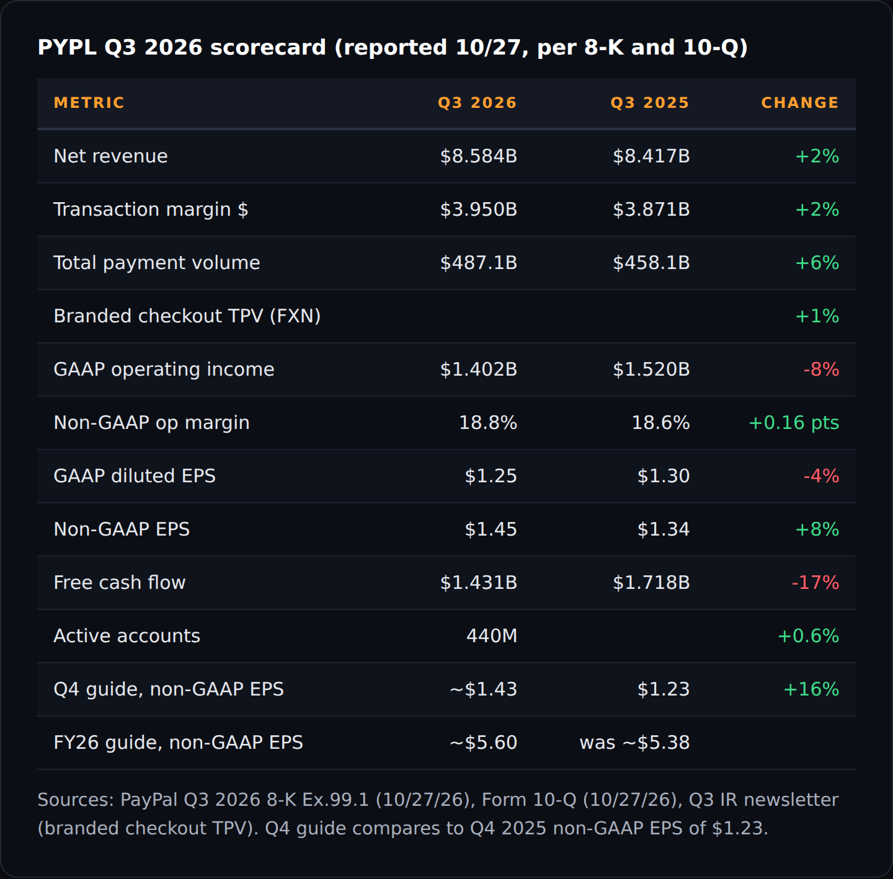
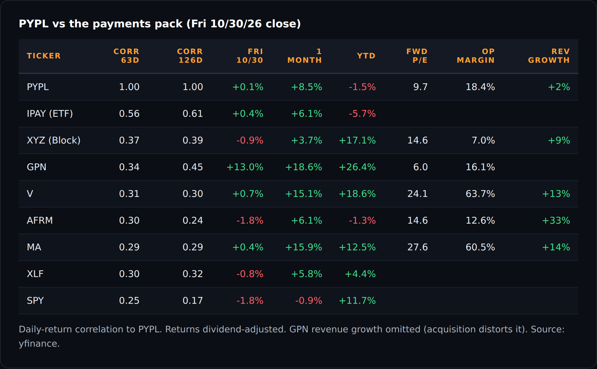
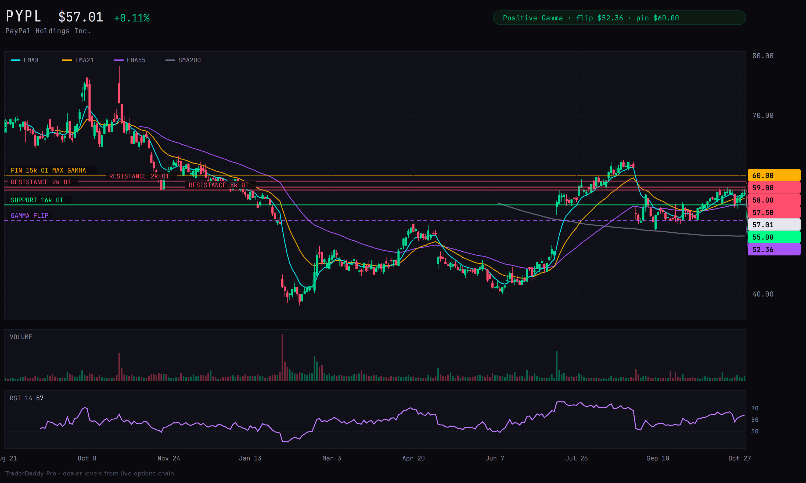
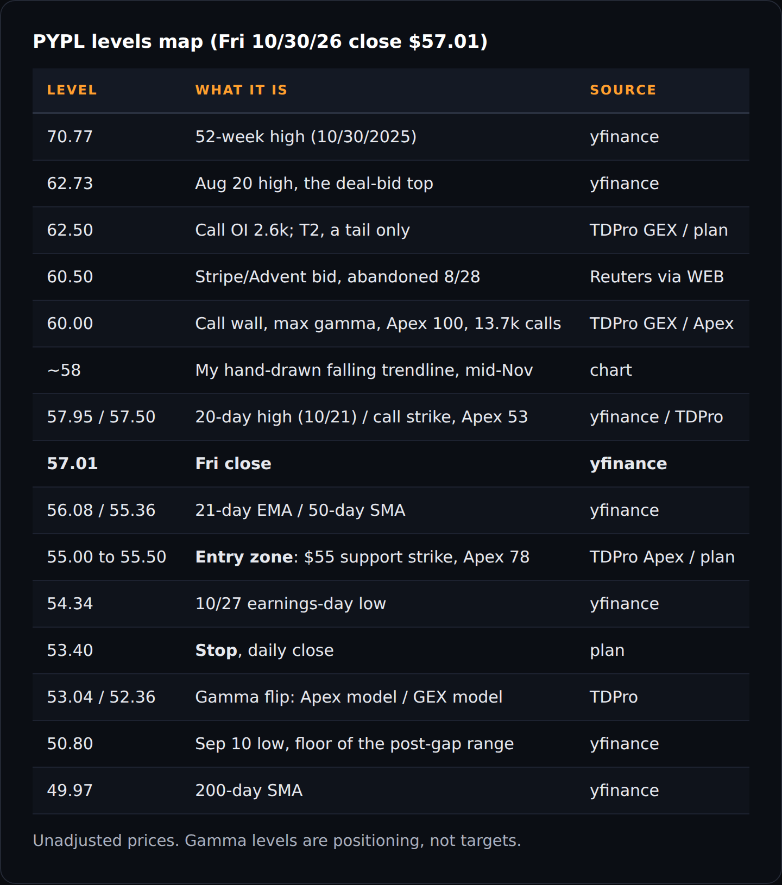
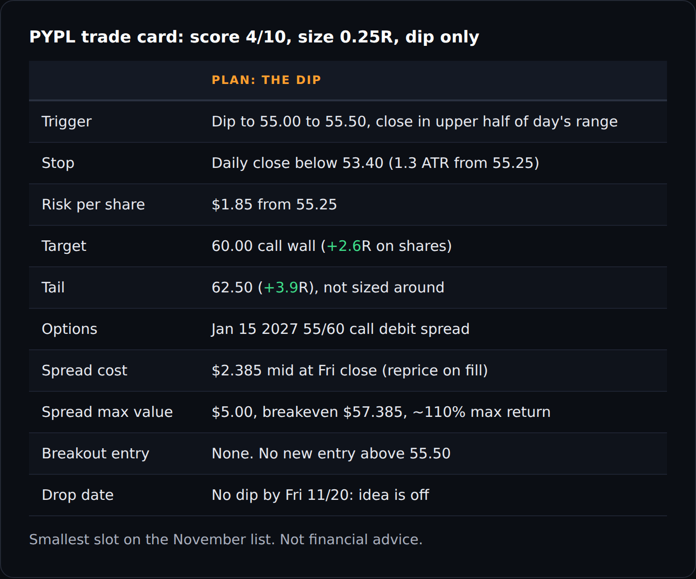

# PYPL Due Diligence: PayPal

*Research 60% | Trading 40%*

<!--seo-title: PYPL Due Diligence: PayPal-->
<!--seo-desc: PayPal due diligence: Q3 numbers, a new CEO and withdrawn 2027 targets, the Stripe/Advent bid that came and went, a $60 call wall, and a dip-only trade pla-->

**PayPal (PYPL)** · **$57.01** at the 2026-10-30 close

!> **Score: 4/10 · Size: 0.25R · Action: BUY ON TRIGGER**
!> PayPal (PYPL) is a cheap, slow-growing payments giant in the middle of a turnaround under a CEO who has been in the chair since March. It trades at **9.7x forward earnings** and buys back about **$1.5B of stock a quarter**, but the flagship checkout button grew **1%** last quarter, and the stock sits **$3** under a **$60** call wall with no catalyst of its own in November. I want it only on a dip to **$55.00 to $55.50**, through a Jan $55/$60 call spread, at **0.25R**. No dip by **Fri 11/20**, no trade. No breakout entry.

## 1. Business and management

One reportable segment, three businesses: branded checkout (the PayPal button), Braintree (unbranded card processing), and Venmo. The growth is coming from the two that aren't the button.

- PayPal reports as **one segment**. Q3 net revenue **$8.584B**, transaction margin dollars **$3.950B**. *([Q3 10-Q, Note 18](https://www.sec.gov/Archives/edgar/data/1633917/000163391726000088/pypl-20260930.htm))*
- Transaction revenue from **Braintree rose about $270M** and **Venmo about $100M** year over year. Revenue from **PayPal products fell about $240M**, blamed on mix, bigger merchant incentives and lower FX fees. *(Q3 10-Q, MD&A)*
- **Branded checkout TPV grew 1%** currency neutral, the **fourth straight quarter** in the 1% to 2% range. Financial services is now **more than 20%** of transaction margin dollars and growing double digits. *([Q3 IR newsletter](https://s205.q4cdn.com/875401827/files/content_files/PYPL-3Q-26-Earnings-IR-Newsletter.pdf))*
- Venmo: double-digit TPV growth for an **eighth straight quarter**, Pay Later volume **+25%**, Pay with Venmo **+43%**. Lores sees a "4x to 5x opportunity" to raise Venmo revenue per account. *([Q3 call, MarketBeat summary](https://www.marketbeat.com/instant-alerts/transcript-paypal-q3-earnings-call-highlights-2026-10-27/))*
- **Enrique Lores** is president and CEO (signed the 10-Q). He took over **3/1/2026**, after the board removed Alex Chriss on **2/3/2026**, saying the pace of change and execution was not in line with its expectations. Lores ran HP from 2019 and had chaired PayPal's board since July 2024. *(Q3 10-Q, [Fortune](https://fortune.com/2026/02/03/paypal-dumps-ceo-in-surprise-shakeup-poaches-hps-top-exec-as-replacement))*
- **Jamie Miller** is EVP, Chief Financial and Operating Officer (signed the 10-Q). *(Q3 10-Q)*
- Turnover below the CEO: two EVP general managers (Small Business and Consumer) left effective **6/2/2026**, and SVP and CTO Jon Southall left for Convera, reported **10/30**. *([4/30 8-K](https://www.sec.gov/Archives/edgar/data/1633917/000119312526197533/d128781d8k.htm), [Fintech Magazine](https://fintechmagazine.com/articles/jon-southall-joins-convera-as-svp-and-cto-from-paypal))*
- **23,800** employees, **$47.4B** market cap. *(yfinance)*

## 2. The numbers

Non-GAAP EPS keeps beating and the buyback keeps shrinking the share count. Underneath, revenue grew 2%, GAAP operating income fell 8% and free cash flow fell 17%.

- **Revenue $8.58B, +2%** (+1% currency neutral). Consensus was **$8.71B**, so revenue missed. *([Q3 8-K Ex.99](https://www.sec.gov/Archives/edgar/data/1633917/000163391726000086/pypl3q-26earningsrelease.htm), [InvestorsHub via Finviz](https://finviz.com/news/408888/paypal-raises-2026-earnings-guidance-after-q3-profit-beats-forecasts-shares-rise-12))*
- **Non-GAAP EPS $1.45 vs $1.31** estimated, +8% year over year. **GAAP EPS $1.25, down 4%.** The gap is a **$152M** restructuring charge from a Q3 workforce cut plus other items. *(Q3 8-K, Q3 10-Q)*
- **FY26 non-GAAP EPS guide raised to ~$5.60** from ~$5.38. Q4 guide **~$1.43**, against **$1.23** a year ago. Q4 transaction margin dollars guided only "slightly positive." *(Q3 8-K, Q3 IR newsletter)*
- For 2027, management said it will increase investment while targeting non-GAAP EPS growth similar to 2026. No numbers given. *(Q3 call, MarketBeat summary)*
- **TTM operating cash flow $7.09B, capex $0.79B, free cash flow $6.30B.** Q3 free cash flow **$1.43B**, down **17%**. Adjusted FCF (strips BNPL receivable timing) **$2.05B**, down **10%**. *(yfinance quarterly, Q3 8-K)*
- Cash, equivalents and investments **$15.1B**; debt **$13.5B**; current ratio **1.26**. They added **$2B** of notes in May (4.55% 2028, 4.95% 2031, 5.55% 2036). *(Q3 8-K, yfinance, [5/15 8-K](https://www.sec.gov/Archives/edgar/data/1633917/000119312526226653/d930458d8k.htm))*
- **Buyback: $1.5B every quarter** for the last five. Q3 bought **27.5M shares**: 10.2M at $51.43 in July, 8.4M at **$59.44** in August, 8.9M at $53.48 in September. **$9.353B** left on the February 2025 authorization; FY26 plan **$6B**. *(Q3 10-Q Item 2, Q3 IR newsletter)*
- **Dividend $0.14** a quarter (**$0.56** a year, about **1.0%** yield). Next one payable **12/24**, record date **12/4**. *(Q3 8-K, yfinance)*
- **EPS beats in 7 of the last 8 quarters.** The one miss, **$1.23 vs $1.29** in February, came with the CEO change. The stock fell **20%** that day and **7.7%** on the May beat. *(yfinance)*
- TraderMatrix quality score **69/100**, labeled "Solid." *(TDPro snapshot)*

## 3. Filing read (10-Q / 10-K / 8-K / S-series / 424B)

Nothing in the filings about Stripe or Advent. What is in there: a securities class action over the branded checkout story, a restructuring that's cutting layers, and $1.5B of Japan loans moved to held for sale.

- Filings since late April: three earnings 8-Ks with 10-Qs (5/5, 7/28, 10/27), management changes (4/30 and 5/21 8-Ks), a **$2B** note offering (5/12 FWP, 424B2s, 5/15 8-K), an S-8 for the new **39.1M-share** equity plan, and Form 144s. No S-4, no 8-K about any takeover approach. *([EDGAR filing index](https://www.sec.gov/cgi-bin/browse-edgar?action=getcompany&CIK=0001633917))*
- **In re PayPal Branded Checkout Securities Litigation.** Filed **2/24/2026**, class period 2/25/2025 to 2/2/2026. Alleges the company didn't disclose impediments to its branded checkout strategy that hurt its ability to hit the 2027 targets. Amended complaint filed **8/10/2026**. Derivative suits name the former CEO. *(Q3 10-Q, Note 13)*
- **Strategic reorganization** announced April 2026: at least **$1.5B** of gross run-rate savings over two to three years, more than **$700M** by year-end 2026. The Q3 layoff ("removing organizational layers") cost **$152M** and should save about **$340M** a year. *(Q3 10-Q MD&A, Q3 IR newsletter)*
- **$1.5B of Japan installment loans** reclassified to held for sale in Q3. Consumer loans receivable fell **19%** to **$4.2B**. *(Q3 10-Q)*
- Open regulatory items: CFPB civil investigative demands (Regulation E error resolution, PayPal Credit), and a German competition proceeding over surcharging and how PayPal is presented at checkout. *(Q3 10-Q, legal proceedings)*
- Item 1A supplements the 10-K risk factors (cyber, now including AI-enabled threats; regulation; GENIUS Act stablecoin rules for PYUSD). *(Q3 10-Q, Part II Item 1A)*
- One new **10b5-1 plan**: Chief Risk Officer Aaron Webster, adopted **8/25/2026**, about **89,900** shares through February 2028. *(Q3 10-Q, Item 5)*

## 4. News, last 6 months

The big moves in PYPL this year were headlines, not trend: a CEO firing, a takeover bid, and the bid going away. Earnings beats barely moved it.

- **2/3/2026, Q4 miss and CEO change** (context, before the window). EPS **$1.23 vs $1.29**, Chriss out, Lores named, 2027 targets no longer committed. Stock **-20.3%**, $52.33 to $41.70. *(Fortune, [SiliconANGLE](https://siliconangle.com/2026/02/03/paypal-appoints-hp-executive-enrique-lores-ceo-disappointing-quarter/), yfinance)*
- **4/29/2026, reorganization and two EVP exits.** Stock **+2.6%** that day. *(4/30 8-K, yfinance)*
- **5/5/2026, Q1.** EPS **$1.34 vs $1.27**, a beat. Stock **-7.7%**, $50.39 to $46.49. I couldn't pin the reason down. *(yfinance)*
- **5/15/2026, $2B of notes** issued. *(5/15 8-K)*
- **7/15/2026, Stripe and Advent bid $60.50 a share** (about **$53B**), reported as a 28% premium to the $47.37 close. Stock **+17.2%** to $55.52 on **91M** shares. Two days earlier, 7/13, it rose **2.8%** on double its usual volume. Price moved before the story, a little. *([PYMNTS](https://www.pymnts.com/?p=3960664), [The Next Web](https://thenextweb.com/news/paypal-stripe-advent-53bn-bid-inadequate), yfinance)*
- **7/28/2026, Q2.** EPS **$1.38 vs $1.28**. Stock **+4.0%**. *(yfinance)*
- **8/20/2026, the high, $62.73.** It closed **$61.47** on 8/27, above the bid. Reports said the board saw the offer as inadequate. *(yfinance, Reuters via The Next Web)*
- **8/28/2026, the consortium drops out**, per Bloomberg. Stock **-12.7%**, $61.47 to $53.66, on **36M** shares. Reports say Stripe and Advent could come back later if things change. None of the three companies commented. *([Irish Times](https://www.irishtimes.com/business/2026/08/28/stripe-abandons-50bn-pursuit-of-paypal/), [Axios](https://www.axios.com/2026/08/28/stripe-advent-end-paypal-pursuit), yfinance)*
- **10/26/2026, -3.6%** the day before earnings, $57.02 to $54.99, no headline found. *(yfinance)*
- **10/27/2026, Q3.** Beat on EPS, missed on revenue, raised the year. Stock **+2.0%** to $56.09 after a **$54.34** low. *(Q3 8-K, yfinance)*
- **10/30/2026, CTO departure reported.** On a day SPY fell **1.8%**, PYPL closed **+0.1%**. *(Fintech Magazine, yfinance)*

## 5. Growth drivers

Everything that's working is something other than the PayPal button.

- **Braintree:** about **$1.1B** of added transaction revenue in nine months. It's lower margin: the 10-Q says Braintree has higher expense rates than PayPal's other products. *(Q3 10-Q)*
- **Venmo:** about **$230M** of added transaction revenue in nine months, debit card at **6.7M** monthly actives (+55%), and only **23%** of Venmo users on its financial products so far. *(Q3 10-Q, Q3 call (MarketBeat))*
- **BNPL and financial services:** Pay Later volume **+25%**, financial services **>20%** of transaction margin dollars and growing double digits. *(Q3 call, Q3 IR newsletter)*
- **Cost cuts:** at least **$1.5B** gross run-rate savings targeted, a significant portion reinvested. Q3 non-transaction opex grew only **1%**. *(Q3 10-Q, Q3 IR newsletter)*
- **Share count:** about **117M** shares retired in 12 months. With revenue flat, that's most of the EPS growth. *(Q3 8-K)*

## 6. Risks

- **Branded checkout keeps stalling.** It's the high-margin piece and it has grown 1% to 2% for four quarters. The EU de minimis change is a **70bp** headwind expected to run through Q4, and the U.K. is still weak. *(Q3 IR newsletter, Q3 call (MarketBeat))*
- **Headline gap risk, both ways.** The bid added **17%** in a day and its exit took **13%** in a day. The consortium could return, or not. No date on either. *(yfinance, Irish Times)*
- **Execution and credibility.** New CEO since March, 2027 targets withdrawn, the CTO and two GMs gone, and a class action over the old checkout story. *(Q3 10-Q, Fortune, Fintech Magazine)*
- **Consumer and credit.** Market health reads **HIGH** risk (3.5 of 5): high beta lagging low vol, high-yield ETFs under their 50-day, and discretionary losing to staples. PayPal lives on discretionary spend and carries BNPL loans. *(TDPro market health)*
- **Rates.** Interest on customer balances already fell year over year in Q3. FOMC meets **Dec 8-9**. *(Q3 10-Q, [Federal Reserve](https://www.federalreserve.gov/monetarypolicy/fomccalendars.htm))*

## 7. Competition and correlation

PYPL doesn't trade with anyone. Its highest correlation is to the payments ETF that holds it, and nothing else gets above 0.45.

- 63-day correlation: IPAY **0.56**, Block **0.37**, Visa **0.31**, Mastercard **0.29**, SPY **0.25**. No peer is above **0.7**, so no peer's earnings is PYPL's event. *(yfinance)*
- Against the rest of my November list (126 days): NFLX **0.25**, USB **0.22**, NVDA **0.12**, AMZN **0.10**, EQT **0.04**, TXN **-0.07**. *(yfinance)*
- **Beta to SPY 0.58** over 126 days, but **0.88** over 63. Beta to XLF **0.87** (63 days) and **1.03** (126 days). The low long-window beta is partly the bid and the gap being company-specific. *(yfinance)*
- Where it loses: Visa and Mastercard grow **13% to 14%** at **60%+** operating margins; PayPal grows **2%** at **18%**. Where it wins: price. **9.7x** forward against **24x to 28x** for the networks. *(yfinance)*
- Merchants are getting paid to keep the button: the 10-Q blames part of the PayPal-products revenue drop on "higher co-marketing campaigns and incentives with large merchants." *(Q3 10-Q)*

## 8. Sentiment and positioning (people)

The Street is a shrug: hold, with the mean target at Friday's close. Insiders are quiet. Congress is noise.

- **33** analysts, consensus **hold** (2.93 on the 1 to 5 scale). Mean target **$57.10**, median **$58**, range **$36 to $80**. *(yfinance)*
- After Q3: **Barclays downgraded to Underweight, $53** (10/29). Target cuts at UBS ($60), Citi ($58). Raises at BMO ($59), TD Cowen ($60), Evercore ($45), Morgan Stanley ($46, Underweight), BofA ($54, Underperform). Truist raised to $58 on 10/23. *(yfinance)*
- Insiders, 21 days: **one sale, zero buys.** Frank Keller, President of Checkout Solutions, sold **732** shares at **$55.37** on 10/28, about **$40.5K**, **2%** of his stake (code S). *(TDPro, SEC Form 4)*
- Over six months: Form 144 notices in April, May, June, July, August, September and October, and no open-market buys in the 21-day window. *(SEC EDGAR)*
- Congress: Sen. John Boozman bought two lots of **$1K to $15K** on 7/30; Rep. Gil Cisneros sold **$1K to $15K** on 5/15. Noise. *(TDPro)*
- Short interest **27.3M** shares, about **3.3%** of float, **2.8** days to cover, down **8.9%** from the prior settlement (10/15). No squeeze fuel. *(FINRA via TDPro)*

## 9. Options and flow (dealers and size)

Positive gamma, a $60 call wall right overhead, and a $55 support strike right underneath. Dealers are set up to pin this thing between them.

- **Positive gamma.** The GEX model puts the flip at **$52.36**; the Apex model at **$53.04**. Spot is **7% to 9%** above them. TraderMatrix flags it as a positive-gamma pocket while the broad market is short gamma. *(TDPro GEX, TDPro Apex)*
- **$60 is the call wall**: max gamma strike, Apex score **100**, **13,698** calls open. Smaller resistance at **$57.50**, **$58** and **$59**. *(TDPro GEX, TDPro Apex)*
- **$55 is support**: Apex score **78**, the most total open interest on the board (**15,713**), **10,114** calls and **5,599** puts. *(TDPro Apex, TDPro GEX)*
- **Expected move:** **±1.6%** tomorrow, **±4.6%** for a week ($54 to $60), **±9.1%** for a month ($52 to $63), **±13%** for six weeks ($49 to $66). The one-month band held **58%** of the time over five years. *(TDPro)*
- That **9.1%** monthly move is about **31%** annualized implied vol. Realized 30-day vol is **23.9%** (one-year range **17.7% to 77.1%**), and 21-day is **20.7%**. Options are pricing more movement than the stock is delivering, which is one more reason to buy a spread instead of a naked call. *(TDPro, yfinance)*
- **Unusual activity, 10/30:** one bullish call print, about **$397K** of premium, **6,206** contracts against **863** open, 1 to 7 days out, about **1.7%** out of the money. Score **70**, below TraderMatrix's baseline tier. *(TDPro)*
- **Dark pool:** **zero** $1M+ blocks in 30 days, query didn't fail. On a $47B name I read that as a gap in feed coverage, not a signal. *(TDPro)*
- **Chain, Jan 15 2027 (Fri close):** $55 call **$4.10/$4.90**, OI **11,706**; $60 call **$2.00/$2.23**, OI **25,717**. Dec 18 $52.50 put **$0.77/$1.04**. *(yfinance)*

## 10. Chart and technicals

A bid spike, a gap down, and two months of higher lows back up into the middle of the old range. Not extended. Not broken out either.

- **The range since the gap:** **$50.80** low on 9/10, then higher lows at **$51.81**, **$52.29**, **$52.43** and **$54.34**. Friday's **$57.01** sits about **52%** of the way up the $50.80 to $62.73 range. *(yfinance)*
- **The falling trendline:** lower highs from the **$79.21** spike on 10/28/2025 through the **$62.73** August high. My hand-drawn line runs near **$58** by mid-November. That's my favorite setup when it breaks, but here the **$60** wall sits right on top of it. *(yfinance)*
- **Moving averages (unadjusted):** EMA8 **$56.62**, EMA21 **$56.08**, EMA34 **$55.74**, EMA55 **$55.19**, EMA89 **$54.25**. SMA20 **$56.18**, SMA50 **$55.36**, SMA100 **$53.48**, SMA200 **$49.97**. Stacked bullish. Price is **14.1%** over the 200-day, which is still drifting lower. *(yfinance)*
- **Momentum:** RSI(14) **56.9**. MACD **0.53** over signal **0.51**, barely. ADX **18.5** with +DI **23.9** leading -DI **19.9**: the DI lead points up, and an ADX under 20 says there's no real trend. *(yfinance)*
- **ATR(14) $1.40** (Wilder), **$1.33** simple; ATR(20) **$1.28**. Keltner (20 EMA, 2 ATR): **$53.55 to $58.68**. *(yfinance)*
- **Weekly pivots:** pivot **$56.35**, S1 **$55.00**, R1 **$58.37**. S1 lands right on the $55 strike. *(yfinance)*
- **52-week range:** **$70.77** high on 10/30/2025, **$38.46** low on 2/12/2026. The 61.8% Fib of that range is **$58.43**; 50% is **$54.61**. 20-day range **$52.43 to $57.95**. *(yfinance)*

## 11. Sector and macro

Payments lagged all year. October was the first good month, and PYPL ignored Friday's selloff.

- **PYPL:** 1 week **0.0%**, 1 month **+8.5%**, 3 months **-0.9%**, 6 months **+14.4%**, YTD **-1.5%**, 1 year **-15.1%**. *(yfinance)*
- **XLF:** +1.1%, +5.8%, -0.5%, +9.2%, YTD **+4.4%**, 1 year **+9.9%**. **IPAY:** YTD **-5.7%**. *(yfinance)*
- **SPY:** -0.6%, -0.9%, +2.1%, +5.7%, YTD **+11.7%**, 1 year **+12.4%**. **QQQ:** -2.0%, -6.7%, +1.1%, +3.6%, YTD **+12.8%**. *(yfinance)*
- Market health composite **HIGH** (3.5 of 5): risk appetite fading, credit ETFs under their 50-day, discretionary under staples. VIX term structure is still in contango (**0.93**), and financial conditions are looser than average. *(TDPro market health)*
- FOMC met **Oct 27-28**; next meeting **Dec 8-9**, after the dip window closes and before the Jan expiry. *(Federal Reserve)*

## 12. Valuation

Cheap on every multiple. Cheap for a reason: revenue grows 2% and the EPS growth is mostly buybacks.

- **10.9x** trailing GAAP earnings, **9.7x** forward, **10.2x** the ~$5.60 FY26 guide. *(yfinance, Q3 8-K)*
- **7.9x** EV/EBITDA, **1.4x** sales, **2.4x** book. *(yfinance)*
- **FCF yield about 13%** ($6.30B TTM against $47.4B). Dividend yield **1.0%**. *(yfinance)*
- **Graham number $52.39** (GAAP EPS $5.24, book $23.28). **Lynch value about $45** (8x the ~$5.60 guide, at the 8% EPS growth rate). **Analyst mean $57.10.** The three average **about $51.40**, so at $57 the stock is about **11%** above the blend. *(yfinance, Q3 8-K)*
- **82%** institutional ownership, **0.7%** insider. The bid itself said a buyer thought it was worth **$60.50** in July. *(yfinance, PYMNTS)*

## 13. Steelman: bull vs bear

Both sides agree on the facts. The fight is whether a cheap multiple and a buyback can outrun a button that doesn't grow.

!> **Bull case**
!> ▸ **9.7x** forward with a **13%** FCF yield, and **$1.5B** a quarter of buybacks with **$9.35B** still authorized. *(yfinance, Q3 10-Q)*
!> ▸ EPS beats in **7 of 8** quarters, FY guide raised to **~$5.60**, Q4 guided **+16%** on non-GAAP EPS. *(yfinance, Q3 8-K)*
!> ▸ Venmo has **eight straight** double-digit TPV quarters and Pay Later grew **25%**. Real growth exists inside the company. *(Q3 call (MarketBeat))*
!> ▸ Positive gamma, a **$55** support strike, low correlation to everything else I own, and it held flat on a **-1.8%** SPY day. *(TDPro, yfinance)*
!> ▸ A strategic buyer already put **$60.50** on the table, and reports say it could come back. *(PYMNTS, Irish Times)*

!> **Bear case**
!> ▸ Branded checkout grew **1%**, PayPal-product revenue fell **$240M**, and revenue missed. The growth is in lower-margin Braintree. *(Q3 10-Q, Q3 IR newsletter)*
!> ▸ New CEO, withdrawn 2027 targets, a 2027 "increase investment" message, a departed CTO and a class action. That's a turnaround, and turnarounds take longer than a month. *(Q3 call, Q3 10-Q, Fintech Magazine)*
!> ▸ **$60** is the call wall, half a dollar under the old bid, near the analyst median of **$58**, and just under the August high. Upside to it is about **5%**. *(TDPro, yfinance)*
!> ▸ The bid and its exit moved the stock **17%** and **13%** in single days. A stop can't protect against that. *(yfinance)*
!> ▸ The Street is a hold with a **$57.10** mean, and the only post-print rating change was a downgrade. *(yfinance)*

## 14. What would make me wrong

A close under $53.40 is a trade problem. A close under $50.80, or another checkout quarter at 1%, is a business question.

!> **Where this is wrong**
!> ▸ **Too cautious:** a daily close above **$60** on volume. That clears the call wall and the falling trendline. I still wouldn't chase it; if the dip already filled, I'd let the spread ride to max value. *(TDPro GEX, yfinance)*
!> ▸ **The trade is wrong:** a daily close below **$53.40** after a fill. That's under the 10/27 earnings low, and just above the Apex flip at **$53.04**, where dealers stop dampening moves. Stop out. *(plan, yfinance, TDPro)*
!> ▸ **The base failed:** a close below **$50.80**, the September low. That breaks the higher-low structure built since the gap. *(yfinance)*
!> ▸ **Event:** a takeover headline in either direction, another senior exit, or a ruling against PayPal in the checkout class action. Any of those matters more than the chart. *(Q3 10-Q, Irish Times)*

## 15. Catalyst calendar

- **2026-11-17:** NVDA earnings, a market event (PYPL correlation 0.12) *([NVIDIA](https://nvidianews.nvidia.com/news/nvidia-sets-conference-call-for-third-quarter-financial-results-6928873))*
- **2026-11-20:** November monthly options expiry; last day for the dip trigger *(yfinance chain, plan)*
- **2026-12-04:** Dividend record date, $0.14 *(Q3 8-K)*
- **2026-12-08:** FOMC, December 8-9 *(Federal Reserve)*
- **2026-12-18:** December monthly options expiry *(yfinance chain)*
- **2026-12-24:** Dividend paid, $0.14 *(Q3 8-K)*
- **2027-01-15:** Expiry of the $55/$60 call spread *(trade plan)*
- **date not confirmed:** PayPal Q4 earnings (yfinance guesses 2/2/2027; PayPal hasn't announced it). The last two Q4 reports came in early February *(yfinance)*
- **date not confirmed:** Any return of the Stripe/Advent consortium *(Irish Times)*
- **date not confirmed:** Next ruling in the branded checkout securities class action *(Q3 10-Q)*

## 16. Trade plan

!> **The plan**
!> ▸ **The dip (only plan):** price trades into **$55.00 to $55.50** (the $55 support strike, the weekly S1 and the 50-day) and the daily close is in the **upper half** of that day's range. No buying mid-session on the way down. **Stop:** daily close below **$53.40**. That's **$1.85** from $55.25, about **1.3 ATR**.
!> ▸ **No-trade zone:** anything above **$55.50**. Friday's $57.01 is in it. **No breakout entry**: from $58 the $60 wall is closer than any sensible stop.
!> ▸ **Targets:** **$60.00**, the call wall (**+2.6R** on shares from $55.25; the spread is at max value here) / **$62.50**, the August highs, a tail only (**+3.9R**), not sized around

- **Options:** **$55/$60 call debit spread**, Jan 15, 2027. Debit **$2.385** at mid (55 call $4.10/$4.90, 60 call $2.00/$2.23 at Friday's close, yfinance; reprice it on the fill day, it should be cheaper), max value **$5.00**, so max profit **$2.615** on $2.385 risked, about **1.1 to 1** (**~110%**), breakeven **$57.385** at expiry. The debit is the most a takeover-style gap down can cost.
- **Put-selling alternative:** not on my November list, which is long shares and long calls only. If you sell puts, the **Dec 18 $52.50 put** was **$0.77/$1.04** Friday, about **$0.91** mid. That's a **$51.60** basis if assigned, under both gamma flips and near the September floor, for about **1.7%** in 48 days. Wide market, so don't count on the mid.
- Size **0.25R**, the smallest slot on the November list. It shares a loose "cheap, slow-growth, buyback" bucket with USB and NFLX even though the price correlation is low (0.22 to 0.25).
- **Drop date:** no dip into the zone by **Fri 11/20** and the idea is off for November.
- **Exit if:** a daily close below **$50.80**, the September low
- **Exit if:** a takeover headline, a senior departure, or an adverse ruling in the branded checkout class action
- **Exit if:** the Jan 15 expiry arrives. This was never meant to hold into Q4 earnings

## Unverified

!> **Couldn't confirm these, so no dates or numbers lean on them**
!> ▸ IV rank: an earlier TraderMatrix reading of about 18 couldn't be re-pulled (the tool now returns insufficient history), so no IV rank is used here. Implied vs realized vol is used instead.
!> ▸ Why the stock fell 7.7% on the May beat and 3.6% the day before the October print: no solid coverage found, so no reason is given.
!> ▸ The Stripe/Advent bid, the board's view of it, and the consortium's exit come from press reports (Reuters, Bloomberg, PYMNTS). None of the three companies confirmed them, and PayPal filed nothing about them.
!> ▸ 2027 commentary (more investment, similar EPS growth) is from a call summary, not the transcript.
!> ▸ Q4 earnings date: not announced. If you know something about the checkout lawsuit or think the $60 wall is softer than it looks, tell me.

*Not financial advice. Data as of the 2026-10-30 close.*

**Sources:** [PayPal Q3 2026 8-K and Ex.99.1 (10/27/26)](https://www.sec.gov/Archives/edgar/data/1633917/000163391726000086/pypl3q-26earningsrelease.htm) · [PayPal Form 10-Q (10/27/26)](https://www.sec.gov/Archives/edgar/data/1633917/000163391726000088/pypl-20260930.htm) · [Q3 2026 IR newsletter](https://s205.q4cdn.com/875401827/files/content_files/PYPL-3Q-26-Earnings-IR-Newsletter.pdf) · [4/30/26 8-K (EVP departures)](https://www.sec.gov/Archives/edgar/data/1633917/000119312526197533/d128781d8k.htm) · [5/15/26 8-K ($2B notes)](https://www.sec.gov/Archives/edgar/data/1633917/000119312526226653/d930458d8k.htm) · [SEC EDGAR filing index and Form 4s](https://www.sec.gov/cgi-bin/browse-edgar?action=getcompany&CIK=0001633917) · [Q3 call highlights, MarketBeat](https://www.marketbeat.com/instant-alerts/transcript-paypal-q3-earnings-call-highlights-2026-10-27/) · [Q3 consensus, InvestorsHub via Finviz](https://finviz.com/news/408888/paypal-raises-2026-earnings-guidance-after-q3-profit-beats-forecasts-shares-rise-12) · [CEO change, Fortune (2/3/26)](https://fortune.com/2026/02/03/paypal-dumps-ceo-in-surprise-shakeup-poaches-hps-top-exec-as-replacement) · [CEO change, SiliconANGLE (2/3/26)](https://siliconangle.com/2026/02/03/paypal-appoints-hp-executive-enrique-lores-ceo-disappointing-quarter/) · [Stripe/Advent bid, PYMNTS](https://www.pymnts.com/?p=3960664) · [Board view of the bid, The Next Web](https://thenextweb.com/news/paypal-stripe-advent-53bn-bid-inadequate) · [Consortium drops out, Irish Times (8/28/26)](https://www.irishtimes.com/business/2026/08/28/stripe-abandons-50bn-pursuit-of-paypal/) · [Consortium drops out, Axios (8/28/26)](https://www.axios.com/2026/08/28/stripe-advent-end-paypal-pursuit) · [CTO departure, Fintech Magazine](https://fintechmagazine.com/articles/jon-southall-joins-convera-as-svp-and-cto-from-paypal) · [FOMC calendar, Federal Reserve](https://www.federalreserve.gov/monetarypolicy/fomccalendars.htm) · [NVIDIA earnings call release](https://nvidianews.nvidia.com/news/nvidia-sets-conference-call-for-third-quarter-financial-results-6928873) · yfinance: prices, technicals, peer data, analyst actions and option quotes (pulled 11/1/26) · TraderMatrix (TDPro): gamma, Apex levels, expected move, insider, politician, short interest, dark pool, flow and market health (pulled 11/1/26)

<!--share-->
<!--subscribe-->

~ Michael
