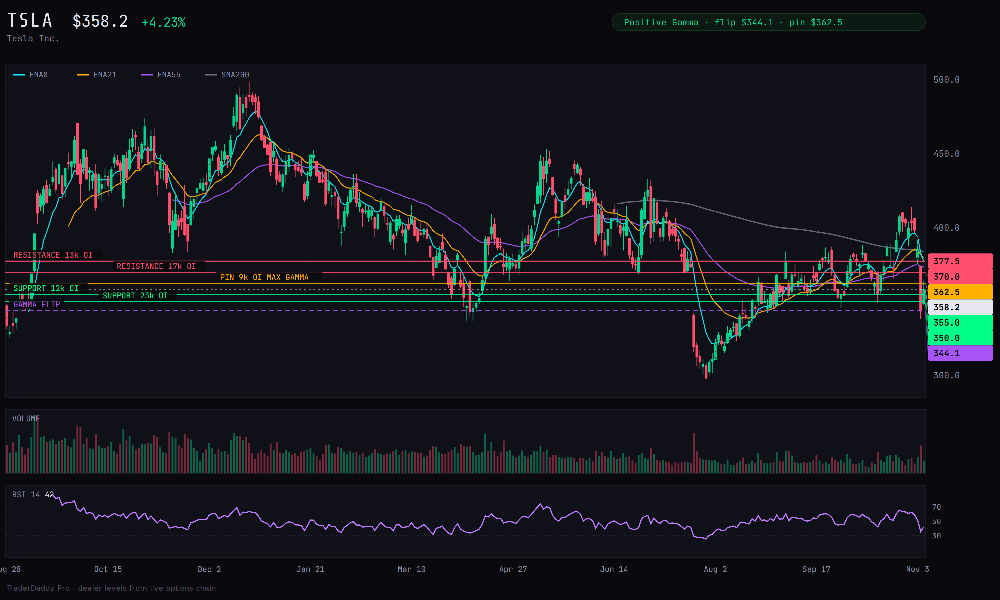

# TSLA Due Diligence: Tesla

**Tesla (TSLA)** · **$358.22** at the 2026-11-06 close

> [!verdict] **Score: 5/10 · Size: 0.5R · Action: [BUY ON TRIGGER](#green)**
>
> Tesla is a car company priced like an AI and robotics company: **$20.6B** of **$28.05B** in Q3 revenue was still cars, at a **2.6%** operating margin. The stock just failed a breakout at $414 and fell to $338 in three sessions. It is the only name from this week's screen sitting in positive gamma, on a shelf where dealer strikes, volume and three prior lows stack at **$350 to $355**. This is a counter-trend dip buy in a risk-off tape, so it gets half a unit and a hard stop at **$335**.

## 1. Business and management

Tesla is a car company valued as an AI and robotics company: **$20.56B** of the **$28.05B** Q3 revenue is still automotive, while R&D and capex are being pushed hard toward self-driving, Optimus, compute and now a possible tie-up with SpaceX.

- **Automotive:** **$20.56B** Q3 revenue (**-3%** year over year), **18.5%** gross margin versus 17.0% a year ago. Vehicle sales were **$20.09B**, regulatory credits only **$113M** (down 73%), leasing **$353M**. *([Q3 10-Q](https://www.sec.gov/Archives/edgar/data/1318605/000162828026066775/tsla-20260930.htm))*
- **Services and other:** **$4.605B** revenue (**+33%**), gross profit about **$734M** (**15.9%** margin, derived from $4,605M revenue and $3,871M cost). Drivers: used cars, collision and maintenance, paid Supercharging. *([Q3 10-Q](https://www.sec.gov/Archives/edgar/data/1318605/000162828026066775/tsla-20260930.htm))*
- **Energy generation and storage:** **$2.881B** revenue (**-16%**), **33.1%** gross margin versus 31.4%. Deployments rose to **13.7 GWh** from 12.5 GWh, but revenue fell on tariff refunds to some Megapack customers, lower Megapack pricing and fewer Powerwalls. *([Q3 10-Q](https://www.sec.gov/Archives/edgar/data/1318605/000162828026066775/tsla-20260930.htm))*
- Q3 deliveries **486,532** versus **497,099** a year ago (**-2%**); production **464,391** versus **447,450** (**+4%**). Model 3/Y were **478,237** of deliveries; Other Models fell to **8,295** from 15,933 after Model S and X were sunset in mid-2026. *([Q3 deliveries release, 8-K Ex.99.1](https://www.sec.gov/Archives/edgar/data/1318605/000162828026064366/exhibit991111111.htm))*
- Active FSD (Supervised) subscriptions reached **1.74M** from 1.04M a year ago. Cybercab began carrying Robotaxi rides in Austin on **9/3**. Management says battery supply, not demand, is the limiter on auto volume, and cites the largest passenger-vehicle backlog in four years and a record energy order backlog. *([Q3 2026 Update, 8-K Ex.99.1](https://www.sec.gov/Archives/edgar/data/1318605/000162828026066738/exhibit9914.htm))*
- Optimus production started on Fremont high-volume lines; the updated Tesla Semi is in volume production in Nevada; Megafactory Texas (**50 GWh** planned) began production in Q3. *([Q3 2026 Update, 8-K Ex.99.1](https://www.sec.gov/Archives/edgar/data/1318605/000162828026066738/exhibit9914.htm))*
- CEO: **Elon Musk**, CEO since October 2008 and also CEO of SpaceX since 2002 (SpaceX absorbed xAI in Feb 2026). Robyn Denholm signs the proxy letter alongside him as chair. *([2026 proxy statement](https://www.sec.gov/Archives/edgar/data/1318605/000110465926116700/tm267596-1_def14a.htm))*
- CFO: **Vaibhav Taneja** signed the Q3 10-Q as Chief Financial Officer and Principal Financial Officer. Tom Zhu is also a named executive officer. *([Q3 10-Q](https://www.sec.gov/Archives/edgar/data/1318605/000162828026066775/tsla-20260930.htm))*
- **134,785** employees, **$1.416 trillion** market cap at the **$358.22** close on 11/6, **3.95B** shares outstanding. *(yfinance)*

## 2. The numbers

Flat revenue, better gross margin, and a profit line cut by a surge in R&D and SG&A. Operating cash flow is strong, but capex is eating almost all of it and is guided higher.

- **Revenue $28.05B** versus $28.10B a year ago (**flat**); **+0.7%** sequentially from $28.24B in Q2. *([Q3 10-Q](https://www.sec.gov/Archives/edgar/data/1318605/000162828026066775/tsla-20260930.htm))*
- **Gross margin 19.6%** versus 18.0% (gross profit **$5.494B** versus $5.054B). *([Q3 10-Q](https://www.sec.gov/Archives/edgar/data/1318605/000162828026066775/tsla-20260930.htm))*
- **Operating income $718M** versus **$1.624B** (**-56%**); operating margin **2.6%** versus 5.8%. R&D jumped **69%** to **$2.761B** and SG&A rose **29%** to **$2.015B**. *([Q3 10-Q](https://www.sec.gov/Archives/edgar/data/1318605/000162828026066775/tsla-20260930.htm))*
- **Diluted EPS $0.22 GAAP** versus $0.39; **$0.48 non-GAAP** versus $0.50. Net income to common **$787M** versus $1.373B. Adjusted EBITDA **$3.90B** versus $4.23B. *([Q3 2026 Update, 8-K Ex.99.1](https://www.sec.gov/Archives/edgar/data/1318605/000162828026066738/exhibit9914.htm))*
- Interest income of **$445M** on **$45.4B** of cash and investments is 62% of operating income. A $863M unrealized gain on the SpaceX stake sits in the nine-month cash flow reconciliation. *([Q3 10-Q](https://www.sec.gov/Archives/edgar/data/1318605/000162828026066775/tsla-20260930.htm))*
- **TTM operating cash flow $18.71B, capex $15.41B, free cash flow $3.30B** (sum of the last four quarters: FCF $1.42B, $1.44B, negative $1.09B, $1.53B). Q3 alone: OCF **$6.26B**, capex **$4.73B**, FCF **$1.53B** versus $3.99B a year ago. *([Q3 2026 Update, 8-K Ex.99.1](https://www.sec.gov/Archives/edgar/data/1318605/000162828026066738/exhibit9914.htm))*
- Nine-month capex was **$13.01B** versus $6.13B a year earlier. Management now expects 2026 capex **in excess of $20 billion**, which implies roughly **$7B or more** in Q4 (derived). *([Q3 10-Q](https://www.sec.gov/Archives/edgar/data/1318605/000162828026066775/tsla-20260930.htm))*
- **Cash and short-term investments $45.45B** (cash $17.85B plus investments $27.59B). Debt and finance leases **$9.52B** ($1.39B current plus $8.14B long-term). Current ratio **1.74** (current assets $70.4B over current liabilities $40.5B). No loans drawn on the new $30B of bank facilities. *([Q3 10-Q](https://www.sec.gov/Archives/edgar/data/1318605/000162828026066775/tsla-20260930.htm))*
- Inventory **$14.09B** versus $12.39B at year-end; days of vehicle supply **11** versus 10 a year ago. *([Q3 2026 Update, 8-K Ex.99.1](https://www.sec.gov/Archives/edgar/data/1318605/000162828026066738/exhibit9914.htm))*
- Guidance: no numeric delivery, margin or EPS guide. Language is to focus on "maximum capacity utilization," with deliveries "impacted by aggregate demand for our products, supply chain readiness and allocation decisions between sale to customers and use for our owned and operated fleet." Profit will shift over time toward "SI, software and fleet-based profits." *([Q3 2026 Update, 8-K Ex.99.1](https://www.sec.gov/Archives/edgar/data/1318605/000162828026066738/exhibit9914.htm))*
- Buybacks and dividends: the 10-Q contains no repurchase disclosure and Item 2 reports no unregistered sales; the balance sheet shows no dividend. *([Q3 10-Q](https://www.sec.gov/Archives/edgar/data/1318605/000162828026066775/tsla-20260930.htm))*
- **Earnings surprise, last 8 quarters (non-GAAP EPS vs consensus):** Q3'26 $0.48 vs $0.45 beat; Q2'26 $0.33 vs $0.54 miss; Q1'26 $0.41 vs $0.35 beat; Q4'25 $0.50 vs $0.45 beat; Q3'25 $0.50 vs $0.56 miss; Q2'25 $0.40 vs $0.41 miss; Q1'25 $0.27 vs $0.41 miss; Q4'24 $0.73 vs $0.77 miss. **3 beats, 5 misses.** *(yfinance earnings_dates)*
- Trailing P/E **394**, forward P/E **166** at the 11/6 close. *(yfinance)*
- TDPro long-term quality score **36 out of 100 (Weak)**. *(TDPro get_ticker_snapshot)*

## 3. Filing read (10-Q / 10-K / 8-K / S-series / 424B)

The headline in the filings is a **possible Tesla and SpaceX combination**, buried in Item 5 of the 10-Q, alongside **$30B of new bank facilities** and a capex plan above **$20B**. There is no equity or note offering in the period.

- 10-Q Item 5: the board formed a Special Committee of disinterested directors "to explore deepening Tesla's relationship with SpaceX, which could be through certain arrangements including without limitation a business combination." No terms, no assurance, and it would need the committee's recommendation and shareholder approval. *([Q3 10-Q](https://www.sec.gov/Archives/edgar/data/1318605/000162828026066775/tsla-20260930.htm))*
- Per Musk on SpaceX's 10/20 call (as reported by 24/7 Wall St), a deal would need approval from at least 50% of all outstanding Tesla shares, not just those voting. *([24/7 Wall St, 10/21/26](https://247wallst.com/investing/2026/10/21/tesla-and-spacex-just-formed-special-committees-to-weigh-a-merger/))*
- **9/29 8-K, items 1.01, 1.02, 2.03:** three senior unsecured facilities totaling **$30B**: **$20B** three-year delayed-draw term loan, **$8B** five-year revolver, **$2B** 364-day revolver. They replace a terminated **$5B** revolver. Minimum consolidated liquidity covenant of **$5B**. Nothing drawn, and Tesla "does not currently plan to draw on the facilities in 2026." *([9/29 credit agreements 8-K](https://www.sec.gov/Archives/edgar/data/1318605/000162828026063820/tsla-20260929.htm))*
- 8-K item codes, 4/22 to 11/6: **2.02 and 9.01** on 4/22, 7/2, 7/22, 10/2 (deliveries) and 10/21 (earnings); **1.01, 1.02, 2.03, 9.01** on 9/29. No 8-K for officer or director changes (5.02), no 3.02 equity sales, and no 424B, S-3 or S-4 in the window. An S-8 was filed 4/27 and a 10-K/A on 4/30 (not read). *([EDGAR filing index](https://www.sec.gov/cgi-bin/browse-edgar?action=getcompany&CIK=0001318605&type=&dateb=&owner=include&count=40))*
- **Pay package:** the 2018 CEO option award was reinstated by the Delaware Supreme Court; Musk exercised about **304.0M** options in Q2 (net settling about 17.5M shares). The resulting restricted shares carry a service condition through **1/19/2028** and a five-year hold after vesting. The **96M**-share 2025 interim award was forfeited. The separate 2025 performance award is about **423.7M** restricted shares, approved by shareholders 11/6/2025. Shares outstanding rose to **3,953M** from 3,751M at year-end. *([Q3 10-Q](https://www.sec.gov/Archives/edgar/data/1318605/000162828026066775/tsla-20260930.htm))*
- **Related parties:** Tesla put **$2.00B** into SpaceX stock (formerly an xAI preferred deal) in March 2026, under 1% ownership, carried at fair value with an **$863M** unrealized gain for the nine months. Musk is CEO of both companies. Tesla booked about **$430.1M** of Megapack-heavy revenue from xAI in 2025 and **$78.1M** through February 2026, and about $4.8M of expense for Musk's security service in 2025. *([2026 proxy statement](https://www.sec.gov/Archives/edgar/data/1318605/000110465926116700/tm267596-1_def14a.htm))*
- Legal: the Delaware derivative suits over Musk, X and xAI were dismissed 4/13/2026 and are on appeal at the Delaware Supreme Court. The California Civil Rights Department race-discrimination trial (equitable phase) ran **9/21 to 10/30**, ruling pending. The EEOC case is in discovery. The FSD class action is stayed pending a Ninth Circuit appeal on class certification. *([Q3 10-Q](https://www.sec.gov/Archives/edgar/data/1318605/000162828026066775/tsla-20260930.htm))*
- Item 1A: the 10-Q refers to the 10-K risk factors and adds none. MD&A flags tariffs hitting energy harder than auto, and automotive regulatory credits shrinking as programs are restricted. *([Q3 10-Q](https://www.sec.gov/Archives/edgar/data/1318605/000162828026066775/tsla-20260930.htm))*
- Governance calendar: 2026 annual meeting **12/3/2026**, 3:00 p.m. Central, to elect three Class I directors, hold an advisory vote on 2025 executive pay, and ratify PwC. Tesla has filed seven proxy solicitation notices (DEFA14A) since 10/19, the latest on 11/6. *([2026 proxy statement](https://www.sec.gov/Archives/edgar/data/1318605/000110465926116700/tm267596-1_def14a.htm))*

## 4. News, last 6 months

Price led the story at the top, and the story caught up at the bottom. TSLA ran from $390.82 on 5/1 to a close high of $445.27 on 5/13, fell 33.0% to $298.32 by 7/29, and sits at $358.22, 19.6% under the high, after a 14.6% two-day drop on 11/4 and 11/5.

- **5/13/2026, the high.** Close of **$445.27**, the 6-month peak. Nothing in the filings or the news feed marks it. The CFO sold 3,000 shares at **$450** that day (Form 4 filed 5/15). Next session **-0.44%**; the stock then lost **33.0%** into the 7/29 low. *(yfinance, SEC Form 4)*
- **6/12/2026, SpaceX lists as SPCX.** Prices 6/11, trades 6/12 on Nasdaq. TSLA closed **+1.82%** on 6/12 and **+1.16%** on 6/15. The IPO is the origin of the merger talk below and of the Musk net-worth swings. *(yfinance, [Invezz](https://invezz.com/news/2026/06/12/tesla-slips-as-spacex-debuts-buy-spcx-or-buy-the-tsla-dip/))*
- **6/29/2026, FSD v14 Lite to HW3 cars.** Rollout to about **3.5 million** older vehicles announced by VP of AI Ashok Elluswamy on X. TSLA closed **+8.46%** to $411.84 the same day, the biggest gain in over a year, then **+2.13%** the next session. Pre-delivery positioning and SpaceX tie-up speculation were cited too, so the cause is shared. *(yfinance, [KuCoin/Elluswamy post](https://www.kucoin.com/news/flash/tesla-stock-surges-8-after-fsd-v14-lite-software-update-launch), [Invezz](https://invezz.com/pk/news/2026/06/29/why-tesla-stock-is-climbing-over-4percent-on-monday/))*
- **7/2/2026, Q2 deliveries: 480,126**, up 25% y/y against a consensus near 406,600. Sell the news: TSLA **-7.49%** to $393.45, then **+6.69%** on 7/6. Price had run **+12.0%** from $379.71 (6/26) to $425.30 (7/1) before the print, so the beat was in the price. *(yfinance, [247WallSt](https://247wallst.com/investing/2026/07/02/tesla-drops-7-despite-blowout-q2-delivery-beat-nio-slips-after-its-own-delivery-update/))*
- **7/22/2026, Q2 earnings (after the close).** Adjusted EPS **$0.33** against about $0.51 expected, record capex **$5.79B**, free cash flow **-$1.09B**, revenue **$28.24B** (beat). CFO Vaibhav Taneja: capex "will grow for the next two or three years." Next session **-14.52%** to $319.69, the worst day in over a year; **-2.08%** after that. Low close **$298.32** on 7/29. *(yfinance, [FinanceBuzz](https://financebuzz.com/news/tesla-stock-plunges-after-earnings-miss), [Biznews](https://www.biznews.com/investing/mr-market-sends-musk-dont-believe-you-message))*
- **9/3/2026, Cybercab rides begin in Austin; NHTSA opens Audit Query AQ26002 a day later.** The audit examines how Tesla self-certified a vehicle with no wheel or pedals. Price ran **+5.42%** into the event on 9/3, then **-5.92%** to $354.08 on 9/4. Move came first; the probe headline came second. *(yfinance, [Claims Journal](https://claimsjournal.com/news/national/2026/09/08/339985.htm))*
- **9/29/2026, $30B of credit lines.** 8-K Items 1.01, 1.02, 2.03: a **$20B** 3-year delayed-draw term loan (Citi as administrator), an **$8B** 5-year revolver and a **$2B** 364-day revolver (Wells Fargo as administrator) replace a **$5B** revolver. Zero drawn; "does not currently plan to draw on the facilities in 2026." Covenant: **$5B** minimum liquidity. Next session **+0.56%**. *([Tesla 8-K, 9/29/26](https://www.sec.gov/Archives/edgar/data/1318605/000162828026063820/tsla-20260929.htm), yfinance)*
- **10/2/2026, Q3 deliveries: 486,532** (Q2 480,126; Q3 2025 497,099), production 464,391. TSLA **+4.65%** to $370.59, **+2.20%** the next session. *([Tesla North, Q3 summary](https://teslanorth.com/2026/10/21/tesla-q3-2026-earnings/), yfinance)*
- **10/21/2026, Q3 earnings (after the close).** Revenue **$28.05B**, flat y/y; non-GAAP EPS **$0.48** vs about $0.44; GAAP EPS **$0.22**; operating margin **2.6%** ($718M, down from $1.62B); free cash flow **+$1.53B**; energy revenue **$2.88B**, down 16% y/y against about $3.9B expected. Price had added **3.41%** on 10/21 going in. Next session **-3.08%** to $374.58; eight firms raised targets that day (section 8). *([Tesla North, Q3 summary](https://teslanorth.com/2026/10/21/tesla-q3-2026-earnings/), yfinance, [InvestingLive](https://investinglive.com/stocks/tesla-q3-earnings-beat-as-margins-and-cash-flow-surprise-revenue-narrowly-misses/))*
- **10/22 to 10/23/2026, SpaceX-Tesla merger talk.** On SpaceX's earnings call Musk said a combination "would need a 50% vote of all shares," called himself a conflicted party, and said terms were not agreed and a deal might never happen. TSLA **-0.63%** on 10/23, then Barclays' upgrade lifted it **+5.21%** on 10/26 and **+4.04%** on 10/27. *(yfinance, [US News/Reuters](https://money.usnews.com/investing/news/articles/2026-10-22/spacex-says-tesla-merger-would-need-musks-approval), [CNBC, 10/23/26](https://www.cnbc.com/2026/10/23/spacex-tesla-merger-chatter-takes-center-stage-after-earnings.html))*
- **11/3 to 11/5/2026, midterm shock.** Democrats took the House and Senate; Texas statewide races went to Democrats. Investors priced probes of Musk's companies and tighter rules on Texas data centers (Deutsche Bank). TSLA **-1.32%** on 11/3, **-3.34%** on 11/4 and **-10.77%** on 11/5 to **$343.69** (intraday low $338.15), a **$456B** combined Tesla and SpaceX market-cap loss. Nasdaq had its worst day since April 2025 and NVDA fell 9.3%, so roughly half of this is the tape, not Tesla. *([CNBC, 11/5/26](https://www.cnbc.com/2026/11/05/tesla-spacex-stocks-fall-after-2026-midterms.html), [Bloomberg, 11/5/26](https://www.bloomberg.com/news/articles/2026-11-05/tesla-shares-tumble-again-in-deepening-post-election-slump), yfinance)*
- **11/6/2026, bounce.** **+4.23%** to **$358.22** with no company news; the Nasdaq rose 1.09% while the week closed -3.4%. Tesla filed a shareholder letter the same day urging a vote for Musk, Denholm and Straubel (meeting 12/3). *(yfinance, [Tesla DEFA14A, 11/6/26](https://www.sec.gov/Archives/edgar/data/0001318605/000110465926123945/tm267596d10_defa14a.htm), Stocktwits market recap)*

## 5. Growth drivers

The Q3 numbers say the pieces are moving (**1.74M** FSD subscribers, six robotaxi cities, Optimus on a Fremont line). They also say none of it is in revenue yet: Musk himself dates a "noticeable" financial impact to Q2 2027.

- **Robotaxi.** Driverless service in **six cities** (Austin is the largest, with **300+ Cybercabs**); cumulative unsupervised miles near **2 million**, up eightfold in the quarter; Austin runs 6 a.m. to midnight; target operating cost **$0.30 per mile**; Texas Cybercab capacity over **125,000 a year**. Musk expects a noticeable financial impact around **Q2 2027** and a "big deal" by Q3 or Q4 2027. *([Not a Tesla App, Q3 call recap](https://www.notateslaapp.com/news/4867/tesla-q3-2026-earnings-call-recap-everything-you-need-to-know), [Tesla North, Q3 summary](https://teslanorth.com/2026/10/21/tesla-q3-2026-earnings/))*
- **FSD software.** **1.74M** active subscriptions, up **67%** y/y; paid attach on over **75%** of new North American deliveries, up nearly 20 points q/q; approved in **9 EU countries**; an EU-wide vote is expected in December and Musk would be surprised if it slipped past Q1 2027. Tesla confirmed an analyst estimate of roughly **$1B** in FSD annual recurring revenue. *([Tesla North, Q3 summary](https://teslanorth.com/2026/10/21/tesla-q3-2026-earnings/), [Not a Tesla App, Q3 call recap](https://www.notateslaapp.com/news/4867/tesla-q3-2026-earnings-call-recap-everything-you-need-to-know))*
- **Unsupervised FSD for customers.** First customer vehicles around **Q2 2027**, select U.S. regions, probably highway first (Elluswamy). Customer-owned cars would join the robotaxi network on the same timeline. *([Not a Tesla App, Q3 call recap](https://www.notateslaapp.com/news/4867/tesla-q3-2026-earnings-call-recap-everything-you-need-to-know))*
- **Energy storage.** **13.7 GWh** deployed in Q3 (second-best quarter), revenue **$2.88B**, down 16% y/y on tariff-related refunds; energy gross margin **33.1%** vs 20.4%, mostly from tariff refunds and warranty adjustments, so not a clean run rate. Megapack output is nearly sold out for **2027**; Megafactory Texas has started, planned at **50 GWh**. *([Tesla North, Q3 summary](https://teslanorth.com/2026/10/21/tesla-q3-2026-earnings/), [Not a Tesla App, Q3 call recap](https://www.notateslaapp.com/news/4867/tesla-q3-2026-earnings-call-recap-everything-you-need-to-know))*
- **Optimus.** Early production started on a Fremont high-volume line designed for about **1M robots a year**. Musk: at least a year to reach about **20,000 a week**; external deliveries and the open design and reliability issues point to **late 2027**; AI5 chip (about 10x AI4 compute) goes into Optimus around **April 2027**. *([Not a Tesla App, Q3 call recap](https://www.notateslaapp.com/news/4867/tesla-q3-2026-earnings-call-recap-everything-you-need-to-know))*
- **New products.** Cybercab first customer deliveries targeted by **year-end 2026**, starting small; Semi in volume production in Nevada (500 miles at 82,000 lbs); Next Gen Roadster unveiled **10/15**, still in design; training compute to **400 MW** by year-end. Terafab (own chips): test chip May or June **2027**, useful volume about **Q3 2028**, likely **$100B+** over time, cost split with SpaceX not settled. *([Tesla North, Q3 summary](https://teslanorth.com/2026/10/21/tesla-q3-2026-earnings/), [Not a Tesla App, Q3 call recap](https://www.notateslaapp.com/news/4867/tesla-q3-2026-earnings-call-recap-everything-you-need-to-know))*
- **Core autos and pricing.** Q3 deliveries **486,532** (down 2.1% y/y); automotive gross margin ex credits **18.1%** vs 16.3% in Q2. Model 3 Standard **$36,990** and Model Y Standard **$39,990** (launched 10/2025) are the entry prices; no 2026 price cut was found. China-made wholesale **67,829** in October, up **10.3%** y/y but down 28.9% from September's 95,366; YTD **810,889**, up 21.42%. *([Tesla North, Q3 summary](https://teslanorth.com/2026/10/21/tesla-q3-2026-earnings/), [CnEVPost](https://cnevpost.com/2026/11/03/tesla-china-oct-2026-wholesale/), [Autoguide](https://cdn-fastly.autoguide.com/auto/manufacturers/tesla-manufacturers/tesla-introduces-model-y-and-model-3-standardthe-most-affordable-yet-44626237))*
- **Funding the build.** Q3 operating cash flow **$6.26B**, capex **$4.73B**, free cash flow **$1.53B**, cash and short-term investments **$45.45B**, plus the **$30B** of undrawn facilities. *([Tesla North, Q3 summary](https://teslanorth.com/2026/10/21/tesla-q3-2026-earnings/), [Tesla 8-K, 9/29/26](https://www.sec.gov/Archives/edgar/data/1318605/000162828026063820/tsla-20260929.htm))*

## 6. Risks

The dated risks cluster in December: the 12/3 vote, the EU FSD vote and the FOMC. The undated one is the biggest: Musk's attention and political exposure now move the stock more than the quarter does.

- **Market.** TSLA fell **14.6%** in two sessions (11/4 and 11/5) in a tape where the Nasdaq had its worst day since April 2025 and NVDA lost 9.3%. The S&P 500 closed the week **-2.7%**, the Nasdaq **-3.4%**. Next dated macro: FOMC **12/8 to 12/9** (with projections). *([Bloomberg, 11/5/26](https://www.bloomberg.com/news/articles/2026-11-05/tesla-shares-tumble-again-in-deepening-post-election-slump), Stocktwits market recap, [Federal Reserve](https://www.federalreserve.gov/monetarypolicy/fomccalendars.htm))*
- **Execution and margin.** Operating margin **2.6%**, operating expenses **$4.78B** (up 39% y/y), GAAP net income **$787M** (down 29% q/q). Q2 free cash flow was **-$1.09B**; Taneja said capex grows for two or three years. Battery supply is the stated cap on vehicle output. Q3 deliveries fell 2.1% y/y while production (464,391) ran below deliveries (486,532). *([Tesla North, Q3 summary](https://teslanorth.com/2026/10/21/tesla-q3-2026-earnings/), [FinanceBuzz](https://financebuzz.com/news/tesla-stock-plunges-after-earnings-miss))*
- **Regulatory: NHTSA.** Audit Query AQ26002 on Cybercab self-certification opened around **9/3**. Tesla did not seek an exemption in advance, while Zoox got limited approval in July. No decision date; the next step is whether NHTSA converts it to a formal investigation. *([Claims Journal, 9/8/26](https://claimsjournal.com/news/national/2026/09/08/339985.htm))*
- **Regulatory: Europe.** FSD (Supervised) is approved nationally in 9 countries, but the EU-wide committee vote slipped from 10/6 to December and needs 15 of 27 states and 65% of EU population; France opposes and Germany, Italy and Spain have not recognized the Dutch approval. Tesla is also testing the name "Tesla Assisted Driving." *([Electrive, 9/28/26](https://www.electrive.com/2026/09/28/eu-vote-on-tesla-fsd-not-expected-before-december/), [Electrive, 10/12/26](https://electrive.com/2026/10/12/from-full-self-driving-supervised-to-tesla-assisted-driving-with-a-new-name-aims-to-secure-eu-approval))*
- **Regulatory: politics.** Democrats control both chambers. Deutsche Bank flags Texas data-center moratorium risk for the planned Terafab in Grimes County and SpaceX compute; Musk spent over **$470M** on GOP causes (Financial Times, via CNBC) and most of his candidates lost. Congress also reportedly asked Musk and SpaceX to preserve Starlink-Ukraine records (CNN, via CNBC). *([CNBC, 11/5/26](https://www.cnbc.com/2026/11/05/tesla-spacex-stocks-fall-after-2026-midterms.html))*
- **Key person.** Musk is a Class I director up for re-election at the **12/3/2026** annual meeting (with Robyn Denholm and JB Straubel). He owns **19.8%** of Tesla per the proxy. He leads SpaceX (public since June) and calls himself a "conflicted party" in the merger talks; a Tesla vote would need **50% of all Tesla shares**, not just those voting. *([Tesla DEFA14A, 11/6/26](https://www.sec.gov/Archives/edgar/data/0001318605/000110465926123945/tm267596d10_defa14a.htm), [US News/Reuters](https://money.usnews.com/investing/news/articles/2026-10-22/spacex-says-tesla-merger-would-need-musks-approval))*
- **Concentration.** The valuation rests on programs with no revenue yet: energy is **10.3%** of Q3 revenue ($2.88B of $28.05B), and the robotaxi, Optimus and unsupervised FSD that justify the multiple are dated by management to **2027**. Meanwhile the autos business is flat (**$28.05B**, 0% y/y). *([Tesla North, Q3 summary](https://teslanorth.com/2026/10/21/tesla-q3-2026-earnings/))*
- **Balance sheet is not the risk.** **$45.45B** of cash and **$30B** of undrawn lines against zero borrowings; the exposure is capex discipline, not solvency. *([Tesla North, Q3 summary](https://teslanorth.com/2026/10/21/tesla-q3-2026-earnings/), [Tesla 8-K, 9/29/26](https://www.sec.gov/Archives/edgar/data/1318605/000162828026063820/tsla-20260929.htm))*

## 7. Competition and correlation

TSLA trades like a high-beta Nasdaq name, not like an automaker. Legacy autos and BYD barely move with it.

- 63-day daily-return correlation: **QQQ 0.66**, **SPY 0.63**, **NVDA 0.56**, **XLY 0.48**. At 126 days: QQQ **0.69**, SPY **0.66**, XLY **0.61**, NVDA **0.45**. *(yfinance)*
- Auto peers are a weak tell. 63-day correlation: RIVN **0.42**, NIO **0.31**, LCID **0.24**, F **0.14**, GM **0.12**, BYD (US ADR, BYDDY) **0.00**. The ADR trades on US hours against a Shenzhen/Hong Kong primary, so read that figure as indicative only. *(yfinance)*
- Mega-cap tech at 63 days: META **0.24**, MSFT **0.26**, AMZN **0.23**, GOOGL **0.16**, AAPL **0.04**. NVDA is the only one above 0.5. *(yfinance)*
- Beta to SPY is **2.16** over 63 days and **2.47** over 126. Beta to XLY is **1.14** and **1.51**. It moves about twice the market and a bit more than its own sector ETF. *(yfinance)*
- Forward P/E: TSLA **165.9x**, against GM **5.8x**, F **6.6x**, BYD ADR **12.3x**, NIO **27.2x**. RIVN and LCID have negative forward earnings (not meaningful). Mega-cap tech runs 11.7x (NVDA) to 32.4x (AAPL). *(yfinance)*
- Operating margin: TSLA **5.4%**, GM **7.3%**, BYD ADR **6.5%**, F **3.1%**, NIO **-1.1%**, RIVN **-40.9%**, LCID **-261%**. Tech peers: NVDA **66.2%**, MSFT **49.8%**, META **35.4%**, GOOGL **31.8%**, AAPL **31.1%**, AMZN **13.9%**. *(yfinance)*
- Revenue growth (latest quarter, YoY): TSLA **-0.2%**, BYD ADR **+13.6%**, GM **+2.9%**, F **-2.0%**, RIVN **+38.3%**, NIO **+69.1%**, LCID **+56.2%**, NVDA **+105.9%**. *(yfinance)*
- YTD: TSLA **-20.3%**, BYD ADR **-21.6%**, RIVN **-30.9%**, NIO **-33.5%**, LCID **-68.9%**, GM **+6.7%**, F **-1.9%**, NVDA **+0.3%**, AAPL **+26.3%**, MSFT **+10.4%**, AMZN **+12.3%**, GOOGL **-8.8%**, META **-7.3%**. *(yfinance)*
- The market prices TSLA on the AI/autonomy story, not on auto earnings: a 5% operating margin and flat revenue sit under a multiple 25 to 30 times the legacy automakers'. *(yfinance (peer table above))*
- Peer catalyst dates: none confirmed. NVDA's next earnings date was not verified from company IR. *(unverified)*

## 8. Sentiment and positioning (people)

The Street is still long (40 analysts, mean target 15% above the close), no analyst has reacted to the 11/5 selloff, insiders have not filed a Form 4 since 9/9, and retail is leaning bearish after the drop.

- **40** analysts, consensus "buy" (**2.27** on the 1 to 5 scale). Targets: mean **$413.10**, median **$436**, low **$128.11**, high **$600**. Mean is **15.3%** above the $358.22 close; median **21.7%**. These targets predate the 11/5 drop. *(yfinance)*
- Last 30 days (10/8 to 11/6): **20** rating or target actions, **10 target raises, 0 cuts, 0 downgrades, 3 upgrades**. Barclays moved to Overweight from Equal-Weight on 10/26 (target **$450** from $370); CLSA to Hold from Underperform (**$400** from $310); BNP Paribas to Neutral from Underperform (**$420** from $266). *(yfinance)*
- Post-Q3 targets on 10/22: Canaccord **$442**, Morgan Stanley **$410**, JPMorgan **$430**, Piper Sandler **$475**, Mizuho **$460**, UBS **$425**; reiterated: Cantor **$485**, StoneX **$475**, RBC **$480**, TD Cowen **$460**. Jefferies raised to **$400** on 10/12. Needham stays Hold; GLJ Research stays Sell at **$24.86**. *(yfinance)*
- Only one action since 10/26: GLJ reiterating Sell on 11/5. No firm has moved a target after the **-14.6%** two-day drop. *(yfinance)*
- **Insiders, 21 days (10/17 to 11/7): zero** transactions of any kind. The TDPro feed returned count 0 with 0 buys, 0 sells, 0 other. EDGAR agrees: the latest Tesla Form 4 was filed **9/9/2026**. *(TDPro get_insider_trades (direction all), [SEC EDGAR Form 4 index](https://www.sec.gov/cgi-bin/browse-edgar?action=getcompany&CIK=0001318605&type=4))*
- **Insiders, 6 months (5/7 to 11/7), zero open-market buys (code P), no director or officer sales above CFO level.** Vaibhav Taneja (CFO), exercise and sell: 5/13 **3,000 sh at $450 = $1.35M**; 6/8 **2,605 at $402.20 = $1.05M**; 9/8 **2,605 at $360.13 = $0.94M**. Total **$3.34M**. The 6/5 and 9/4 lines (6,538 and 6,539 sh, no price) are share withholding on vesting. The June and September sales sit on the same quarterly cadence (3/6, 6/8, 9/8), consistent with a plan; plan status not verified. *(yfinance insider table (Form 4 data), [SEC Form 4, 5/15/26](https://www.sec.gov/Archives/edgar/data/1318605/000110465926062860/0001104659-26-062860-index.htm), [9/9/26](https://www.sec.gov/Archives/edgar/data/1318605/000110465926106432/0001104659-26-106432-index.htm))*
- **Elon Musk, 6/16/2026:** exercised options on **303,960,630** shares at **$23.34**, reported as an exercise of a derivative security (value shown **$7.09B**); no sale is reported. Form 4 filed 6/17. Last open-market buy by Musk: **$1.0B**, 2,568,732 shares at $371.90 to $396.36 on **9/12/2025**, outside this window. *(yfinance insider table, [SEC Form 4, 6/17/26](https://www.sec.gov/Archives/edgar/data/1318605/000110465926075213/0001104659-26-075213-index.htm))*
- **Politicians, 180 days: 3 trades, all small.** Rep. Pete Sessions (R-TX) sold **$15K to $50K** on 10/2, disclosed 25 days later. Rep. Gilbert Cisneros (D-CA) sold **$1K to $15K** on 8/18 and bought **$1K to $15K** on 5/29. Noise. *(TDPro get_politician_trades_by_ticker, House Clerk)*
- **Retail (Stocktwits, 11/7):** sentiment score **14**, labeled extremely bearish; tagged messages **48.9% bullish, 51.1% bearish**, delta -11.7. Message volume "high" at **74,839** in the last day, **1.07M** watchers. Typical posts: @jwojr76 "back towards $400 this week"; @positiveenergizer flags the **$372.14** 50-day for Monday; @zambono shares a Rolling Stone Cybertruck obituary. *(Stocktwits MCP get_symbol_pulse)*

## 9. Options and flow (dealers and size)

Positive gamma with spot above both flips, but the book is short-dated and the tape was two-sided. Premium is rich: IV rank 62.6, IV about equal to realized.

- **Positive gamma** (net GEX +$65.9M). Spot **$358.22** sits about **4%** above the flip. Two models disagree on where it is: the GEX model puts the flip at **$344.05**, the Apex simulation at **$346.57**. Both are within $2.50 of each other and well below spot. *(TDPro get_gex_ticker, get_apex_levels)*
- **Max gamma strike $362.50** (GEX model, net +$16.7M). The largest absolute gamma strike is **$360** (9,250 calls and 8,578 puts open), a pin right at spot. *(TDPro get_gex_ticker)*
- **Dominant Apex strike is $377.50** (score 100, 9,974 total OI), then **$350** (score 95, 11,882 OI), then **$362.50** (78), $380 (62), $370 (53). *(TDPro get_apex_levels)*
- **Call walls (resistance):** $362.50, $370 (11,956 calls open), $377.50 (10,650), $380 (12,314). Heaviest overhead call OI is **$400** (21,585 calls). *(TDPro get_gex_ticker)*
- **Put walls (support):** **$355** (net +$6.4M), **$350** (10,024 puts, 12,835 calls), $340 (9,995 puts), $330 (11,548 puts). Net gamma turns negative below about $345. *(TDPro get_gex_ticker)*
- Both gamma models use only the nearest five weekly expiries (through 11/16 and 11/18). They describe the next two weeks, not the December expiry the trade lives in. *(TDPro (expirationsUsed))*
- **Expected move:** **+/-4.5%** tomorrow (**$342 to $375**), **+/-9%** one week (**$327 to $392**), **+/-15%** one month (**$308 to $417**), **+/-18%** six weeks (**$300 to $428**). Historical hold rates for the 68% band: 81% (1d), 76% (1w), 65% (1m and 6w). *(TDPro get_expected_move)*
- **IV rank 62.6**, rich. Self-tracked ATM IV rose from **41.9%** to **51.6%** over the five sessions to 11/6. *(TDPro get_iv_rank (CBOE basis; recent change self-tracked, not comparable to the rank))*
- **HV30 is 51.4%**, inside a one-year range of **29.7% to 69.8%**; 21-day realized is **57.0%**. Dec 18 ATM implied vol is about **52%** ($360 call 52.3%), so implied is roughly **1.0x** realized. No premium edge in either direction. *(yfinance (unadjusted closes), chain 11/6 close)*
- **Unusual activity, Fri 11/6:** 64 rows scored 60+, **$251.7M** total premium. Sentiment-labeled split is **$134.0M bullish** vs **$117.6M bearish**, so the tape was two-sided. Largest: a **$20.1M** put golden sweep (bearish, puts opening) and an **$18.7M** call golden sweep (bullish). Many rows flipped sentiment intraday; premium is a session running total, and strike and expiry are not published. *(TDPro get_unusual_activity (todayOrLastSession, sessionDate 11/6))*
- **Dark pool, 5 calendar days:** 1,188 blocks, **$2.15B** notional, net **-$600M**, leaning distribution; largest print **$34.8M**. **30 days:** 4,500 blocks, **$8.49B**, net **-$129M**, essentially balanced; largest **$68.7M**. Neither query failed and neither was truncated. The 5-day lean is a lean, not proof of selling. *(TDPro get_dark_pool)*
- **Short interest:** **69.35M** shares (about **2.5%** of float), **2.22** days to cover, down 2.2% from the prior settlement (10/15). Daily short volume ratio **46.7%** on 11/5, which is mostly market-maker hedging. No squeeze fuel. *(FINRA via TDPro get_short_interest; float from yfinance)*
- **Dec 18 2026 $360 call:** bid **$24.35**, ask **$24.70**, mid **$24.53**, OI **4,615**, IV 52.3%. Breakeven at expiry about **$384.53**. *(yfinance option_chain, Fri 11/6 close)*
- **Dec 18 $355/$385 call spread:** long $355 call 27.00 x 27.50 (mid **$27.25**, OI **948**); short $385 call 13.45 x 13.75 (mid **$13.60**, OI **2,144**). Debit **$13.65** at mid (**$14.05** at natural), width $30, max value **$30**, breakeven about **$368.65** at mid. *(yfinance option_chain, Fri 11/6 close)*
- **Dec 18 $360/$385 call spread:** debit **$10.93** at mid (24.525 minus 13.60), width $25, max gain **$14.07**, breakeven about **$370.93**. A 1.29 reward per 1 risk at mid. *(yfinance option_chain, Fri 11/6 close)*
- All option quotes are from the Friday 11/6 close and will move at the open. Jan 15 2027 quotes were not pulled; the $355 and $385 strikes did not exist on that chain at the time of the pull. *(yfinance)*

## 10. Chart and technicals

TSLA failed at **$414.23** on 11/2, fell **18.4%** in three sessions to **$338.15**, and sits at **$358.22**, under every moving average with -DI in control. The $350 to $360 shelf is the line that matters.

- **The chart shows a failed breakout.** Price ran from **$354.72** (10/16 close) to **$414.23** (11/2 high), then reversed: 11/4 closed **$385.19**, 11/5 fell to **$343.69** on **2.05x** the 50-day average volume (79.7M shares, low **$338.15**), and Friday bounced to **$358.22** (+4.23%) on 0.94x volume. On the rendered chart, price sits under every moving average (EMA8, EMA21, EMA55, SMA200) and inside a band of dealer levels: resistance at **$377.5** and **$370**, max gamma pin **$362.5**, support **$355** and **$350**, gamma flip **$344.1**. *(render_chart.mjs (TDPro dealer levels, live options chain) plus yfinance)*
- **Moving averages (unadjusted):** EMA8 **$377.30**, EMA21 **$379.61**, EMA34 **$376.60**, EMA55 **$373.48**, EMA89 **$373.46**. SMA20 **$380.42**, SMA50 **$372.14**, SMA100 **$366.78**, SMA200 **$383.87**. Price is **6.7% under** the 200-day and below all nine averages. The EMAs are bunched between **$373 and $380**, a flat stack, not a trend stack. *(yfinance, unadjusted daily)*
- **Momentum is weak.** RSI(14) **42.4**. MACD **1.46** under its signal **5.69** (histogram **-4.22**). ADX **16.8**, with **-DI 36.4 leading +DI 20.3**. ADX only measures strength, so the DI lead is what says sellers control the move; at 16.8 there is no established trend, just a sharp drop inside a range. *(yfinance, unadjusted daily)*
- **Volatility:** ATR(14) **$16.71** (Wilder), ATR(20) **$16.16** (simple mean of true range; Wilder smoothing gives $15.66). Keltner (EMA20 **$379.80**, 2x ATR20): upper **$412.12**, lower **$347.47**. Friday closed **$10.75** above the lower band. *(yfinance, unadjusted daily)*
- **Range and Fibonacci (252 sessions, 11/6/25 to 11/6/26):** high **$498.83** (12/22/25), low **$297.38** (7/29/26). Price is **30.2%** up the range. Fib retracements off the high: 0.786 **$340.49**, 0.618 **$374.33**, 0.5 **$398.10**, 0.382 **$421.88**. The 20-day range is **$338.15** (11/5) to **$414.23** (11/2). *(yfinance, unadjusted daily)*
- **Trend structure is mixed.** Since the 7/29 low, swing highs stepped up ($366.50, $384.04, $386.83, $388.56, $414.23). Swing lows were $354.05 (9/15), $345.88 (9/30), $349.33 (10/16), then **$338.15** on 11/5, which breaks that higher-low sequence. Against the bigger picture it is still a series of lower highs: $498.83 (12/22), $453.40 (5/13), $445.60 (5/27), $432.86 (7/1), $414.23 (11/2). *(yfinance, unadjusted daily)*
- **Falling trendline:** drawn through the 5/13 high ($453.40) and the 7/1 high ($432.86), it runs near **$379** on 11/6 (**$381** on 11/2, **$376** by 11/13). The 11/2 high cleared it and failed; price is back under it. Verdict: not extended (RSI 42, below the 200-day), not a clean range, and a break of the falling trendline that failed and is being retested from below. It needs a close back above **$380 to $384** to recover. *(yfinance, unadjusted daily; trendline hand-computed from two swing highs)*
- **Volume profile, last 60 sessions ($5 bins, share of volume):** **$355 to $360 = 16.8%** (largest node), **$375 to $380 = 13.2%**, **$350 to $355 = 12.3%**, **$360 to $365 = 12.1%**, **$365 to $370 = 10.4%**, **$370 to $375 = 6.5%**, **$380 to $385 = 6.4%**, **$400 to $405 = 5.7%**. Volume under $350 is thin (60-day low **$331.12**). *(yfinance, unadjusted daily, typical price (H+L+C)/3 binned)*
- **52-week and 20-day extremes:** 52-week high **$498.83** (12/22/25), low **$297.38** (7/29/26); 20-day high **$414.23** (11/2), low **$338.15** (11/5). Next week's pivots from last week's bar (H **$414.23**, L **$338.15**, C **$358.22**): P **$370.20**, R1 **$402.25**, R2 **$446.28**, S1 **$326.17**, S2 **$294.12**. *(yfinance, unadjusted daily)*
- **Last 10 sessions (O/H/L/C, volume vs 50-day avg of 39.0M):** 10/26 383.83/397.27/383.73/**391.62** 1.41x; 10/27 397.76/408.45/395.25/**407.46** 1.19x; 10/28 410.16/410.85/397.18/**404.22** 0.93x; 10/29 405.63/406.98/400.50/**403.30** 0.60x; 10/30 393.22/404.22/387.52/**399.81** 1.10x; 11/2 404.66/414.23/397.61/**403.82** 1.14x; 11/3 406.25/406.50/396.53/**398.50** 0.71x; 11/4 379.80/392.04/375.50/**385.19** 1.26x; 11/5 374.12/374.30/338.15/**343.69** 2.05x; 11/6 348.92/363.84/347.60/**358.22** 0.94x. *(yfinance, unadjusted daily)*

## 11. Sector and macro

TSLA has lagged its sector and the index this week, in a market that is risk-off by the regime gauges.

- Returns (adjusted close, to 11/6). TSLA: 1w **-10.4%**, 1m **-5.2%**, 3m **+9.0%**, 6m **-16.4%**, YTD **-20.3%**, 1y **-19.7%**. *(yfinance)*
- XLY: 1w **+1.9%**, 1m **+5.6%**, 3m **-1.7%**, 6m **-1.8%**, YTD **-0.9%**, 1y **+0.7%**. SPY: 1w **-2.7%**, 1m **-5.4%**, 3m **-4.7%**, 6m **+0.2%**, YTD **+8.7%**, 1y **+10.9%**. QQQ: 1w **-5.0%**, 1m **-13.4%**, 3m **-9.2%**, 6m **-7.6%**, YTD **+7.2%**, 1y **+7.8%**. *(yfinance)*
- TSLA fell 10.4% in the week against +1.9% for its sector ETF. The month looks milder (-5.2%) only because QQQ fell 13.4% over the same stretch. *(yfinance)*
- **Market Health: HIGH, 4.5 of 5 points.** Four ALERTs: SPHB/SPLV (risk appetite fading, ratio down 19% over 20 sessions), HYG/JNK below their 50-day averages, **VIX/VIX3M inverted at 1.04**, and XLY/XLP below its 50-day with the 50 under the 200. One WATCH: HY spreads above their 30-day average. *(TDPro get_market_health, 11/6)*
- Offsets: breadth is healthy (RSP beat SPY by 7.0 points over 20 sessions), regional banks hold relative strength, and ANFCI at **-0.43** says financial conditions are looser than average. *(TDPro get_market_health)*
- Macro regime: 10Y **4.84%**, 2Y **4.46%**, 10Y-2Y **+0.35**, 10Y real yield **2.60%**, fed funds **3.88%**. Fed net liquidity **$5.79T**, down **1.27%** over four weeks. *(TDPro get_macro_regime (Treasury, Fed, FRED, CFTC))*
- **CPI (October data): Tue 11/10, 8:30am ET.** Next CPI (November data): Thu 12/10. *([BLS CPI schedule](https://www.bls.gov/schedule/news_release/cpi.htm))*
- **No FOMC meeting in November.** The next is **December 8-9**, inside a Dec 18 expiry. *([Federal Reserve FOMC calendar](https://www.federalreserve.gov/monetarypolicy/fomccalendars.htm))*
- Monthly options expiration is Fri 11/20 and quarterly expiry Fri 12/18 (third Fridays). *(Calendar rule (third Friday))*

## 12. Valuation

The multiple is the whole argument. Earnings and cash flow do not support $1.4T on any conventional measure, so the price is a bet on something other than the car business.

- Market cap **$1.416T** (3.95B shares at $358.22). Enterprise value **$1.388T**. *(yfinance)*
- **393.6x** trailing earnings (EPS $0.91) and **165.9x** forward (forward EPS $2.16). *(yfinance)*
- **141.0x** EV/EBITDA, **13.7x** sales, **15.9x** book. *(yfinance)*
- FCF yield about **0.35%** ($4.97B trailing free cash flow against the $1.416T market cap). Compare 4.0% to 4.8% on short Treasuries. *(yfinance; TDPro get_macro_regime)*
- Mean analyst target **$413.10**, **15.3%** above Friday's close. *(yfinance)*
- **45.0%** institutional ownership and **17.8%** insider ownership. Yahoo's insider percentage includes the CEO's large stake, so it is not a count of open-market holders. *(yfinance)*
- Against the group: GM 5.8x, F 6.6x and BYD's ADR 12.3x forward earnings; NVDA 11.7x, MSFT 21.9x, AAPL 32.4x. TSLA is the most expensive name on the page by a wide margin. *(yfinance)*

## 13. Steelman: bull vs bear

Both sides agree the balance sheet is fine. The fight is whether a counter-trend dip in a risk-off tape is worth half a unit of risk.

> [!bull] **Bull case**
>
> - The $352 to $355 zone stacks the **$355** and **$350** dealer strikes, the two biggest volume nodes of the last 60 sessions and three prior lows (9/15, 10/16, 10/19). *(TDPro GEX, yfinance)*
> - Spot is in positive gamma, **4%** above a flip both models put at **$344 to $347**, so dealers lean against the move in both directions. *(TDPro get_gex_ticker, get_apex_levels)*
> - The Street has not flinched: **10** target raises and **0** cuts in 30 days, mean target **$413.10**, and no firm moved after the 11/5 drop. *(yfinance)*
> - **$45.45B** of cash plus **$30B** of undrawn lines. Nothing here gets forced. *(Q3 10-Q, 9/29 8-K)*
> - The first target is real resistance, not a hope: the 11/4 close sits on the **$383.87** 200-day and the falling trendline. *(yfinance)*

> [!bear] **Bear case**
>
> - A breakout just failed. Price is under all nine averages, **-DI 36.4** leads **+DI 20.3**, and 11/5 closed below the zone on **2.05x** volume. *(yfinance)*
> - **-$600M** of net dark pool selling in 5 days, and Stocktwits sentiment at **14**, extremely bearish. *(TDPro get_dark_pool, Stocktwits)*
> - **2.6%** operating margin, **165.9x** forward earnings and a **0.35%** FCF yield. The multiple rides on robotaxi and Optimus, which management dates to **2027**. *(Q3 10-Q, yfinance)*
> - Beta **2.16** to SPY in a market reading risk-off (Market Health **4.5 of 5**, VIX curve inverted). It fell **14.6%** in two sessions last week with the Nasdaq. *(yfinance, TDPro get_market_health)*
> - The **12/3** annual meeting, with Musk up for re-election and a SpaceX combination being explored, lands inside the hold. *(Tesla DEF 14A, Q3 10-Q Item 5)*

## 14. What would make me wrong

A tag of $335 is a trade problem. A close back under $344 is the gamma regime flipping. Neither one says the business changed.

> [!warn] **Where this is wrong**
>
> - **Too cautious:** a daily close above **$384**, the 200-day, without a dip first. That reclaims the trendline the 11/2 breakout lost, and this card never fills. That is a different setup, not a chase of this one. *(yfinance)*
> - **The trade is wrong:** a trade at **$335** after a fill. That is under the 11/5 capitulation low of $338.15 and the 0.786 retrace at $340.49. *(plan, yfinance)*
> - **The dip is not holding:** a daily close under **$344**, the gamma flip. Below it dealers chase moves instead of fading them, and volume under $350 is thin. *(TDPro get_gex_ticker, yfinance)*
> - **The bigger picture breaks:** a close under **$331.12**, the 60-session low. That puts the **$297.38** July low back in play. *(yfinance)*
> - **Event risk:** a SpaceX combination headline, a formal NHTSA investigation, or an EU FSD vote that fails. None of those has a date. *(Q3 10-Q, Claims Journal, Electrive)*

## 15. Catalyst calendar

- **2026-11-10:** October CPI, 8:30am ET *([BLS](https://www.bls.gov/schedule/news_release/cpi.htm))*
- **2026-11-17:** NVDA earnings, 5pm ET call. NVDA fell 9.3% on 11/5 alongside TSLA, so the AI tape is shared (63-day correlation 0.56) *([NVIDIA](https://nvidianews.nvidia.com/news/nvidia-sets-conference-call-for-third-quarter-financial-results-6928873))*
- **2026-11-20:** Monthly options expiration. The gamma book behind the $344 flip and $355 support is mostly weeklies through mid-November *(calendar rule, TDPro expirationsUsed)*
- **2026-12-03:** Tesla annual meeting, 3pm CT: Class I directors including Musk, say-on-pay, auditor *([Tesla DEF 14A](https://www.sec.gov/Archives/edgar/data/0001318605/000110465926116700/tm267596-1_def14a.htm))*
- **2026-12-04:** This card expires if the dip never fills *(plan)*
- **2026-12-08:** FOMC, December 8 to 9, with projections *([Federal Reserve](https://www.federalreserve.gov/monetarypolicy/fomccalendars.htm))*
- **2026-12-10:** November CPI, 8:30am ET *([BLS](https://www.bls.gov/schedule/news_release/cpi.htm))*
- **2026-12-18:** Expiry of the Dec 18 calls *(yfinance option expirations)*
- **date not confirmed:** SpaceX combination: special committee exploring it, no terms, needs 50% of all Tesla shares *(Q3 10-Q Item 5, US News/Reuters)*
- **date not confirmed:** EU-wide FSD vote, reported for December, not on a published agenda *(Electrive)*
- **date not confirmed:** NHTSA audit AQ26002 outcome on Cybercab self-certification *(Claims Journal)*
- **date not confirmed:** Dallas Cybercab rides, said to start in November *(Q3 call recap)*
- **date not confirmed:** Q4 deliveries and Q4 earnings (yfinance shows 1/27/2027, not confirmed by Tesla) *(yfinance)*

## 16. Trade plan

> [!plan] **The plan**
>
> - **The dip:** a trade into **$352 to $355** with a daily close back at or above **$352**. That is the $355 and $350 dealer strikes, the two biggest volume nodes and three prior lows, sitting about **$9** above the $344 gamma flip. **[Stop:](#red)** **$335**, under the 11/5 low of $338.15. From a $353.50 fill that is **$18.50** of risk, **1.11 ATR**. It is inside the one-week expected move ($327 to $392), so this is a stop that can get tagged by a normal week.
> - **No-trade zone:** above **$355**. Friday's **$358.22** is $3 over the zone and right under the $360 to $362.50 pin. A bounce off $356 does not fill, and that is fine
> - **[Targets:](#green)** **$385.19**, the 11/4 close on the 200-day and the falling trendline (**1.7R** from $353.50; the $370 and $377.50 call walls sell first) / **$398.50**, the 11/3 close at the 0.5 retrace (**2.4R**)

- **Options:** **Dec 18 $355/$385 call debit spread**, which tops out at T1, Dec 18, 2026, which carries the 12/3 meeting, the 12/8 to 12/9 FOMC and 12/10 CPI. Debit **$13.65** at mid ($355 call 27.00 x 27.50, $385 call 13.45 x 13.75 at Friday's close). Bought on a fill at the zone it will cost less, so reprice it that day, max value **$30**, so about **1.2 to 1** on the debit at Friday's prices, breakeven about **$368.65** at expiry. IV rank is **62.6**, but implied (52%) is about equal to realized (51 to 57%), so the spread is about the width of the move, not a discount. The single **Dec 18 $360 call** at **$24.53** mid is the simpler way to own it, breakeven **$384.53**.
- **Put-selling alternative:** not on this week's list, which is long shares and long calls only. A put sold at the $335 stop level would pay for being wrong at the exact price the card says it is wrong, so the two don't mix. Not priced here.
- Size **0.5R**, the whole list this week. TSLA's 63-day correlation is 0.66 to QQQ and 0.56 to NVDA, so it carries the tech tape with it.
- **The 12/3 annual meeting sits inside the hold** and the card has no exit before it. Going flat into 12/3 if the position is open and short of T1 is the cautious version.
- **Exit if:** a daily close under **$344**, the gamma flip, after a fill (the dip did not hold)
- **Exit if:** a close under **$331.12**, the 60-session low
- **Exit if:** no fill by **Fri 12/4**

## Unverified

> [!muted] **Couldn't confirm these, so no dates or numbers lean on them**
>
> - Cause of the 11/5 drop from $385.19 to $343.69 (-10.8%) and the 11/6 bounce to $358.22 (+4.2%): no sourced explanation found.
> - Q4 2026 earnings date: yfinance lists 1/27/2027 but Tesla IR has not been confirmed; left out of catalysts.
> - Prior-year TTM free cash flow: not sourced, so no year-over-year TTM comparison is given.
> - Purpose of the 4/30 10-K/A and the 4/27 S-8 (listed in the filing index, documents not read).
> - Form 4 and Form 144 insider sales since April (filings exist, not read here; belongs in the sentiment section).
> - Exchange ratio, price, or timing of any SpaceX combination: not disclosed.
> - Date and substance of the 11/6 shareholder letter attached to the DEFA14A: not read.
> - Dallas Cybercab rides: management said on the Q3 call they start 'next month' (November 2026). No day given and the wording comes from a call recap, not a filing.
> - EU-wide FSD vote: Germany's Transport Ministry and press report December 2026 (earliest, not formally scheduled on a published agenda). Management: Musk would be surprised if approval slipped past Q1 2027.
> - NHTSA AQ26002 outcome: no deadline published. Whether it becomes a formal investigation is open.
> - Cybercab customer deliveries 'by year-end 2026' and a possible Optimus video 'in the next one to two months': company statements on the call, no dated commitment.
> - SpaceX-Tesla merger: no terms, no timetable. Any combination needs special-committee, board and controlling-shareholder approval at SpaceX and a vote of 50% of all Tesla shares.
> - Q4 2026 deliveries 8-K and Q4 earnings (yfinance shows 1/27/2027): both fall after 12/31 and the earnings date is not confirmed by Tesla.
> - 2026 capex guidance: one call recap says about $20B, while Q2 coverage quoted 'more than $25B'. Not reconciled to the Q3 letter; no figure used here as a guide.
> - yfinance low target of $128.11 matches no firm in the 30-day action list (GLJ is $24.86). Source of the low is unidentified.
> - Q3 figures (revenue, EPS, FSD, energy, Optimus) come from the 10/21 update summarized by Tesla North and Not a Tesla App, not read from the Tesla letter itself. Tesla's 10-Q was not reviewed for this section.
> - Optimus display at the China International Import Expo (11/5 to 11/10): a Stocktwits post says a production version was shown; the year of the matching trade-press item could not be confirmed.
> - Cause of the 7/22 and 11/5 price moves is stated by outlets, not by Tesla; Tesla made no statement on the 11/5 decline.
> - Whether the Taneja June and September sales were made under a 10b5-1 plan.
> - Cisneros and Sessions trade values are disclosure ranges, not exact amounts.
> - NVDA next earnings date (not confirmed from company IR)
> - Jan 15 2027 call quotes (not pulled; strikes $355 and $385 absent from the chain at pull time)
> - BYD correlation is computed on the US ADR (BYDDY) and is indicative only
> - Per-strike expiry and strike of unusual-activity rows (not published in the feed)

~ Michael

*Not financial advice. Data as of the 2026-11-06 close.*

**Sources:** [Tesla Q3 2026 10-Q (filed 10/22/26)](https://www.sec.gov/Archives/edgar/data/1318605/000162828026066775/tsla-20260930.htm) · [Tesla Q3 2026 Update, 8-K Ex.99.1 (10/21/26)](https://www.sec.gov/Archives/edgar/data/1318605/000162828026066738/exhibit9914.htm) · [Tesla Q3 production and deliveries, 8-K Ex.99.1 (10/2/26)](https://www.sec.gov/Archives/edgar/data/1318605/000162828026064366/exhibit991111111.htm) · [Tesla credit agreements 8-K (9/29/26)](https://www.sec.gov/Archives/edgar/data/1318605/000162828026063820/tsla-20260929.htm) · [Tesla 2026 proxy statement DEF 14A (10/19/26)](https://www.sec.gov/Archives/edgar/data/1318605/000110465926116700/tm267596-1_def14a.htm) · [EDGAR submissions API, Tesla CIK 0001318605](https://data.sec.gov/submissions/CIK0001318605.json) · [24/7 Wall St, Tesla and SpaceX special committees (10/21/26)](https://247wallst.com/investing/2026/10/21/tesla-and-spacex-just-formed-special-committees-to-weigh-a-merger/) · [yfinance TSLA (price, earnings_dates, info)](https://finance.yahoo.com/quote/TSLA) · [TDPro get_ticker_snapshot TSLA](https://www.tradermatrix.pro/ticker-search/TSLA/overview) · yfinance: prices (unadjusted), analyst table, upgrades_downgrades, insider_transactions (pulled 11/7/26) · [Tesla DEF 14A (2026)](https://www.sec.gov/Archives/edgar/data/0001318605/000110465926116700/tm267596-1_def14a.htm) · [Tesla DEFA14A shareholder letter, 11/6/26](https://www.sec.gov/Archives/edgar/data/0001318605/000110465926123945/tm267596d10_defa14a.htm) · [SEC EDGAR Form 4 filings, Tesla (CIK 1318605)](https://www.sec.gov/cgi-bin/browse-edgar?action=getcompany&CIK=0001318605&type=4) · TraderMatrix (TDPro): insider and politician feeds (11/7/26) · Stocktwits symbol pulse (11/7/26) · [CNBC, 11/5/26, Tesla and SpaceX fall after midterms](https://www.cnbc.com/2026/11/05/tesla-spacex-stocks-fall-after-2026-midterms.html) · [Bloomberg, 11/5/26](https://www.bloomberg.com/news/articles/2026-11-05/tesla-shares-tumble-again-in-deepening-post-election-slump) · [CNBC, 10/23/26, merger chatter](https://www.cnbc.com/2026/10/23/spacex-tesla-merger-chatter-takes-center-stage-after-earnings.html) · [US News/Reuters, 10/22/26, SpaceX merger approval](https://money.usnews.com/investing/news/articles/2026-10-22/spacex-says-tesla-merger-would-need-musks-approval) · [Tesla North, Q3 2026 earnings summary](https://teslanorth.com/2026/10/21/tesla-q3-2026-earnings/) · [Not a Tesla App, Q3 2026 call recap](https://www.notateslaapp.com/news/4867/tesla-q3-2026-earnings-call-recap-everything-you-need-to-know) · [InvestingLive, Q3 beat](https://investinglive.com/stocks/tesla-q3-earnings-beat-as-margins-and-cash-flow-surprise-revenue-narrowly-misses/) · [FinanceBuzz, Q2 selloff](https://financebuzz.com/news/tesla-stock-plunges-after-earnings-miss) · [Biznews, Q2 capex and FCF](https://www.biznews.com/investing/mr-market-sends-musk-dont-believe-you-message) · [247WallSt, Q2 deliveries](https://247wallst.com/investing/2026/07/02/tesla-drops-7-despite-blowout-q2-delivery-beat-nio-slips-after-its-own-delivery-update/) · [KuCoin, FSD v14 Lite](https://www.kucoin.com/news/flash/tesla-stock-surges-8-after-fsd-v14-lite-software-update-launch) · [Invezz, SpaceX debut and 6/29 move](https://invezz.com/news/2026/06/12/tesla-slips-as-spacex-debuts-buy-spcx-or-buy-the-tsla-dip/) · [Claims Journal, 9/8/26, Cybercab NHTSA probe](https://claimsjournal.com/news/national/2026/09/08/339985.htm) · [Electrive, EU FSD vote timing](https://www.electrive.com/2026/09/28/eu-vote-on-tesla-fsd-not-expected-before-december/) · [Electrive, Tesla Assisted Driving name](https://electrive.com/2026/10/12/from-full-self-driving-supervised-to-tesla-assisted-driving-with-a-new-name-aims-to-secure-eu-approval) · [CnEVPost, Tesla China October 2026](https://cnevpost.com/2026/11/03/tesla-china-oct-2026-wholesale/) · [Autoguide, Model 3 and Y Standard](https://cdn-fastly.autoguide.com/auto/manufacturers/tesla-manufacturers/tesla-introduces-model-y-and-model-3-standardthe-most-affordable-yet-44626237) · [Federal Reserve FOMC calendar](https://www.federalreserve.gov/monetarypolicy/fomccalendars.htm) · [NVIDIA earnings call release](https://nvidianews.nvidia.com/news/nvidia-sets-conference-call-for-third-quarter-financial-results-6928873) · [TDPro MCP: get_gex_ticker, get_apex_levels, get_expected_move, get_iv_rank, get_unusual_activity, get_dark_pool, get_short_interest, get_market_health, get_macro_regime](https://www.tradermatrix.pro) · [BLS CPI release schedule](https://www.bls.gov/schedule/news_release/cpi.htm) · [yfinance (prices, info, option chains), pulled 2026-11-07](https://pypi.org/project/yfinance/) · [yfinance TSLA daily bars, auto_adjust=False, 3 years through 11/6/26](https://finance.yahoo.com/quote/TSLA/history) · render_chart.mjs dealer levels (TraderDaddy Pro options chain), 11/6 close

