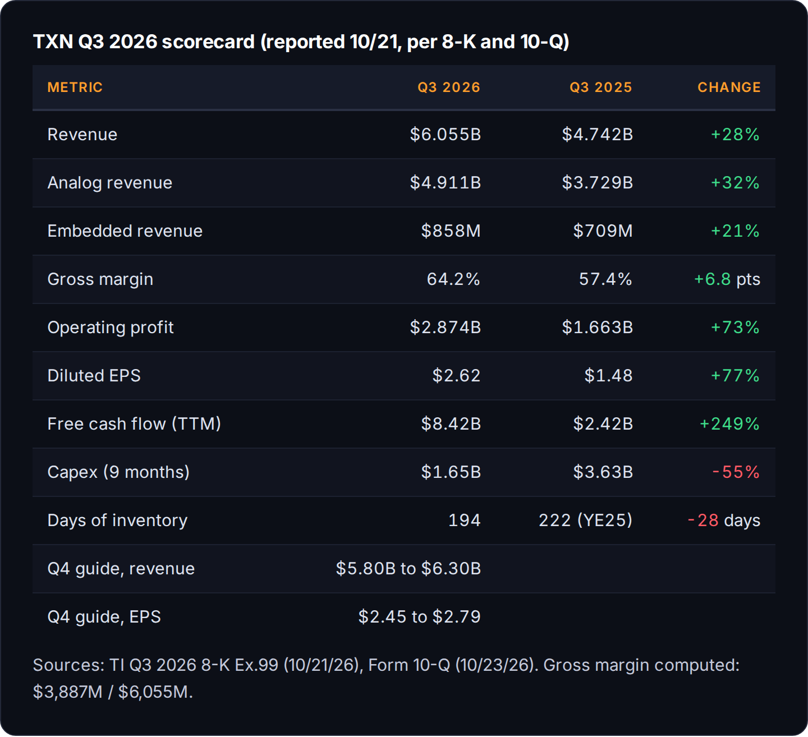
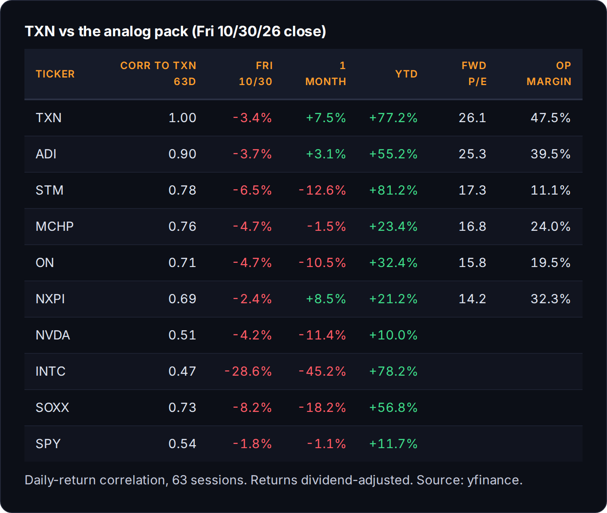
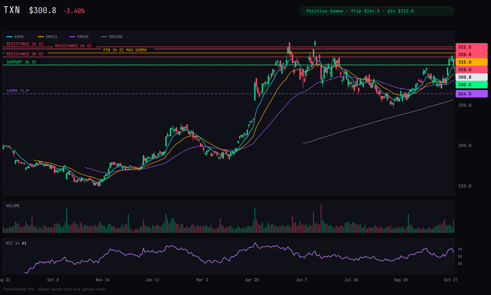
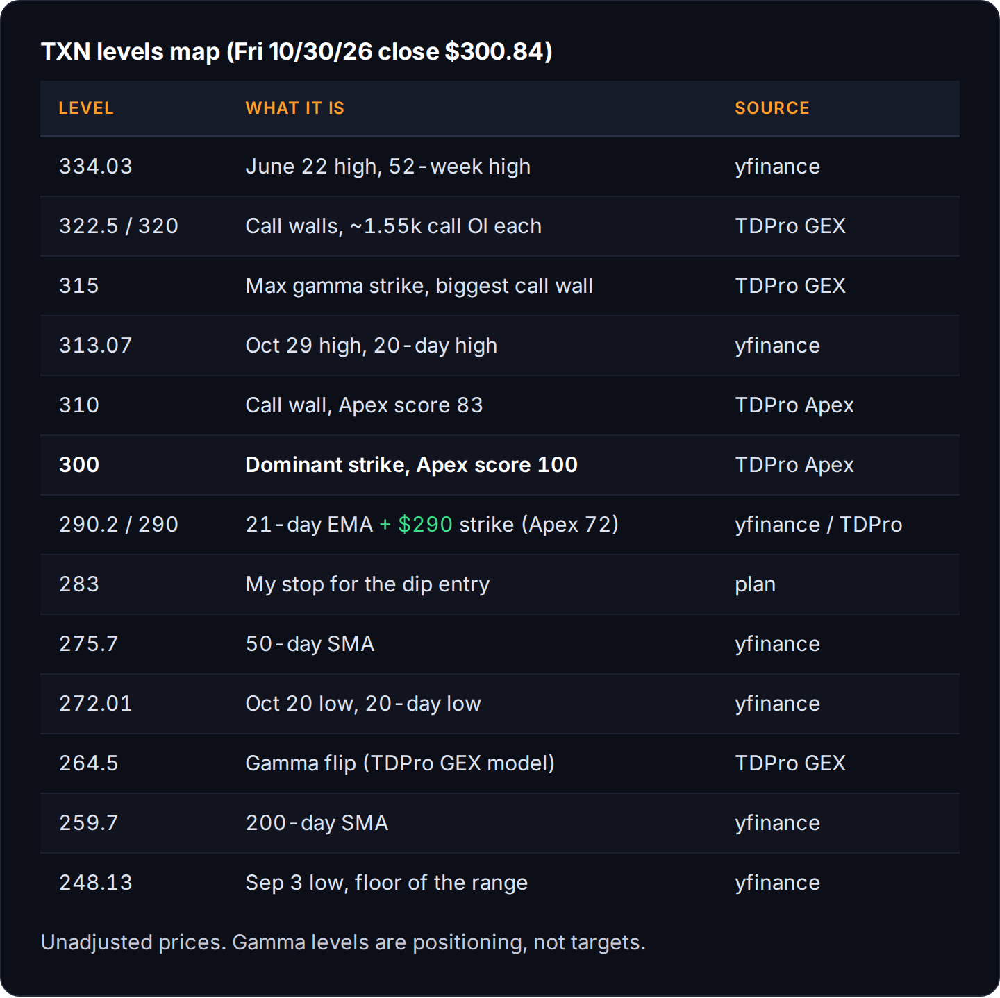
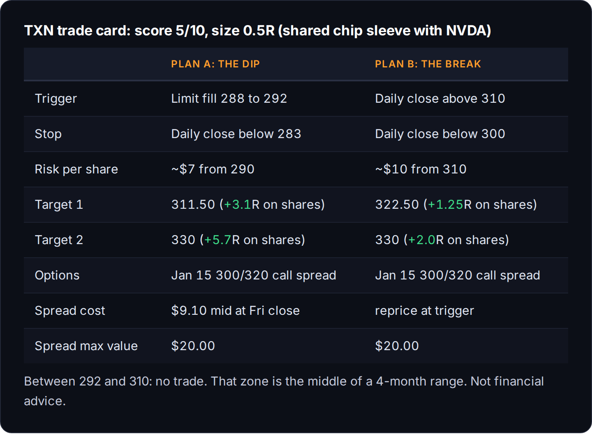

# TXN Due Diligence: Texas Instruments

*Research 60% | Trading 40%*

<!--seo-title: TXN Due Diligence: Texas Instruments-->
<!--seo-desc: Texas Instruments due diligence: Q3 numbers, the Silicon Labs deal and $2B of new notes, insider sales, gamma walls, correlation to ADI and NVDA, and a tra-->

**Texas Instruments (TXN)** · **$300.84** at the 2026-10-30 close

!> **Score: 5/10 · Size: 0.5R · Action: WAIT**
!> Texas Instruments makes the boring chips: power management, signal chain, the little analog parts that sit inside every car, factory robot and server rack. If you think the industrial and data center cycle has legs, this is one of the strongest balance sheets in analog. The business is excellent. The price is in the middle of a four-month range, and the stock is carrying somebody else's earnings risk into November. TXN and NVDA share one risk bucket, capped at **1.0R combined**.

## 1. Business and management

Two segments, and analog is 81% of revenue and the whole story.

- **Analog:** **$4.911B** of Q3 revenue, **$2.505B** operating profit. *([Q3 10-Q](https://www.sec.gov/Archives/edgar/data/97476/000009747626000169/txn-20260930.htm))*
- **Embedded Processing:** **$858M** revenue, **$227M** operating profit. **Other:** **$286M**. *(Q3 10-Q)*
- End markets: industrial up **more than 40%** year over year, automotive up **mid-teens**, data center up **about 95%** and now **about 13%** of revenue. *([Q3 call, Webull transcript summary](https://www.webull.com/news/15789174635930624))*
- CEO Haviv Ilan on stockpiling: "I do not see any inventory buildup. On the contrary, I wish they a little bit more." *(Q3 call, Webull)*
- Haviv Ilan is chairman, president and CEO. *([Q3 press release](https://www.sec.gov/Archives/edgar/data/97476/000009747626000165/q32026txnex99-eredgar.htm))*
- Julie Knecht is SVP and CFO (she signed the 10-Q). *(Q3 10-Q)*
- **33,000** employees, **$275B** market cap. *(yfinance)*

## 2. The numbers

A growth quarter on every line, with free cash flow inflecting as capex rolls off. The one thing that shrank was the buyback.

- **Revenue +28%** year over year and **+11%** sequential. *(Q3 10-Q)*
- **Gross margin 64.2%**, up from 57.4%. The 300mm fabs are finally paying for themselves. *(Q3 10-Q)*
- **Free cash flow went from $2.42B to $8.42B** trailing 12 months. Capex was **$1.65B** in the first nine months of 2026 versus **$3.63B** a year earlier. Management's 2026 capex range is **$2B to $3B**. *(Q3 10-Q)*
- **Days of inventory fell from 222 to 194.** They're shipping what they built. *(Q3 10-Q)*
- **Three straight EPS beats:** $1.68 vs $1.37 est (April), $2.14 vs $1.94 (July), $2.62 vs $2.43 (October). The January 2026 report missed slightly ($1.27 vs $1.31). *(yfinance)*
- **Q4 guide: $5.80B to $6.30B revenue, $2.45 to $2.79 EPS.** The midpoints, **$6.05B** and **$2.62**, are flat with Q3. Ilan called the forecast "above seasonal." *(Q3 press release, Q3 call)*
- Last year Q4 revenue fell **6.7%** from Q3. *(yfinance)*
- Dividend raised **7% to $1.52** a quarter on 9/17, **23 straight years** of increases. That's **$6.08** a year. *([9/17 dividend 8-K](https://www.sec.gov/Archives/edgar/data/97476/000095010326014118/dp253473_ex99.htm))*
- About a **2.0%** yield, with a **74%** payout ratio. *(yfinance)*
- Buybacks shrank: **$48M** in Q3, **$636M** trailing 12 months versus **$1.611B** a year earlier. Total cash returned is down **11%**. Section 3 explains where the cash is going. *(Q3 10-Q)*

## 3. Filing read (10-Q / 10-K / 8-K / S-series / 424B)

**TI is buying Silicon Labs (SLAB) for $231 a share in cash, about $7.5B of enterprise value.** It's where the buyback money went, it adds leverage to a balance sheet that didn't need it, and a blocked-deal headline could hit any day.

- Announced **2/4/2026**, closing expected in the **first half of 2027**, pending regulatory approvals. *(Q3 10-Q, "Acquisition of Silicon Labs")*
- A **$5B** 364-day delayed-draw term loan signed in June, undrawn as of 9/30. *(Q3 10-Q)*
- **$2B of new notes priced 10/26/2026**: four $500M tranches, 5.000% due 2028, 5.350% due 2031, 5.500% due 2033 and 5.750% due 2036, settling **11/9/2026**. *([pricing term sheet](https://www.sec.gov/Archives/edgar/data/97476/000119312526432176/d161660dfwp.htm))*
- The notes carry a special mandatory redemption at **101** if the deal doesn't close by the merger agreement's termination date, **2/4/2027**, which can extend to 8/4/2027 or 2/4/2028. *(pricing term sheet)*
- Total debt was **$13.65B** on 9/30, before these notes. *(Q3 10-Q)*
- The risk is China. A June 11 report said SAMR hadn't accepted the filing yet. *([MLex](https://www.mlex.com/mlex/mergers-acquisitions/articles/2488396))*
- SAMR formally accepted the filing in early August. *([ION Analytics](https://ionanalytics.com/insights/mergermarket/parr/samr-formally-accepts-slab-ti-for-review/))*
- The deal is reportedly headed for a **Phase 2** review. TI's own 10-Q still says closing is expected in the first half of 2027. No final decision yet, so treat China as the open question, not a done deal. *([The Capitol Forum](https://thecapitolforum.com/texas-instruments-silicon-labs-deal-said-to-be-slated-for-phase-2-review-by-chinas-antitrust-enforcer/))*
- The market isn't worried. SLAB closed Friday at **$222.45** against the **$231** deal price, a **3.8%** spread. That's a "probably closes" spread, not a "coin flip" spread. *(yfinance)*
- The 10-Q incorporates the 10-K risk factors by reference (no new ones). Acquisition charges were **$7M** in Q3 and **$41M** year to date. *(Q3 10-Q)*

## 4. News, last 6 months

News follows price on this one. Twice.

- **4/22/2026, Q1 report.** EPS $1.68 vs $1.37. Stock gapped **+19.4%** the next day, 236.31 to 282.23. *(yfinance)*
- **6/22/2026, the high.** **$334.03** intraday. No single headline I can tie to it. *(yfinance)*
- **7/22/2026, Q2 report.** EPS beat, stock slid from ~$294 to **$271.30** over the next week. Analysts raised targets anyway: Baird to $385, KeyBanc to $400, JPMorgan to $340. *(yfinance)*
- **9/3/2026, the floor.** **$248.13**, the low of the summer range. *(yfinance)*
- **9/17/2026, dividend raise** to $1.52. *(9/17 dividend 8-K)*
- **10/21/2026, Q3 report.** Beat and above-seasonal guide. The stock **fell 1.8%** the next day. *(Q3 press release, yfinance)*
- **10/26/2026, $2B notes priced** for the Silicon Labs deal. *(pricing term sheet)*
- **10/26 to 10/29, the rip.** From **$284.69 to $312.94** in four sessions, about **+9.9%**, with no decision-relevant catalyst in the news feed. Price moved first. The story hasn't shown up yet. *(yfinance, TDPro news)*
- **10/30/2026, the drop.** Down **3.87%** on the tape, but Friday was the **ex-dividend date** ($1.52, record date 10/30). Adjusted for the dividend, TXN fell **3.4%** on a day SOXX fell **8.2%** and Intel fell **28.6%**. Intel reported 10/29 after the close. *(yfinance)*
- That last one is the most bullish thing here. On a day SOXX fell 8.2%, TXN held up better than every analog peer except NXPI. *(yfinance)*

## 5. Growth drivers

Data center is the new leg, industrial is the base, and the FCF line keeps compounding if capex stays put.

- **Data center: ~95% growth, ~13% of revenue.** Power delivery for AI racks. This is the piece the market is paying up for. *(Q3 call)*
- **Industrial: +40%+** year over year. Industrial is TI's biggest market, and Q3 was the strongest growth line on the call. *(Q3 call)*
- **Pricing:** Ilan said they saw "some price movement, mainly on the analog side" in the second half, "not very significant for this year." 2027 pricing gets discussed on the January call. *(Q3 call)*
- **Free cash flow inflection:** capex fell **55%** while revenue grew **28%**. If capex stays in the $2B to $3B range, the FCF line keeps compounding. *(Q3 10-Q)*
- **CHIPS Act:** **$1.10B** of incentive cash received in 2026 so far, plus the **35%** investment tax credit. *(Q3 10-Q)*

## 6. Risks

- **Borrowed event risk.** TXN has no earnings in November. NVDA reports **11/17** and ADI reports **11/24**. More in section 7. *(NVIDIA, ADI releases)*
- **Deal risk.** SAMR accepted the filing in August and reportedly moved it to a Phase 2 review; no decision yet. A block means a $2B note redemption at 101 and a headline the stock hasn't priced. *(ION Analytics, The Capitol Forum, pricing term sheet)*
- **Cyclical risk.** Industrial and auto are cyclical. A flat Q4 guide in an "above seasonal" quarter means a lot of good news is already in the run rate. The risk factors flag "customer demand that differs from forecasts." *(Q3 10-Q)*
- **China.** **23%** of Q3 revenue shipped to China, and Ilan said China grew faster than the rest. That's growth and exposure in the same number. *(Q3 10-Q geographic table, Q3 call)*
- **Valuation.** It isn't cheap. See section 12. *(yfinance)*

## 7. Competition and correlation

TXN trades like ADI, not like NVDA, and it is the expensive one in the group.

- The 63-day correlation to ADI is **0.90**. To NVDA it's **0.51**. ADI is the bigger tell. *(yfinance)*
- **ADI reports Tuesday 11/24 at 7:00am ET.** That's effectively TXN's November earnings. *([ADI press release](https://www.analog.com/en/newsroom/press-releases/2026/10-22-2026-adi-report-4q-fy2026-financial-results.html))*
- **26.1x forward earnings**, level with ADI at 25.3x and well above MCHP, ON, NXPI and STM in the 14x to 17x range. You're paying for the **47.5% operating margin**, which no peer here comes close to. *(yfinance)*
- Beta to SPY is **1.65** over 63 days and **2.03** over 126. Beta to SOXX is only **0.54 to 0.58**. It swings harder than the market and softer than semis. *(yfinance)*

## 8. Sentiment and positioning (people)

The Street says buy, four directors trimmed into the rip, and Congress is noise.

- **29** analysts, mean target **$336.86**, median **$340**, range **$250 to $400**, consensus "buy" (2.03 on the 1 to 5 scale). *(yfinance)*
- After the Q3 print on 10/22, **seven firms raised targets and two cut**. Post-print targets run from Morgan Stanley's **$278** (Underweight) to Stifel's **$370**. *(yfinance)*
- Four directors sold **$6.38M** between 10/27 and 10/29, all coded **S - Sale+OE** (selling shares from exercised options). *(TDPro, SEC Form 4)*
- Ronald Kirk: **$1.88M** at $310.39, cut his stake **28%**. *(SEC Form 4)*
- Robert Sanchez: **$1.83M** at $302.21, **22%**. *(SEC Form 4)*
- Pamela Patsley: **$1.37M** at $301.56, **12%**. *(SEC Form 4)*
- Janet Clark: **$1.30M** at $302.46, **28%**. *(SEC Form 4)*
- **Zero** insider buys in the 21-day window. Exercise-and-sell after a 77% year is normal behavior. Four directors trimming 12% to 28% within three days is still worth knowing. It isn't a signal by itself. *(TDPro)*
- Rep. Kevin Hern sold **$15K to $50K** on 10/14, disclosed 10/28. Noise. *(TDPro)*

## 9. Options and flow (dealers and size)

Positive gamma, a dominant $300 strike, and a call wall every five bucks above spot. This name pins and chops instead of trending.

- **Positive gamma.** Dealers are long gamma above the flip, which means they sell rips and buy dips. The GEX model puts the flip at **$264.47**; the Apex simulation puts it at **$278.87**. Either way price is well above it. *(TDPro GEX, TDPro Apex)*
- **$300 is the dominant strike** (Apex score 100). Friday closed 84 cents above it. *(TDPro Apex)*
- **Call walls at $310, $315, $320 and $322.50.** **$315** is the max gamma strike with **2,091** calls of open interest. *(TDPro GEX)*
- **Support strike at $290** (Apex score 72, **2,213** calls open). *(TDPro Apex)*
- **Expected move:** **±3.3%** tomorrow, **±7.1%** for a week, **±12%** for a month, which is a **$267 to $339** one-month band. A move that size has held **85%** of the time over five years. *(TDPro)*
- That 12% monthly move works out to about **42%** annualized implied vol. Realized 30-day vol is **31.5%**, near the low end of its one-year range of **25.6% to 64.1%**. Options are pricing more movement than the stock is delivering. *(TDPro, yfinance)*
- **IV rank: 30.2, neutral.** IV **41.7%** against 21-day realized vol of **36.2%**, so options are about **1.15x** what the stock is actually doing. No volatility edge either way, which is why the plan buys a spread instead of a naked call. *(TraderMatrix Volatility Lab, 10/30)*
- **Unusual options activity:** none flagged for TXN on 10/30 (score 60+). *(TDPro)*
- **Dark pool:** **zero** $1M+ blocks in 30 days, and the query didn't fail. On a $275B name, I read that as a gap in the feed's coverage. It doesn't tell me big money is staying away. *(TDPro)*
- **Short interest:** **20.2M** shares, **4.21** days to cover, about **2.2%** of float, settled 10/15. No squeeze fuel here. *(FINRA via TDPro)*

## 10. Chart and technicals

The chart tells a different story than the 77% YTD headline: an April breakout, then a range with lower highs.

- **April was the breakout.** The Q1 gap took it from the 230s to the 280s in one day. *(yfinance)*
- **Since June it's a range.** High of **$334.03** (6/22), floor of **$248.13** (9/3). Friday's close sits **61%** of the way up that range. *(yfinance)*
- **The highs are getting lower.** $334.03 in June, $315.34 on 7/9, $313.07 on 10/29. That's a falling trendline off a major peak, which is my favorite setup when it breaks. My hand-drawn line runs near **$310** by mid-November. It hasn't broken yet. *(yfinance)*
- **Moving averages (unadjusted):** EMA8 **$299.29**, EMA21 **$290.22**, SMA50 **$275.66**, SMA200 **$259.66**. Price is **15.9%** over the 200-day. *(yfinance)*
- **Momentum:** RSI(14) around **61** on the chart feed (**64** on my dividend-adjusted calc). ADX **21.6**, with +DI 27.7 leading -DI 12.5. ADX only measures strength, so the DI lead is what says the trend points up. At 21 it's barely a trend. *(yfinance)*
- **ATR(14): $10.50.** One average day covers the whole gap between the $300 strike and the $310 wall. *(yfinance)*

## 11. Sector and macro

Semis are getting repriced. The broad market is fine.

- SOXX is **-18.2%** over a month and **-8.2%** on Friday alone. *(yfinance)*
- SPY is only **-1.1%** over the month. The pain is in chips. *(yfinance)*
- TXN is **+7.5%** over the same month. It's been the place money hides inside semis, which works right up until the sector stops being sold or gets sold harder. *(yfinance)*
- FOMC is **December 8-9**, after the November window this trade lives in.

## 12. Valuation

Fair for a business growing earnings 77% with a 64% gross margin. Not cheap. And forward multiples on a cyclical tend to look cheapest right before the cycle turns.

- **39.0x** trailing earnings, **26.1x** forward (forward EPS $11.52). *(yfinance)*
- **26.2x** EV/EBITDA, **13.2x** sales, **14.3x** book. *(yfinance)*
- FCF yield about **3.1%** ($8.42B TTM FCF against a $275B market cap). *(Q3 10-Q, yfinance)*
- Mean analyst target **$336.86** is **12%** above Friday's close. *(yfinance)*
- **92%** institutional ownership, **0.3%** insider. *(yfinance)*

## 13. Steelman: bull vs bear

Neither side argues the business is broken. The whole fight is entry and borrowed risk.

!> **Bull case**
!> ▸ Every line on the income statement is accelerating, and Q4 guided flat in a seasonally down quarter. *(Q3 10-Q, yfinance)*
!> ▸ FCF tripled as capex rolled off, and the dividend has gone up 23 years straight. *(Q3 10-Q, dividend 8-K)*
!> ▸ Data center is a real new leg with real numbers: 95% growth, 13% of revenue. *(Q3 call)*
!> ▸ On Friday's chip bloodbath it fell less than half as much as SOXX. *(yfinance)*
!> ▸ Positive gamma above $300 means dealers dampen the downside. *(TDPro)*

!> **Bear case**
!> ▸ It's in a four-month range with lower highs, and $300 is the middle of it, not a pullback. *(yfinance)*
!> ▸ Call walls stack every $5 from $310 to $322.50. Positive gamma cuts both ways: it caps rallies too. *(TDPro)*
!> ▸ No November catalyst of its own. ADI (0.90 correlation) and NVDA report into the window, and TXN gets their downside without their upside. *(yfinance, ADI and NVIDIA releases)*
!> ▸ Four directors sold $6.4M in three days into the rip. *(SEC Form 4)*
!> ▸ A $7.5B acquisition with China approval unconfirmed, funded partly by new debt, at 26x forward. *(Q3 10-Q, pricing term sheet, yfinance)*

## 14. What would make me wrong

A stop at $283 or a close under $272 is a trade problem. A close under $248, a bad ADI print or a blocked deal is a business question.

!> **Where this is wrong**
!> ▸ **Too cautious:** a daily close above **$315** with volume. That clears the max gamma wall and the falling trendline, and the only real overhead left is the **$334** June high. If that happens I've been too cute and Plan B is live. *(TDPro GEX, yfinance)*
!> ▸ **The trade is wrong:** a daily close below **$283** after a Plan A fill. Stop out, no arguing. *(plan)*
!> ▸ **The October move failed:** a close below **$272**, the 10/20 low. That puts the breakout attempt back inside the range. *(yfinance)*
!> ▸ **The thesis is wrong:** a close below **$248**, the summer floor. That's a trend break, not a pullback, and I'd want to know why before touching it again. *(yfinance)*
!> ▸ **Event:** a bad ADI print on 11/24 or a Silicon Labs block headline would matter more than anything TI itself says in November. *(ADI release)*

## 15. Catalyst calendar

- **2026-11-09:** Silicon Labs notes settle ($2B) *(pricing term sheet)*
- **2026-11-10:** TXN dividend paid, $1.52 *(TI 8-K)*
- **2026-11-17:** NVDA earnings, 5pm ET call *([NVIDIA](https://nvidianews.nvidia.com/news/nvidia-sets-conference-call-for-third-quarter-financial-results-6928873))*
- **2026-11-24:** ADI earnings, 7am ET release *([ADI](https://www.analog.com/en/newsroom/press-releases/2026/10-22-2026-adi-report-4q-fy2026-financial-results.html))*
- **2026-12-08:** FOMC, December 8-9
- **2027-01-15:** expiry of the $300/$320 call spread *(trade plan)*
- **2027-02-04:** Silicon Labs merger agreement termination date (extendable to 8/4/2027 or 2/4/2028) *(pricing term sheet)*
- **date not confirmed:** TI Q4 earnings (yfinance guesses 1/26/2027; TI hasn't announced it) *(yfinance)*
- **date not confirmed:** TI February capital management call
- **date not confirmed:** MCHP November earnings
- **date not confirmed:** SAMR decision on Silicon Labs *(The Capitol Forum)*

## 16. Trade plan

!> **The plan**
!> ▸ **Plan A, the dip (preferred):** limit fill at **$288 to $292**, the 21-day EMA and the $290 support strike. **Stop:** daily close below **$283**. That's a $7 stop, only **0.67 ATR** for a stock that moves $10.50 on an average day; using a daily close instead of an intraday stop is what keeps it survivable.
!> ▸ **Plan B, the break:** daily close above **$310**. A close above $315 is the stronger version, because that also clears the max gamma strike. **Stop:** daily close below **$300**.
!> ▸ **No-trade zone:** between **$292 and $310**. Friday's $300.84 is in that zone: the middle of the range, sitting on the biggest strike on the board.
!> ▸ **Targets:** Plan A: **$311.50** (+3.1R on shares), then **$330** (+5.7R) / Plan B: **$322.50** (+1.25R on shares), then **$330** (+2.0R)

- **Options:** **$300/$320 call debit spread**, Jan 15, 2027, which clears both 11/17 and 11/24. Debit **$9.10** at mid (300 call $22.45/$24.40, 320 call $13.45/$15.20 at Friday's close, yfinance; if Plan A fills at $290 the spread will be cheaper, so reprice it on the day), max value **$20**, so max profit is **$10.90** against $9.10 risked, about **1.2 to 1**, breakeven **$309.10** at expiry. A defined debit means a bad NVDA or ADI gap costs the premium, nothing more.
- **Put-selling alternative:** not on my November list, which is long shares and long calls only. If you sell puts, the **Dec 18 $280 put** was **$8.05/$9.90** Friday, about **$8.98** mid. That's a **$271** basis if assigned, right at the 50-day and the October low, for about **3.2%** in 47 days. The bid/ask is wide, so don't expect the mid.
- **Exit if:** a close below **$272**, the 10/20 low (the breakout attempt is back inside the range)
- **Exit if:** a close below **$248**, the summer floor (a trend break, not a pullback)
- **Exit if:** a bad ADI print on 11/24 or a Silicon Labs block headline

## Unverified

!> **Couldn't confirm these, so no dates or numbers lean on them**
!> ▸ Analyst consensus: a MarketBeat "Hold" consensus with a $305 to $324 target cluster could not be reproduced. yfinance shows "buy" and a $336.86 mean, which is the figure used here.
!> ▸ Why Intel fell 28.6% on 10/30: no solid coverage of the reaction found, so no reason is given.
!> ▸ The 6/22 high at $334.03: no single headline ties to it.
!> ▸ Dark pool: zero $1M+ blocks in 30 days on a $275B name reads as a feed coverage gap, not a signal.
!> ▸ SAMR Phase 2 review: reported, not confirmed by TI, and no decision yet. If you know more about it, or think I'm wrong about ADI being the real November tell, tell me.

*Not financial advice. Data as of the 2026-10-30 close.*

**Sources:** [TI Q3 2026 8-K and Ex.99 (10/21/26)](https://www.sec.gov/Archives/edgar/data/97476/000009747626000165/q32026txnex99-eredgar.htm) · [TI Form 10-Q (10/23/26)](https://www.sec.gov/Archives/edgar/data/97476/000009747626000169/txn-20260930.htm) · [9/17/26 dividend 8-K](https://www.sec.gov/Archives/edgar/data/97476/000095010326014118/dp253473_ex99.htm) · [10/26/26 FWP pricing term sheet](https://www.sec.gov/Archives/edgar/data/97476/000119312526432176/d161660dfwp.htm) · [Form 4s (10/29 and 10/30/26), SEC EDGAR](https://www.sec.gov/cgi-bin/browse-edgar?action=getcompany&CIK=0000097476) · yfinance: prices, technicals, peer data, analyst actions and option quotes (pulled 11/1/26) · TraderMatrix (TDPro): gamma, Apex levels, expected move, insider, politician, short interest, dark pool and flow data (pulled 11/1/26) · TraderMatrix Volatility Lab: IV rank and IV vs realized (10/30/26) · [Q3 call quotes, Webull transcript summary](https://www.webull.com/news/15789174635930624) · [MLex](https://www.mlex.com/mlex/articles/2488396) · [ION Analytics](https://ionanalytics.com/insights/mergermarket/parr/samr-formally-accepts-slab-ti-for-review/) · [The Capitol Forum](https://thecapitolforum.com/texas-instruments-silicon-labs-deal-said-to-be-slated-for-phase-2-review-by-chinas-antitrust-enforcer/) · [ADI earnings date release](https://www.analog.com/en/newsroom/press-releases/2026/10-22-2026-adi-report-4q-fy2026-financial-results.html) · [NVIDIA earnings call release](https://nvidianews.nvidia.com/news/nvidia-sets-conference-call-for-third-quarter-financial-results-6928873)

<!--share-->
<!--subscribe-->

~ Michael
