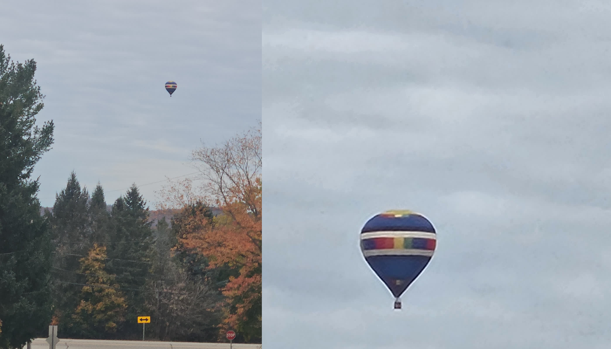
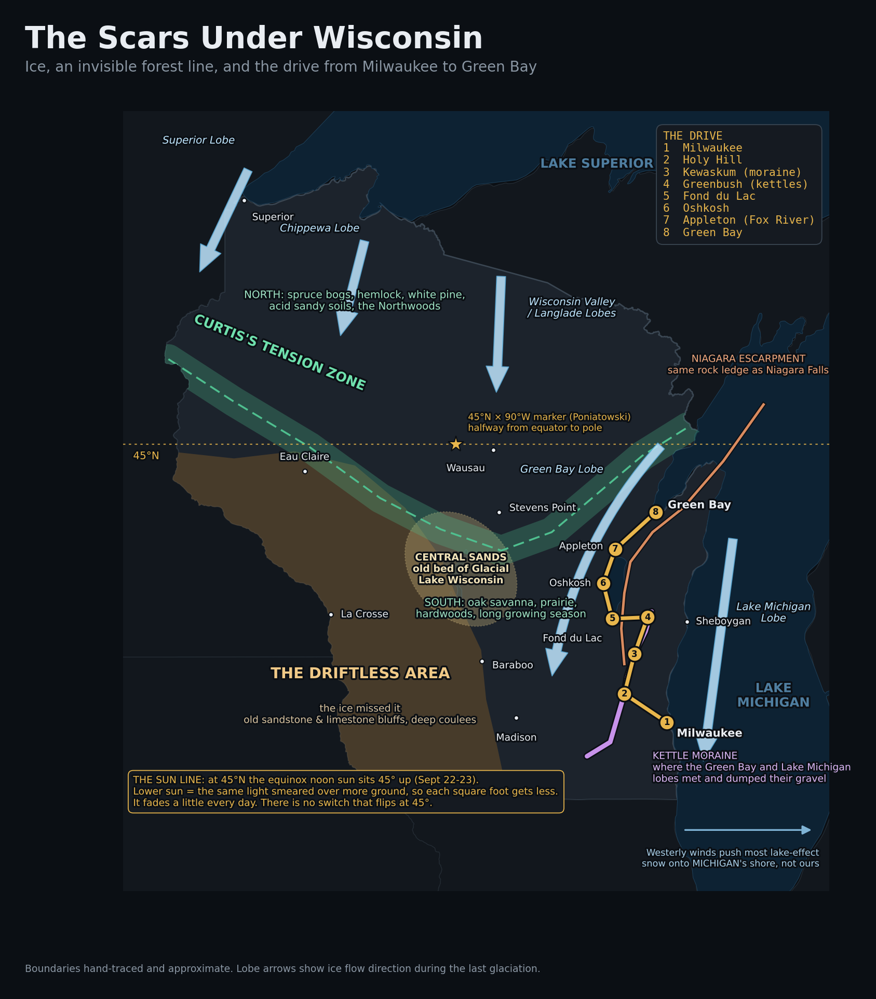
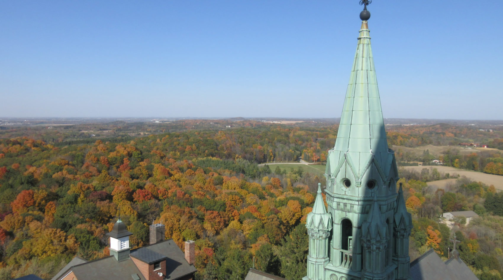
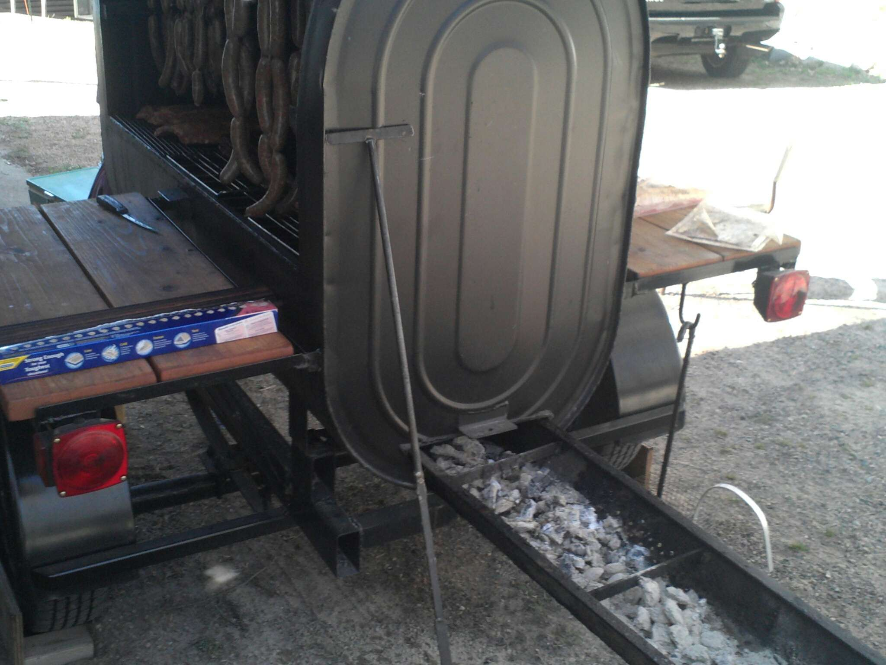

*Sunrise this morning. Hot air balloon over Holy Hill, fall colors out in full. Wish I had gotten better pictures, but I was running and it was moving fast.*

I saw a hot air balloon over Holy Hill at sunrise this morning with the fall colors out in full. Know what that must have looked like from up there? Ugh.

The Brewers just won the World Series. The Packers beat Carolina 27-19 on Thursday night. When else does Wisconsin get a spotlight like this? So if you're from out of state and you're finally looking our way, let me take you for a drive.

## It's the wind

It's October that does it, I think. Lots of nosebleeds, lol. I get dandruff in my beard for a month. There's a swing of 80 degree days followed by 40 degree days. But mostly it's in the wind. You can feel the difference in it. Even on the warm nights, the breeze is different.

> The breeze is different because the air is coming from somewhere else. All summer the wind drags humid air up from the Gulf. In October more and more of it comes down from Canada, cold and bone dry. Every 80-to-40 swing is one of those fronts handing off. The nosebleeds and the beard are the dry air, plus the furnace kicking on. Your face reads the season before the forecast does.

## The drive

Milwaukee to Green Bay is the drive everybody from out of town will do this year. Here's what you're driving over.

[MACHINE, trim to taste:]
- **Holy Hill.** The basilica sits on a kame, a hill the glacier dumped. I wrote about the one under my house [back in August](https://mphinance.substack.com/p/i-paid-to-be-shown-three-foreign). This morning's balloon was floating over ice-age gravel and almost nobody watching knew it.

*The view from the Holy Hill tower this afternoon. I went up just to get this shot. Everything you see is glacier leftovers.*

- **Fond du Lac.** "Bottom of the lake." East of town the land steps up onto the Ledge, the Niagara Escarpment. Same rock Niagara Falls pours over.
- **Oshkosh.** Lake Winnebago, biggest lake inside the state, shallow, a leftover of a glacial lake.
- **Appleton.** The Fox River runs north, dropping about 170 feet through a chain of locks to Green Bay. That drop is why the valley made paper.
- **Green Bay.** The bay itself is the trough the Green Bay lobe of the ice sheet gouged out.

## Then keep going

I keep going straight through the valley into the Northwoods. The line is right when we hit "the res," the Menominee Reservation, just north of Cecil as we round Shawano Lake.

For the fun of it I went and looked, and 45 north is exactly where we turn left from R to M, which we take west for a couple miles until 55 and the Wolf River. We follow that straight north from there. Lots of deer to hit!

> Three lines stack on that turn. The 45th parallel, halfway between the equator and the pole. Curtis's Tension Zone, the line botanists drew across the state where the southern oak and prairie country gives way to the northern pine, hemlock, and bog. And the reservation line itself. The Menominee have logged their forest on a sustained-yield basis for well over a century, and in NASA satellite imagery the reservation shows up as one solid block of green.

## Sausage weekend

Put it this way. At the end of March or beginning of April, call it Easter or spring break time, we make a few hundred pounds of sausage up north. It's ideal because most of the snow is melted south of that line, and up there we use the snow to toss the summer sausages in to stop the cooking. You also want it warm enough to stand outside cooking and stuffing meat all day.

That same weekend down here comes at the end of February, and everyone's always busy with kid... stuff.

It really is about three weeks of difference, honestly. And we've only got about a three-week window too, call it ten days either side of April Fool's.

## Your own backyard

[MICHAEL: your closer. Your words from the interview, pick and arrange:]
- "definitely just wondering about their own backyard though"
- "I love October here because of the post-September... madness."
- "Shorts during the day, sweatshirts at night are my jam. I wanna cuddle, lol."

~ Michael
