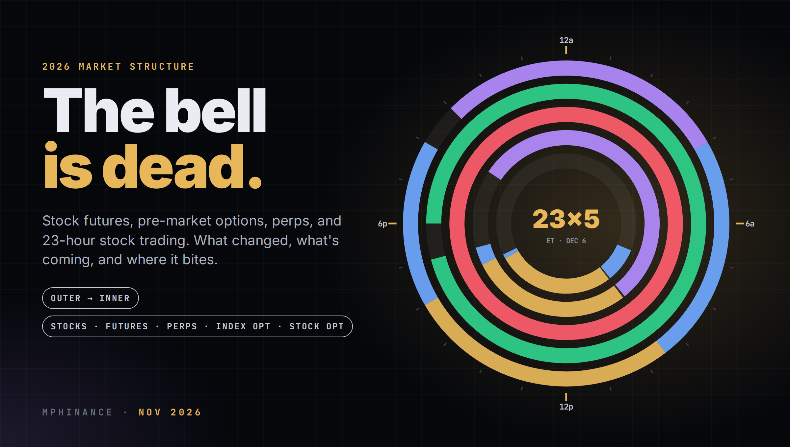
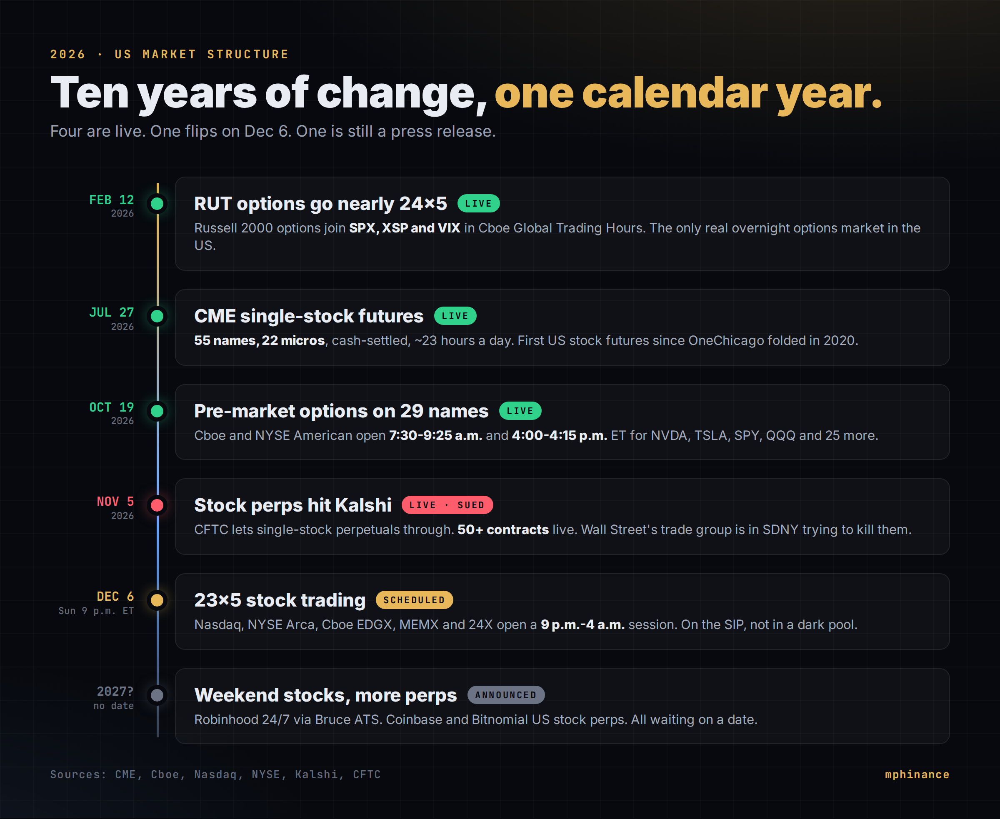
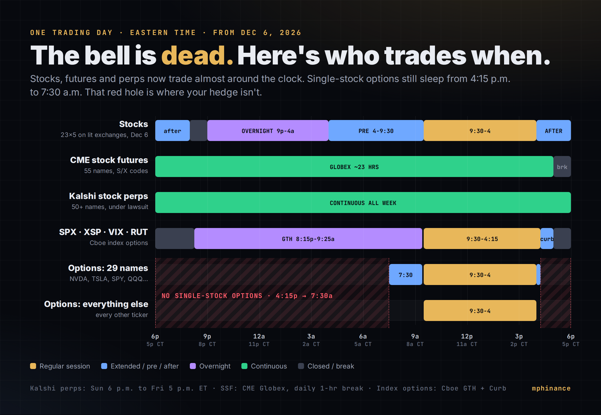
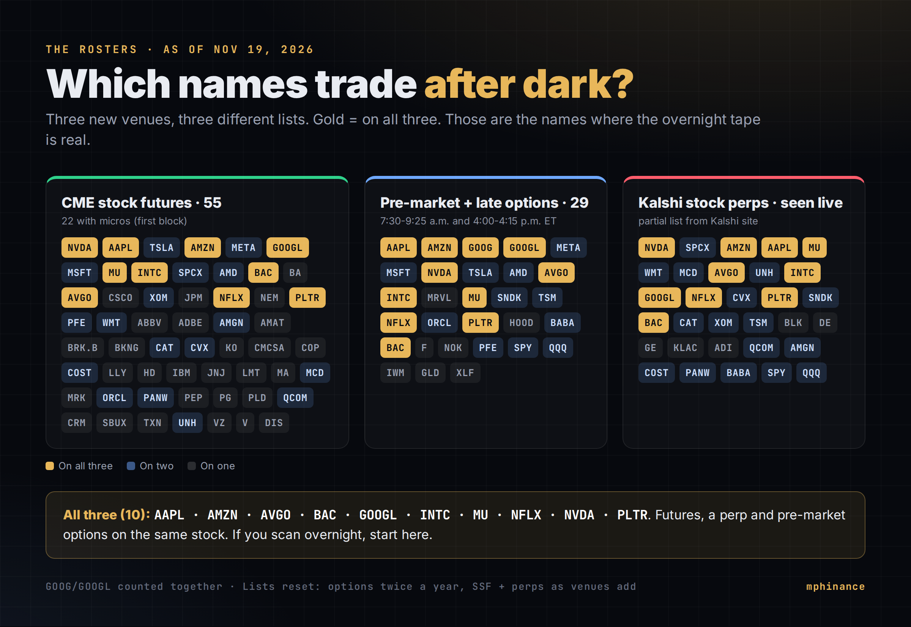
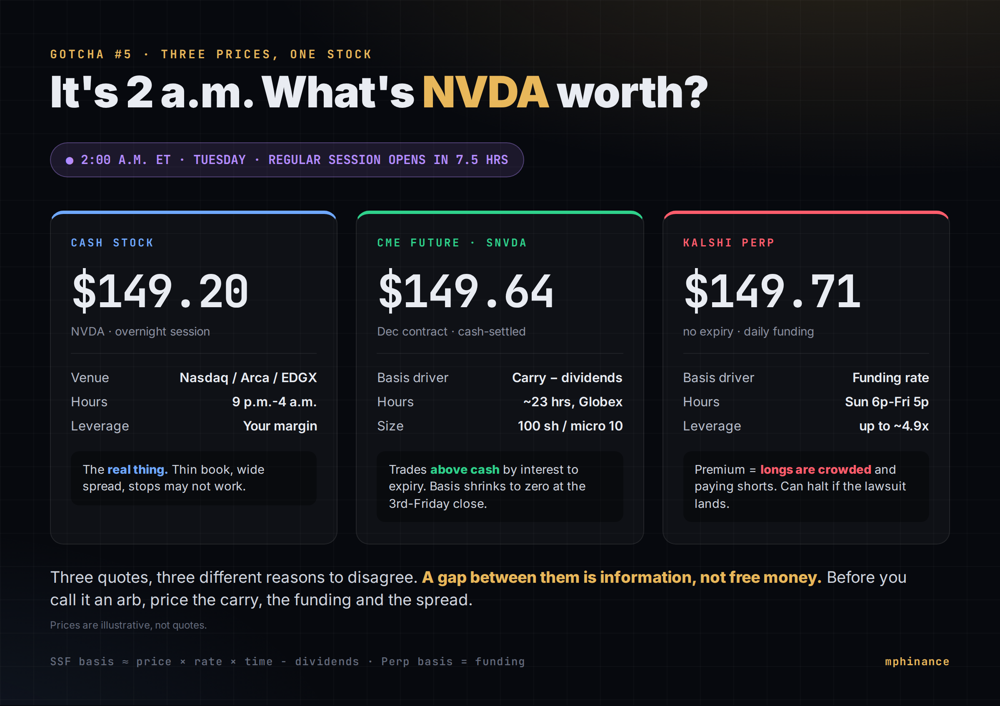

# The Bell Is Dead: 2026's Market Structure Shakeup

*Trading 70% | Market Structure 30%*

US markets changed more in 2026 than in the 10 years before. **Six things matter. Two are still coming.**

Stock futures, pre-market options on the names you actually trade, perps on Kalshi, and on **Sunday, Dec 6**, stocks trading 23 hours a day on lit exchanges. **The "market is closed" excuse is dead.** Overnight gaps now trade somewhere. Your setups need to watch futures, perps and extended-session options, not only the 9:30 open.

That red hole in the chart is the whole post in one picture. **From Dec 6 you can move the stock at 2 a.m. but you can't hedge it with a single-stock option until 7:30.**

---

## CME Single Stock Futures (live since Jul 27)

CME has 55 single-stock futures and 22 micros. They are cash-settled and trade about 23 hours a day on Globex. This is the first US single-stock futures market since OneChicago died in 2020.

!> **Specs, all contracts.** Standard = 100 shares, micro = 10 shares. A 0.01 tick is $1.00 on the standard, $0.10 on the micro. Cash-settled against the official close at expiry, no delivery. Quarterly (Mar/Jun/Sep/Dec), two quarters listed. Last trade 4:00 p.m. ET on the 3rd Friday. Hours Sun-Fri, 5:00 p.m.-4:00 p.m. CT with a daily maintenance break. Codes start with **S** (standard) or **X** (micro).

CME also lists **Total Return** versions with a **T** prefix (TABBV, TAMZN, TCSCO). The Trading Technologies spec sheet shows them. One reseller list does not. Check your platform before you route to them. Some codes pad with zeros to 5 characters (SMU00, SBA00, SV000). Do not "fix" them.

Roster as of the August 2026 list. I found no additions since launch, but CME can add names. Confirm at [cmegroup.com/ssf](https://www.cmegroup.com/ssf).

## Extended-hours options on stocks and ETFs (live since Oct 19)

Options on 29 names now trade before the open and 15 minutes after the close. Cboe Options (C1) and NYSE American both run it, same 29 names. (NYSE American also has a 6:00-7:30 a.m. pre-open for order entry before its 7:30 session.) **These names were about 53% of all US-listed options volume in Jan-Sep 2026.**

- **Pre-market:** 7:30-9:25 a.m. ET (6:30-8:25 a.m. CT)
- **Regular:** 9:30 a.m.-4:00 p.m. ET (8:30 a.m.-3:00 p.m. CT)
- **Late:** 4:00-4:15 p.m. ET (3:00-3:15 p.m. CT)

Gap: nothing trades 9:25-9:30 a.m. ET. The 5 ETFs (SPY, QQQ, IWM, GLD, XLF) already traded to 4:15 p.m., so the late session only adds time for the 24 stocks.

!> **How a name makes the list (Cboe filing).** Options ADV of at least 150,000 contracts. Underlying market cap of at least $50B. Underlying stock ADV of at least 10M shares. Cap of 100 classes. Reviewed twice a year (Jan-Jun and Jul-Dec data), so expect adds and drops early 2027.

Brokers with day-one or announced support: Robinhood, Moomoo, TradeStation, Webull, Fidelity, Interactive Brokers, tastytrade. Limit orders only at most brokers. Expect fat spreads.

One report said NYSE options would go to 23 hours on Dec 6. I could not confirm it. Every primary source ties Dec 6 to **equities**, not options. Treat options as 7:30 a.m.-4:15 p.m. ET until an exchange says otherwise.

## Index options that already trade nearly 24x5

Cboe-proprietary index options trade almost around the clock. RUT joined on Feb 12-13. This is the only true overnight options market in the US.

- **SPX/SPXW, XSP, VIX:** in Global Trading Hours since before 2026
- **RUT/RUTW:** joined Feb 2026
- **GTH:** 8:15 p.m.-9:25 a.m. ET, Mon-Fri (7:15 p.m.-8:25 a.m. CT)
- **Curb:** 4:15-5:00 p.m. ET for select Cboe index options. Check the product page for which ones.

**I found no overnight session for NDX options.** Do not assume it exists because QQQ options got a pre-market session.

## 23x5 stock trading starts Sunday, Dec 6

Five lit exchanges add an overnight session from 9:00 p.m. to 4:00 a.m. ET on Dec 6. Quotes and trades go on the SIP, so overnight is no longer a dark, ATS-only market.

- **Nasdaq:** approved Apr 10, 2026 ("Night Session")
- **NYSE Arca:** approved May 21, 2026
- **Cboe EDGX:** approved May 29, 2026
- **MEMX:** approved Sep 9, 2026
- **24X National:** exchange approved Nov 2024; backstop Jan 24, 2027 if the SIP slips

!> **The new weekly clock (ET).** Overnight 9:00 p.m.-4:00 a.m., Sun-Thu nights. Pre-market 4:00-9:30 a.m. Regular 9:30 a.m.-4:00 p.m. After-hours 4:00-8:00 p.m. Pause 8:00-9:00 p.m. The week opens Sunday 9 p.m. ET (8 p.m. CT) and closes Friday 8 p.m. ET.

What to know:

- The whole 9 p.m.-4 a.m. session carries the **next trading day's date**. A Monday 10 p.m. fill is a Tuesday trade, and so is a 2 a.m. fill. Settlement is T+1 off that date.
- No opening auction in the NYSE Arca overnight session. LULD bands are static overnight.
- Only member broker-dealers trade it. Your broker decides if you get access.
- Nasdaq PSX and Nasdaq Texas keep their old hours at launch. Other NYSE Group equity exchanges keep current hours too.
- **Options do not follow.** Equity options stop at 4:15 p.m. ET and restart at 7:30 a.m. ET. Overnight you can move the stock but cannot hedge it with listed stock options. Hedge with SSFs, perps, or SPX/RUT in GTH.

## Single-stock perpetual futures (live on Kalshi since Nov 5)

Stock perps are now legal on US-regulated exchanges. Kalshi is the only US venue live today. **Wall Street is suing to kill them.**

- **Kalshi:** live Nov 5. 58 contracts filed, 50+ live. Leverage varies by stock, up to ~4.9x. Sun 6 p.m.-Fri 5 p.m. ET. Stock funding once a day. **$1.75B traded through Nov 13, average trade about $200, and 39% of it outside regular hours.**
- **Coinbase Derivatives:** filed Sep 18, deemed approved Nov 2. Starts with AAPL and NVDA. No US launch date. Non-US Coinbase has had stock perps since Mar 20.
- **Bitnomial:** filed Sep 18. 10 stocks including GOOGL and MSFT. No launch date.
- **Robinhood:** crypto perps announced Sep 29 (10x BTC/ETH, 3x others). No stock perps announced. Mizuho says single-stock perps are likely next; Robinhood has not said so.

Kalshi also lists "SK Hynix", which is not a US listing. Check the contract terms before you trade it.

**How it got here:** Kalshi, Coinbase Derivatives and Bitnomial filed under CFTC Reg 40.3 on Sep 18. The CFTC did not act, so the filings were deemed approved. CFTC Chair Michael Selig confirmed it in a statement on Nov 3. They are security futures under joint CFTC and SEC oversight.

**The fight:** The Capital Markets Alliance Association (exchanges, brokers, market makers) sued the CFTC on Nov 3. The judge denied a restraining order. A preliminary-injunction fight is open in SDNY. Coinbase, Kalshi, Payward (Kraken), DRW, Jump and Paradigm filed an amicus on Nov 9. **Risk: a ruling could halt these contracts. Size positions as if that can happen.**

## Other stuff you missed (announced, not live yet)

The next wave is weekend stock trading and more perps. None of it has a firm date.

- **Weekend (24/7) stock trading:** Robinhood via Bruce ATS. Curated list of stocks and ETFs, Saturdays and Sundays included. "Coming months"; one report says early 2027; needs regulatory review.
- **Earnings contracts:** Robinhood, company-specific earnings event contracts. Announced at HOOD Summit, Sep 29.
- **US crypto perps:** Robinhood, 10x BTC/ETH, 3x others, 0.01% fee through end of 2026. "Coming months."
- **Tokenized US stocks:** Robinhood EU has a few hundred stock tokens. Not for US retail.
- **SSF list changes:** no adds found since launch. Watch cmegroup.com/ssf.
- **Options list refresh:** next one likely early 2027 (Jul-Dec data).

## Stuff earlier in 2026 that also changed the game

Different topic, same year. All of these change how you trade the new clock.

- **The PDT rule is dead.** SEC approved FINRA's Rule 4210 rewrite Apr 14; effective **Jun 4, 2026**. No more $25k / four-trades-in-five-days test. It's an intraday margin standard now. Brokers are phasing it in, so check yours.
- **Monday and Wednesday expiries on single stocks.** Live since **Jan 26, 2026** at Cboe and Nasdaq. Only for stocks over $700B market cap (and big ETFs), and no Mon/Wed expiry on an earnings day.
- **Texas has two exchanges.** The Texas Stock Exchange started trading in July. NYSE Texas opened in August.
- **Tokenized stocks got a door.** SEC approved Nasdaq's tokenized-equities pilot Mar 18 (same order book, same CUSIP), then issued an "innovation exemption" for onchain trading Sep 17.

## Trader gotchas

More hours means more places to get run over. Check these before you size a trade.

1. **Thin books.** Pre-market options, overnight stock and stock perps all have wide spreads. Use limit orders. **Do not market-order a 7:45 a.m. NVDA call.**
2. **Your stops may not fire.** Many brokers only work stops in the regular session. Check what your broker does at 9 p.m. and 7:30 a.m.
3. **Hedge mismatch.** Overnight you can trade the stock (from Dec 6), the SSF, the perp and SPX/RUT options. You cannot trade single-stock options. Plan the hedge before the earnings print.
4. **Earnings flow moves earlier.** For the 29 names, earnings reactions now show up in options at 7:30 a.m. ET and 4:00-4:15 p.m. ET. Pre-market IV crush starts before the bell.
5. **Three prices for one stock.** Cash, SSF and perp can diverge overnight. SSF basis = carry and dividends; perp basis = funding. **A gap between them is information, not free money.**
6. **SSF expiry.** Cash settlement vs. the official close on the 3rd Friday. No delivery. Roll before expiry or you settle at the close.
7. **Perp legal risk.** The SDNY case could halt US stock perps. Do not park size there you cannot exit fast.
8. **Leverage stacks fast.** SSF margin is SPAN-based; Kalshi caps stocks near 4.9x. **A 10% overnight gap at 4.9x is about a 49% hit to margin.**
9. **Trade dates.** Every overnight fill, 9 p.m. or 2 a.m., carries the next trading day's date. Watch settlement, wash-sale windows and your broker's day-trade margin math.
10. **Lists change.** The options list resets twice a year. The SSF and perp rosters can grow. Re-check before you build a scanner around them.

For TraderMatrix: the 29 extended-hours option names and the 55 SSF names are good candidates for pre-market flow alerts and overnight basis feeds.

<!--share-->

<!--subscribe-->

## Sources

Primary sources first.

- [CME: Single Stock Futures press release (Feb 10, 2026)](https://www.cmegroup.com/media-room/press-releases/2026/2/10/cme_group_to_launchsinglestockfutures.html)
- [Trading Technologies: CME SSF spec and symbols (Jul 24, 2026)](https://library.tradingtechnologies.com/wp-content/uploads/2026/07/CME_Single_Stock_Futures.pdf)
- [The5ers: full 55-name SSF list](https://the5ers.com/single-stock-futures-list-every-stock-you-can-trade-as-a-future-2026/)
- [Cboe: extended options sessions launch (Oct 19, 2026)](https://ir.cboe.com/news/news-details/2026/Cboe-Launches-Extended-Trading-Sessions-for-Select-Single-Stock-and-ETF-Options/default.aspx)
- [Cboe: SEC approval for extended options hours (May 28, 2026)](https://ir.cboe.com/news/news-details/2026/Cboe-Receives-SEC-Approval-to-Offer-Extended-Trading-Hours-for-Select-Multi-Listed-Single-Stock-Options/default.aspx)
- [Cboe: nearly 24-hour RUT options (Feb 2026)](https://ir.cboe.com/news/news-details/2026/Cboe-Launches-Nearly-24-Hour-Trading-in-Russell-2000-Index-Options/default.aspx)
- [CNBC: NYSE extends options hours (Oct 19, 2026)](https://www.cnbc.com/2026/10/19/nyse-extends-options-trading-hours.html)
- [Nasdaq: 23/5 trading](https://www.nasdaq.com/23-5-trading)
- [NYSE: extended-hours FAQ](https://beta.nyse.com/publicdocs/nyse/NYSE_Extended_Hours_Trading_FAQ.pdf)
- [Databento: 23/5 timeline](https://databento.com/blog/us-equities-overnight-trading)
- [Cooley: 23x5 is almost here (Nov 10, 2026)](https://www.cooley.com/news/insight/2026/2026-11-10-23x5-trading-is-almost-here-practical-considerations-for-public-companies)
- [Ledger Insights: Kalshi first US stock perps (Nov 3, 2026)](https://www.ledgerinsights.com/kalshi-first-to-launch-us-stock-perpetuals-as-wall-street-pushes-back/)
- [Kalshi: stock perps](https://kalshi.com/perps/categories/stocks)
- [Yahoo Finance: perps lawsuit amicus](https://finance.yahoo.com/markets/crypto/articles/coinbase-kalshi-jump-trading-urge-094511851.html)
- [The Block: Robinhood perps and weekend trading (Sep 29, 2026)](https://www.theblock.co/news/business/2026-09-29-robinhood-perps-trading-417242)

~ Michael
