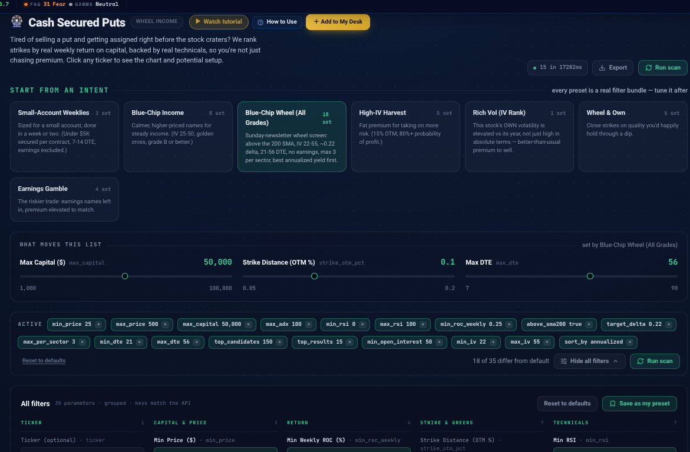
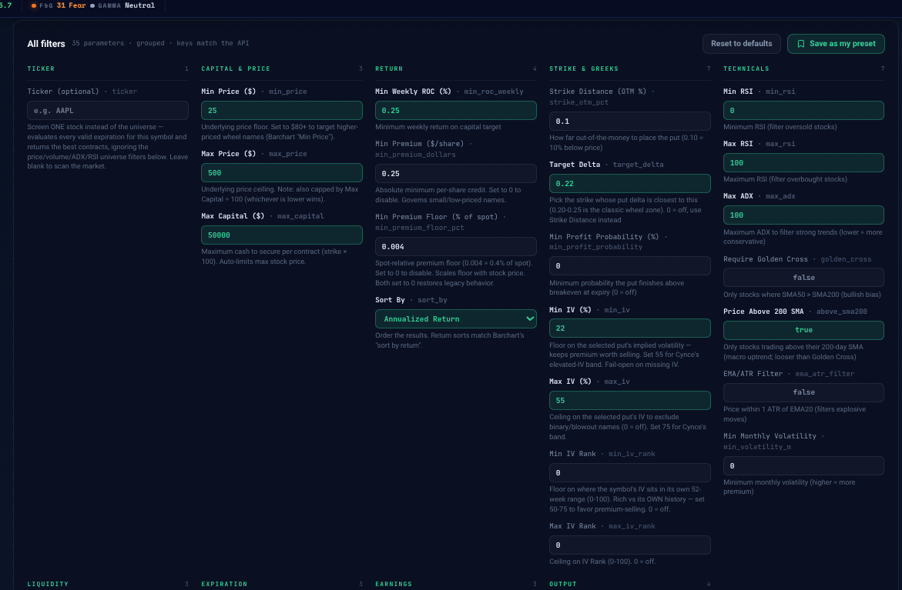
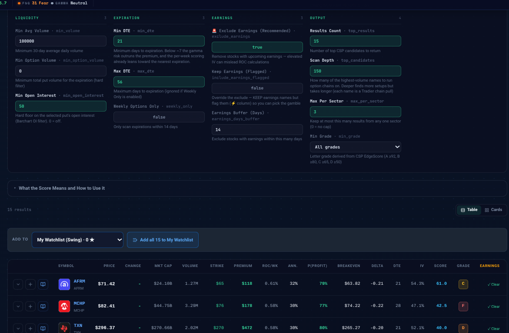

# The Wheel Strategy Teardown & TraderMatrix Case Study
## How We Reverse-Engineered a $39/Month Substack Newsletter and Automated It in TraderMatrix

This directory contains the complete end-to-end audit, mathematical proof, TraderMatrix engine improvements, live CSV exports, and UI screenshots reverse-engineering *Options Income with The Wheel Strategy* (`wheelstrategy.substack.com`).

---

## Directory Contents

```
docs/wheel_strategy_audit/
├── README.md                              <- This summary and case study walkthrough
├── wheel_strategy_substack_audit.md       <- Full 12-week teardown, math proof, & pitch
├── tradermatrix_csp_wheel_setup_guide.md  <- Complete parameter and technical setup guide
├── screenshots/
│   ├── 01_preset_and_hero.png             <- TraderMatrix preset bar with Blue-Chip Wheel active
│   ├── 02_parameters_grouped.png          <- Grouped parameters (capital, return, delta, trend)
│   └── 03_table_results_live.png          <- Live 15-stock table with AFRM, MCHP, TXN, NOW, QCOM
├── data/
│   ├── default_run_bitcoin_miners.csv     <- Un-tuned defaults (CIFR, MARA, sub-$50 crypto miners)
│   └── blue_chip_wheel_live_results.csv   <- Live output from Blue-Chip Wheel preset (15 blue chips)
└── tools/
    └── audit_screen.py                    <- Repeatable Python verification CLI tool
```

---

## Executive Summary: What We Discovered

1. **The "Closed Aquarium"**:
   The newsletter author does not run an unconstrained screen across 5,000 US stocks. Over 12 consecutive weeks (180 published setups), he rotated exclusively through a **closed pool of ~73 blue-chip stocks and liquid ETFs**:
   * $FCX was in 8 of 12 weeks.
   * $UNH was in 8 of 12 weeks.
   * $PLTR was in 6 of 12 weeks.
   * $NEM, $BA, $GE, $TGT were in 5 of 12 weeks each.
   * $TSLA, $C, $BX were in 4 of 12 weeks each.
2. **The Constraint Squeeze**:
   Applying his 3 strict filters (no earnings within 35 days, price above 200 SMA, IV between 22% and 55%) shrinks the 73-stock pool to just **20 to 25 eligible names on any given Sunday**. Capping sectors at $\le 3$ and sorting by annualized yield mathematically collapses into his exact published list.
3. **Delta Snapping**:
   His strikes are chosen strictly by Black-Scholes delta slicing at **0.20 to 0.25 delta** (5.5% to 10% downside cushion) on the standard monthly expiration (21 to 56 DTE).

---

## The TraderMatrix Evolution: From Bitcoin Miners to Blue Chips

### The Default Problem
When TraderMatrix's `/screeners/csp-wheel` loaded with out-of-the-box defaults:
* `max_capital: 5000` capped stock prices at **$50.00**, instantly disqualifying NVDA ($230), AMZN ($250), QCOM ($188), and PLTR ($194).
* `min_roc_weekly: 1.0` demanded a **52% annualized return**, filtering out 100% of large-cap blue chips and forcing the screener to output Bitcoin miners (`CIFR`, `MARA`, `RIOT`, `BTDR`).
* See: [`data/default_run_bitcoin_miners.csv`](data/default_run_bitcoin_miners.csv)

### The Solution: `Blue-Chip Wheel (All Grades)`
Michael and Claude shipped a first-class preset directly into TraderMatrix (`feature/csp-universal-preset`, commit `bcb0368`):
* `max_capital: 50000` & `max_price: 500` (reaches all institutional blue chips)
* `above_sma200: true` (replaces rigid Golden Cross with true Price > 200 SMA)
* `target_delta: 0.22` (dynamically snaps to the nearest 0.22 delta put strike)
* `max_per_sector: 3` (enforces sector diversification)
* `min_dte: 21` & `max_dte: 56` (captures both near-term and far monthly cycles)
* `top_candidates: 150` (scans 150 highest-volume names with cap-aware early stopping)
* See: [`data/blue_chip_wheel_live_results.csv`](data/blue_chip_wheel_live_results.csv)

---

## Live Screenshots & Proof

### 1. Preset Bar & Hero Sliders

*Shows the active `Blue-Chip Wheel (All Grades)` preset button (`18 set`), `$50,000` max capital, `0.1` strike distance, and `56` max DTE.*

### 2. Grouped Parameters

*Shows the full parameter architecture: Min ROC Weekly `0.25%`, Sort By `Annualized Return`, Target Delta `0.22`, Min IV `22%`, Max IV `55%`, and Price Above 200 SMA `true`.*

### 3. Live 15-Stock Output Table

*Shows the live 15-stock table with AFRM ($71.42, Strike $65, Delta -0.21), MCHP ($82.41, Strike $76, Delta -0.22), TXN ($296.37, Strike $270, Delta -0.20), NOW ($135.86, Strike $125, Delta -0.22), and QCOM ($186.51, Strike $165, Delta -0.22), all with cleared earnings.*

---

## The Institutional Value-Add (Why Authors Need Us)

While the newsletter stops at retail Greeks, TraderMatrix and TickerTrace provide the missing risk layer:
1. **YieldMax & Income Fund Footprint**: Correlating short put strikes against multi-million dollar positions in NVDY, GDXY, PLTY, and TSLY.
2. **Dealer Gamma Exposure (GEX)**: Warning wheel sellers when strikes sit dangerously below the Gamma Flip (e.g., PLTR $177.50P vs $185.16 flip level).
3. **Whale Accumulation**: Confirming whether hedge funds are net buying or dumping shares into the put strike.
